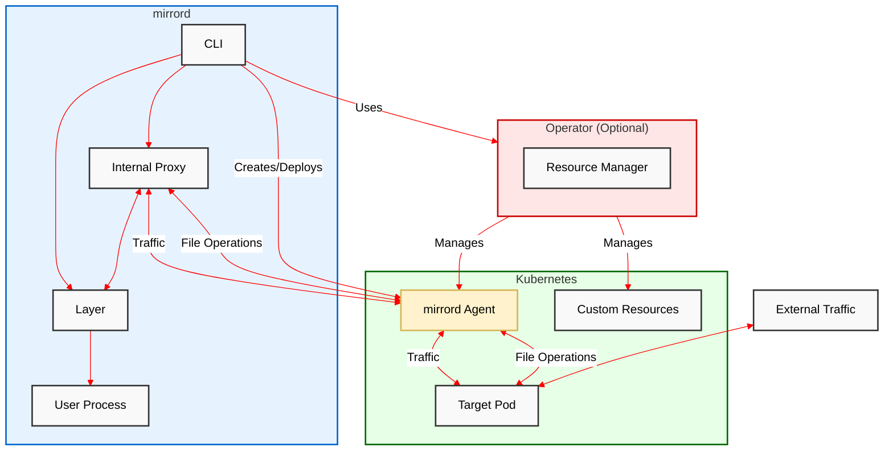
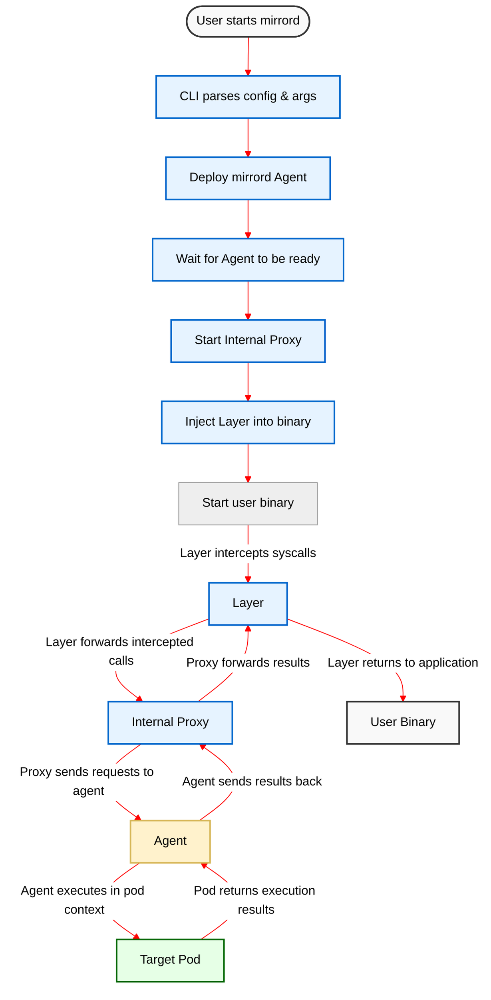

# Contributing

Before submitting pull request features, please discuss them with us first by opening an issue or a discussion.
We welcome new/junior/starting developers. Feel free to join to our [Slack](https://metalbear.co/slack) for help and guidance.

If you would like to start working on an issue, please comment on the issue on GitHub, so that we can assign you to that
issue.

Make sure to take a look at the project's [style guide](STYLE.md).

# Contents

- [Getting Started](#getting-started)
- [Debugging mirrord](#debugging-mirrord)
- [New Hook Guidelines](#new-hook-guidelines)
- [Compiling on macOS](#compiling-on-macos)
- [Adding new target types](#adding-new-target-types)
- [Testing the release workflow](#testing-the-release-workflow)
- [Submitting a Pull Request](#submitting-a-pull-request)
- [Architecture](#architecture)
- [Release mirrord](#release-mirrord)

# Getting Started

The following guide details the steps to setup a local development environment for mirrord and run the E2E tests.

### Prerequisites

- [Bazel](https://bazel.build/), through [bazelisk](https://github.com/bazelbuild/bazelisk). Bazel downloads its own
  toolchains, and the tools that `bazel run //:lint`, `bazel run //:format` and the E2E tests run, like typos, Ruff,
  pnpm, kind and kubectl, at the versions in `bazel/multitool.lock.json`, `package.json` and
  `mirrord/test-utils/requirements.in`.
- [Git](https://git-scm.com/).
- For the E2E tests, [Docker](https://www.docker.com/).

### Building mirrord

```bash
# build everything for this machine
bazel build //...

# the CLI as one file, with the layer and the UI embedded, at bazel-bin/mirrord/cli/standalone/mirrord
bazel build //mirrord/cli:cli_standalone

# run the CLI; it reads the layer and the UI from Bazel's runfiles, so a change to either doesn't
# rebuild the CLI. `bazel/module.bazelrc` makes `bazel run` start programs in the current
# directory, so relative paths in the arguments work.
bazel run //mirrord/cli -- <args>

# serve the UI
bazel run //mirrord/cli -- ui
```

`AGENTS.md` lists the commands that lint, document and test the code.

Bazel only keeps the outputs of the last build, so a build for another platform, like
`bazel build --platforms=//bazel/platforms:x86_64-windows //...`, a switch to another branch or a `bazel clean` makes
Bazel build again what it had built before. A disk cache keeps the outputs of earlier builds, so Bazel takes them from
the cache instead. To set one up, put these lines in `user.bazelrc` at the repository's root, which Git ignores, or in
`~/.bazelrc` to share the cache between checkouts:

```text
common --disk_cache=~/.cache/bazel/disk
# Bazel deletes the least recently used entries once the cache grows past this size.
common --experimental_disk_cache_gc_max_size=250G
```

Bazel expands `~/` to your home directory on every OS, so the same lines work on Windows.

Bazel builds each dependency once, with one set of features for the whole workspace: every feature that any
`Cargo.toml` of the workspace turns on, in `[dev-dependencies]` too. So a feature that only a test needs also ships in
the agent, the CLI and the layer. For example, tests that paused tokio's clock with
`#[tokio::test(start_paused = true)]` needed tokio's `test-util`, which gave every binary a clock behind a lock that
each read of the time takes. A dev-dependency that turns such a feature on, like `tower-test`, does the same. Write the
test without the feature instead, with short real durations, or with a duration that the test passes to the code.
`cargo tree -e features,no-dev` lists the features that the shipped code needs, to compare with what `@crates` gives
each crate.

### Setup a Kubernetes cluster

The E2E tests prepare their own cluster, with the kind or minikube that Bazel downloads, so there's nothing to set up
besides Docker. Bazel also downloads the kubectl and the [Helm](https://helm.sh/) that the tests run, like the
`operator_install` tests, which install the operator with Helm. Each E2E
target names its cluster in `tests/BUILD.bazel`, like `mirrord-e2e` for `//tests:e2e`. Before the
tests start, the target creates the cluster if it doesn't exist, installs
[Argo Rollouts](https://argoproj.github.io/argo-rollouts/) if its tests target rollouts, as `:e2e`'s do, and loads the
agent's image, which Bazel builds from the checkout with `-c opt`, as a release does. The cluster stays after the
tests, so the next run reuses it.

To run the same kind, minikube, kubectl or Helm yourself, run it through Bazel, like
`bazel run @multitool//tools/kubectl -- get pods`.

> **Note:** mirrord-agent is shipped as a container image as mirrord creates a job with this image, providing it with
> elevated permissions on the same node as the impersonated pod.

## E2E Tests

The E2E tests create Kubernetes resources in their cluster, and then run sample apps with the mirrord CLI. The mirrord
CLI spawns an agent for the target on the cluster, and runs the test app, with the layer injected into it.

The E2E targets create their clusters with kind, or with minikube when you pass
`--//tests:cluster_runtime=minikube`:

```bash
bazel test //tests:e2e
```

To run the tests with another agent, like a released one, pass its image with
`--test_env=MIRRORD_AGENT_IMAGE=<image>`. The target then doesn't load the agent that Bazel built, and the cluster pulls
the image instead.

To run the tests on a cluster of your own, pass `--//tests:cluster_runtime=none` with
`--test_env=KUBECONFIG=<path>`, and an agent image that the cluster can pull with
`--test_env=MIRRORD_AGENT_IMAGE=<image>`.

`tests/BUILD.bazel` lists the other E2E targets, like `:e2e_operator_install`, whose tests install the operator.
They run on a cluster of their own, `mirrord-e2e-operator`, because once the operator is in a cluster, the other tests'
sessions would go through it.

A test that should run with both kinds of agent, a job and an ephemeral container, takes
`#[values(AgentMode::Job, AgentMode::Ephemeral)] agent_mode: AgentMode` and passes `agent_mode.flags()` to
`mirrord exec`. A test that works with only one kind takes only that value, so that the filter
`-E 'test(/Ephemeral/)'` still finds every test that runs an ephemeral agent.

On Linux, building and running the tests may use up the machine's RAM and crash it, so limit Bazel's parallel jobs
with e.g. `--jobs=4`.

On a laptop, where some tests can time out, you might want to pass `--test_arg=--no-fail-fast`.

### IPv6

Some tests create a single-stack IPv6 service, so they need an IPv6-only cluster. `:e2e_ipv6` runs them on a kind
cluster of its own, `mirrord-e2e-ipv6`, which needs IPv6 forwarding on the machine:

```bash
sudo sysctl -w net.ipv6.conf.all.forwarding=1
bazel test //tests:e2e_ipv6
```

In order to test on EKS, I used this blueprint: https://github.com/aws-ia/terraform-aws-eks-blueprints/tree/main/patterns/ipv6-eks-cluster

After creating the cluster, I had to give myself permissions to the K8s objects, I did that via the AWS console (in the browser).
Feel free to add instructions on how to make that "manual" step unnecessary.

Tests that need such a cluster are in `traffic::ipv6`, which only `:e2e_ipv6` and CI's `e2e (ipv6)` job run:

- steal_http_ipv6_traffic
- mirror_http_ipv6_traffic
- connect_to_kubernetes_api_service_over_ipv6
- outgoing_traffic_single_request_ipv6_enabled stays always-ignored: on top of an IPv6
  cluster it needs IPv6 internet egress, so a local kind cluster is not enough; use e.g.
  the EKS IPv6 blueprint and run it with `--run-ignored all`

IPv6 is enabled by default, so these run with no extra config. The regular (IPv4) e2e jobs
cover the opt-out path (outgoing_traffic_single_request_ipv6_disabled) and the IPv6-to-IPv4
fallback (outgoing_traffic_ipv6_fallback_to_ipv4).


### Cleanup

The Kubernetes resources created by the E2E tests are automatically deleted when the test exits. However, you can preserve resources from failed tests for debugging. To do this, set the `MIRRORD_E2E_PRESERVE_FAILED` variable to any value.

```bash
bazel test //tests:e2e --test_env=MIRRORD_E2E_PRESERVE_FAILED=y
```

The tests' clusters aren't in `~/.kube/config`, so to look at one with `kubectl`, write its kubeconfig to a file of
its own:

```bash
bazel run @multitool//tools/kind -- get kubeconfig --name mirrord-e2e > mirrord-e2e.kubeconfig
export KUBECONFIG=$PWD/mirrord-e2e.kubeconfig
```

For minikube, have minikube write the cluster into that file:

```bash
KUBECONFIG=$PWD/mirrord-e2e.kubeconfig bazel run @multitool//tools/minikube -- update-context --profile mirrord-e2e
```

All test resources share a common label `mirrord-e2e-test-resource=true`. To delete them, simply run:

```bash
bazel run @multitool//tools/kubectl -- delete namespaces,deployments,services -l mirrord-e2e-test-resource=true
```

To delete a cluster, use kind or minikube itself:

```bash
bazel run @multitool//tools/kind -- delete cluster --name mirrord-e2e
bazel run @multitool//tools/minikube -- delete --profile mirrord-e2e
```

## Integration Tests

The layer's integration tests test the hooks and their logic without actually using a Kubernetes cluster and spawning
an agent. The integration tests usually execute a test app and load the dynamic library of the layer into them. The
tests set the layer to connect to a TCP/IP address instead of spawning a new agent. The tests then have to simulate the
agent - they accept the layer's connection, receive the layers messages and answer them as the agent would.

Since they do not need to create Kubernetes resources and spawn agents, the integration tests complete much faster than
the E2E tests, especially on GitHub Actions.

Therefore, whenever possible we create integration tests, and only resort to E2E tests when necessary.

### Running the Integration Tests

The basic command to run the integration tests is:
```bash
bazel test //mirrord/layer-tests/...
```

### Integration Tests logs and you

These tests will try writing the `mirrord-intproxy` logs of each test to a file named after the test, e.g.
`node_close_application_1_Application__NodeFileOps.log`, in
`bazel-testlogs/mirrord/layer-tests/<test target>/test.outputs/intproxy_logs`. If log file creation fails, then you
should see the logs in `stderr`.

When running these in CI, an artifact is produced (scroll to `Artifacts` which is under
the `Actions` -> `Summary` page) with all the test log files that could be created.

## Testing mirrord manually with a sample app.

From the root directory of the mirrord repository, create a new testing deployment and service:

```bash
kubectl apply -f sample/kubernetes/app.yaml
```

<details>
  <summary>sample/kubernetes/app.yaml</summary>

```yaml
apiVersion: apps/v1
kind: Deployment
metadata:
  name: py-serv-deployment
  labels:
    app: py-serv
spec:
  replicas: 1
  selector:
    matchLabels:
      app: py-serv
  template:
    metadata:
      labels:
        app: py-serv
    spec:
      containers:
        - name: py-serv
          image: ghcr.io/metalbear-co/mirrord-pytest:latest
          ports:
            - containerPort: 80
          env:
            - name: MIRRORD_FAKE_VAR_FIRST
              value: mirrord.is.running
            - name: MIRRORD_FAKE_VAR_SECOND
              value: "7777"

---
apiVersion: v1
kind: Service
metadata:
  labels:
    app: py-serv
  name: py-serv
spec:
  ports:
    - port: 80
      protocol: TCP
      targetPort: 80
      nodePort: 30000
  selector:
    app: py-serv
  sessionAffinity: None
  type: NodePort

```

</details>

Verify everything was created after applying the manifest

```bash
❯ kubectl get services
NAME         TYPE        CLUSTER-IP     EXTERNAL-IP   PORT(S)        AGE
kubernetes   ClusterIP   10.96.0.1      <none>        443/TCP        3h13m
py-serv      NodePort    10.96.139.36   <none>        80:30000/TCP   3h8m
❯ kubectl get deployments
NAME                 READY   UP-TO-DATE   AVAILABLE   AGE
py-serv-deployment   1/1     1            1           3h8m
❯ kubectl get pods
NAME                                 READY   STATUS    RESTARTS   AGE
py-serv-deployment-ff89b5974-x9tjx   1/1     Running   0          3h8m
```

### Build and run mirrord

Build the CLI as one file, with the layer and the UI embedded:

```bash
bazel build //mirrord/cli:cli_standalone
```

The binary is created at `bazel-bin/mirrord/cli/standalone/mirrord`. Add `-c opt` for an optimized build,
like the released one, or `--platforms=//bazel/platforms:<platform>` to build for another platform.

#### Run mirrord with a local process

Sample web server - `app.js` (present at `sample/node/app.mjs` in the repository)

<details>
  <summary>sample/node/app.mjs</summary>

```js
import { Buffer } from "node:buffer";
import { createServer } from "net";
import { open, readFile } from "fs/promises";

async function debug_file_ops() {
  try {
    const readOnlyFile = await open("/var/log/dpkg.log", "r");
    console.log(">>>>> open readOnlyFile ", readOnlyFile);

    let buffer = Buffer.alloc(128);
    let bufferResult = await readOnlyFile.read(buffer);
    console.log(">>>>> read readOnlyFile returned with ", bufferResult);

    const sampleFile = await open("/tmp/node_sample.txt", "w+");
    console.log(">>>>> open file ", sampleFile);

    const written = await sampleFile.write("mirrord sample node");
    console.log(">>>>> written ", written, " bytes to file ", sampleFile);

    let sampleBuffer = Buffer.alloc(32);
    let sampleBufferResult = await sampleFile.read(buffer);
    console.log(">>>>> read ", sampleBufferResult, " bytes from ", sampleFile);

    readOnlyFile.close();
    sampleFile.close();
  } catch (fail) {
    console.error("!!! Failed file operation with ", fail);
  }
}

// debug_file_ops();

const server = createServer();
server.on("connection", handleConnection);
server.listen(
  {
    host: "localhost",
    port: 80,
  },
  function () {
    console.log("server listening to %j", server.address());
  }
);

function handleConnection(conn) {
  var remoteAddress = conn.remoteAddress + ":" + conn.remotePort;
  console.log("new client connection from %s", remoteAddress);
  conn.on("data", onConnData);
  conn.once("close", onConnClose);
  conn.on("error", onConnError);

  function onConnData(d) {
    console.log("connection data from %s: %j", remoteAddress, d.toString());
    conn.write(d);
  }
  function onConnClose() {
    console.log("connection from %s closed", remoteAddress);
  }
  function onConnError(err) {
    console.log("Connection %s error: %s", remoteAddress, err.message);
  }
}

```

</details>

```bash
MIRRORD_LOG=debug bazel-bin/mirrord/cli/standalone/mirrord exec -l debug -c --target pod/py-serv-deployment-ff89b5974-x9tjx node sample/node/app.mjs
```
> **Note:** You need to change the pod name here to the name of the pod created on your system.


```
.
.
.
2022-06-30T05:14:01.592418Z DEBUG hyper::proto::h1::io: flushed 299 bytes
2022-06-30T05:14:01.657977Z DEBUG hyper::proto::h1::io: parsed 4 headers
2022-06-30T05:14:01.658075Z DEBUG hyper::proto::h1::conn: incoming body is empty
2022-06-30T05:14:01.661729Z DEBUG rustls::conn: Sending warning alert CloseNotify
2022-06-30T05:14:01.678534Z DEBUG mirrord_layer::sockets: getpeername hooked
2022-06-30T05:14:01.678638Z DEBUG mirrord_layer::sockets: getsockname hooked
2022-06-30T05:14:01.678713Z DEBUG mirrord_layer::sockets: accept hooked
2022-06-30T05:14:01.905378Z DEBUG mirrord_layer::sockets: socket called domain:30, type:1
2022-06-30T05:14:01.905639Z DEBUG mirrord_layer::sockets: bind called sockfd: 32
2022-06-30T05:14:01.905821Z DEBUG mirrord_layer::sockets: bind:port: 80
2022-06-30T05:14:01.906029Z DEBUG mirrord_layer::sockets: listen called
2022-06-30T05:14:01.906182Z DEBUG mirrord_layer::sockets: bind called sockfd: 32
2022-06-30T05:14:01.906319Z DEBUG mirrord_layer::sockets: bind: no socket found for fd: 32
2022-06-30T05:14:01.906467Z DEBUG mirrord_layer::sockets: getsockname called
2022-06-30T05:14:01.906533Z DEBUG mirrord_layer::sockets: getsockname: no socket found for fd: 32
2022-06-30T05:14:01.906852Z DEBUG mirrord_layer::sockets: listen: success
2022-06-30T05:14:01.907034Z DEBUG mirrord_layer::tcp: handle_listen -> listen Listen {
    fake_port: 51318,
    real_port: 80,
    ipv6: true,
    fd: 32,
}
Server listening on port 80
```

Send traffic to the Kubernetes Pod through the service. On Linux, run the following command:

```bash
curl $(minikube service py-serv --url)
```

On macOS, run the command below and keep the terminal open.

```bash
minikube service py-serv --url
```

Open another terminal and send traffic with `curl` to the service URL displayed by `minikube`.

Check the traffic was received by the local process

```bash
.
.
.
2022-06-30T05:17:31.877560Z DEBUG mirrord_layer::tcp: handle_incoming_message -> message Close(
    TcpClose {
        connection_id: 0,
    },
)
2022-06-30T05:17:31.877608Z DEBUG mirrord_layer::tcp_mirror: handle_close -> close TcpClose {
    connection_id: 0,
}
2022-06-30T05:17:31.877655Z DEBUG mirrord_layer::tcp: handle_incoming_message -> handled Ok(
    (),
)
2022-06-30T05:17:31.878193Z  WARN mirrord_layer::tcp_mirror: tcp_tunnel -> exiting due to remote stream closed!
2022-06-30T05:17:31.878255Z DEBUG mirrord_layer::tcp_mirror: tcp_tunnel -> exiting
OK - GET: Request completed
```

# Debugging mirrord

## mirrord console

Debugging mirrord can get hard since we're running from another app flow, so the fact we're debugging might affect the program and make it unusable/buggy (due to sharing stdout with scripts/other applications).

The recommended way to do it is to use `mirrord-console`. It is a small application that receives log information from different mirrord instances and prints it, controlled via the `MIRRORD_LOG` environment variable.

To use mirrord console, run it:
`bazel run //mirrord/console:mirrord-console`

Then run mirrord with the environment variable:
`MIRRORD_CONSOLE_ADDR=127.0.0.1:11233`

## Debugging the Internal Proxy (`intproxy`)

To see logs from the internal proxy, use the [mirrord console](#mirrord-console).

To debug it with a debugger:

1. Add
   ```Rust
       tokio::time::sleep(Duration::from_secs(20)).await;
   ```
   to [somewhere](https://github.com/metalbear-co/mirrord/blob/fa2af7f1e77a9254fb0908be40b0dae5da53d298/mirrord/cli/src/internal_proxy.rs#L145) in the start of the intproxy code.
2. Set breakpoints in VS Code in the relevant lines of the intproxy code.
3. Build mirrord.
4. Run mirrord.
5. Attach a debugger in VS Code to the intproxy process. On macOS you can do that with `Cmd` + `Shift` + `P` -> `LLDB: Attach to Process...` -> type `intproxy` and choose the `mirrord intproxy` process. The sleep you added at the start of the intproxy is time for you to attach the debugger.

## Retrieving Agent Logs

You can change the minimum severity of logs emitted by the agent by setting `agent.log_level` in the mirrord config
file, for example:
```json
"agent": {
	"log_level": "mirrord=trace"
}
```

By default, the agent's pod will complete and disappear shortly after the agent exits. In order to be able to retrieve
the agent's logs after it crashes, set the agent's pod's TTL to a comfortable number of seconds. This configuration can
be specified either as a command line argument (`--agent-ttl`), environment variable (`MIRRORD_AGENT_TTL`), or in a
configuration file:
```toml
[agent]
ttl = 30
```

Then, when running with some reasonable TTL, you can retrieve the agent log like this:
```bash
kubectl logs -l app=mirrord --tail=-1 | less -R
```

This will retrieve the logs from all running mirrord agents, so it is only useful when just one agent pod exists.

If there are currently multiple agent pods running on your cluster, you would have to run
```bash
kubectl get pods
```
and find the name of the agent pod you're interested in, then run

```bash
kubectl logs <YOUR_POD_NAME> | less -R
```

where you would replace `<YOUR_POD_NAME>` with the name of the pod.

## Operator Isolation Marker

When multiple operator instances share the same cluster, each uses an isolation marker to avoid
reconciling resources created by the other. The marker is set via the `OPERATOR_ISOLATION_MARKER`
environment variable and defaults to `mirrord-operator`. Its value is used as a special label on
operator-managed resources (agents, copy-targets, preview sessions, etc.).

Both the operator and the CLI read this env var at runtime. The CLI labels the resources it creates
with the marker only when the variable is set, so to have an operator running with a custom marker
pick up a session's resources, run the CLI with the same `OPERATOR_ISOLATION_MARKER`.

# New Hook Guidelines

Adding a feature to mirrord that introduces a new hook (file system, network) can be tricky and there are a lot of edge cases we might need to cover.

In order to have a more structured approach, here's the flow you should follow when working on such a feature.

1. Start with the use case. Write an example use case of the feature, for example "App needs to read credentials from a file".
2. Write a minimal app that implements the use case - so in the case of our example, an app that reads credentials from a file. Start with either Node or Python as those are most common.
3. Figure out what functions need to be hooked in order for the behavior to be run through the mirrord-agent instead of locally. We suggest using `strace`.
4. Write a doc on how you would hook and handle the cases, for example:
    1. To implement use case "App needs to read credentials from a file*"
    2. I will hook `open` and `read` handling calls only with flags O_RDONLY.
    3. Once `open` is called, I'll send a blocking request to the agent to open the remote file, returning the return code of the operation.
    4. Create an fd using `memfd`. The result will be returned to the local app, and if successful we'll save that fd into a hashmap that matches between local fd and remote fd/identifier.
    5. When `read` is called, I will check if the fd being read was previously opened by us, and if it is we'll send a blocking `read` request to the agent. The result will be sent back to the caller.
    6. And so on.
5. This doc should go later on to our mirrord docs for advanced developers so people can understand how stuff works
6. After approval, you can start implementing. As part of the implementation you need to add E2E tests (in the `tests`
   crate). For each new hook, please test:
    1. A call that should be sent to the agent. Make sure it has a result that is distinguishable from the result of
       performing that operation locally.
    2. A call that should be bypassed. Make sure the result of the operation proves it happened locally. Please test
       different reasons for bypassing. E.g. for file operations, make a call with a relative path, and make a call
       with a path that is configured to be local. If it's easier for you, you can test bypassing in an integration
       test of mirrord-layer (under mirrord/layer-tests/tests).
    3. If the configuration supports mappings that are relevant for this hook, add test cases with those mappings,
       and test that the mappings take effect correctly. E.g. for file operations test with a path mapping.


# Compiling on macOS

`mirrord` is cross-platform and natively supports compiling from a macOS host, with one exception: `mirrord-agent` - the component/crate that runs inside of the Kubernetes cluster.

`mirrord-agent` feature-gates dependencies, modules and its entrypoint to allow compilation on macOS, but produces a binary that does nothing.
Bazel cross-compiles it for Linux with no setup, for example `bazel build --config=clippy --platforms=//bazel/platforms:x86_64-linux //mirrord/agent/...`.
rust-analyzer builds with Cargo, though, and Cargo needs the following steps to cross-compile to Linux:

1. Install the x86 Linux target
```sh
rustup target add x86_64-unknown-linux-gnu
```

2. Get a C compiler capable of targeting the `x86_64-unknown-linux-gnu` triplet

Usually the builtin clang compiler can handle this, if you use GCC you'll need a custom build that targets this triplet
(see [homebrew-macos-cross-toolchains](https://github.com/messense/homebrew-macos-cross-toolchains) if you use brew)

3. Tell `bindgen` which C compiler to use when building `frida-gum`, the C library we use for detour hooking:
```sh
export CC_x86_64_unknown_linux_gnu=(C compiler from step 2)
```

Now you can pass the Linux target to `cargo` commands:
```sh
cargo check -p mirrord-agent --target x86_64-unknown-linux-gnu
```

And tell rust-analyzer to use it:
```json
"rust-analyzer.cargo.target": "x86_64-unknown-linux-gnu"
```

This is editor specific, please check [rust-analyzer's documentation](https://rust-analyzer.github.io/book/other_editors.html)
to find where to put it in your editor's configuration.

# Adding new target types

Adding a new target type for mirrord requires changes in:

1. `mirrord-config` crate - parsing the target from the user config;
2. `mirrord-cli` crate - verifying the user config;
3. `mirrord-kube` crate - resolving the target to the Kubernetes resource;
4. `mirrord-operator` crate - defining operator's `ClusterRole`;
5. `test` crate - testing `mirrord ls` command

# Testing the release workflow

The standard CI workflow runs when you open a new PR, but in some cases you'll also need to test that the release workflow works properly.

From [the release workflow definition](/.github/workflows/release.yaml):
>   Running from workflow dispatch (AKA manual) will not publish anything. This is intended for testing changes to this flow.

A manual run pushes the images only to their staging repositories and publishes nothing else. Every job or step that
publishes checks `should_release`, which `validate_release_request` never sets to `true` on a manual run, so a new job
or step that publishes must check it too.

To test the release workflow:

1. Push your changes to a branch on the main mirrord repository (not a fork)
2. Go to [the release workflow section under the Actions tab on the mirrord repository](https://github.com/metalbear-co/mirrord/actions/workflows/release.yaml)
3. On the right of the "This workflow has a `workflow_dispatch` event trigger." banner, select the dropdown labelled "Run workflow"
4. Select the branch with your changes and run

You can check the run as it progresses and download the completed artifacts from the "Summary" tab in the sidebar.

## Changing the release on macOS

If you're making changes to the release and/or CI workflows for macOS specifically - for example changing how the universal binary is created, the build logic is in `//mirrord/cli:cli_universal`, `//mirrord/layer:universal_layer` and `//mirrord/cli:cli_universal_signed`. `mirrord/cli/macos_sign.bzl` signs the universal layer in every macOS build, and the universal CLI only in `:cli_universal_signed`, with MetalBear's Developer ID in a release and ad hoc otherwise.

# Submitting a Pull Request

## Greptile Reviews

Greptile may review pull requests automatically. Authors and maintainers can apply the `no-greptile` label when an
automated review is not needed, such as for a typo-only or other trivial change. Opting out of reviews that are not
useful helps keep usage within the included monthly review quota. If Greptile's input becomes useful later, tag
`@greptileai` in the pull request to request a review explicitly.

## Typo Checks

mirrord uses [`typos`](https://github.com/crate-ci/typos) to catch typos in CI. If the pipeline fails
due to a false positive (e.g. a domain-specific term, identifier, or intentional spelling), you can add
an exception in the [typos configuration file](typos.toml) at the root of the repository:

- **Identifiers** (variable names, type names, etc.) — add to `[default.extend-identifiers]`:
  ```toml
  [default.extend-identifiers]
  MyTerm = "MyTerm"
  ```

- **Words** (plain words in prose or strings) — add to `[default.extend-words]`:
  ```toml
  [default.extend-words]
  myword = "myword"
  ```

- **Regex patterns** (e.g. to ignore URLs or structured text) — add to `extend-ignore-re` under `[default]`:
  ```toml
  [default]
  extend-ignore-re = ["<your-pattern>"]
  ```


## Prose Checks (Vale)

mirrord uses [Vale](https://vale.sh) to enforce writing style in Markdown files and Rust doc comments. CI runs it on the Markdown files at the root of the repository, except `CHANGELOG.md`, and on every Markdown file in `changelog.d/`. To run it locally:

```bash
bazel run //:lint -- vale
```

If Vale reports a false positive, you have two options depending on the type of issue:

- **Unknown word** (spelling error on a valid technical term) - add it to the vocabulary file at [.vale/styles/config/vocabularies/Metalbear/accept.txt](.vale/styles/config/vocabularies/Metalbear/accept.txt), one word per line.

- **Wrong term** (Vale flags a correct capitalization or spelling as wrong) - add a substitution rule to [.vale/styles/Metalbear/Terms.yml](.vale/styles/Metalbear/Terms.yml):
  ```yaml
  swap:
    WrongForm: CorrectForm
  ```

- **Inline suppression** (single occurrence that shouldn't be a global exception) — wrap the text with Vale's disable/enable comments:
  ```markdown
  <!-- vale off -->
  Text that should not be checked.
  <!-- vale on -->
  ```


## Changelog Entry

Add a changelog file in `changelog.d/` named `<identifier>.<category>.md`

**Examples:**
- `1054.changed.md` (with GitHub issue)
- `+some-name.added.md` (without issue)

**Identifier:**
- If a GitHub issue exists, use the issue number from the public [mirrord repository](https://github.com/metalbear-co/mirrord)
- Use `+some-name` if no issue exists
- Don't use Linear issues or private repository issue numbers

**Category** (the types in [towncrier.toml](towncrier.toml)):
- `added` for new functionality
- `fixed` for fixed bugs
- `security` for security fixes
- `deprecated` for functionality that a later release will remove
- `removed` for removed functionality
- `internal` for anything users don't care about, e.g. changes in tests or CI
- `changed` for anything else

A pull request that only changes `docs/`, `guides/` or `skills/` needs no changelog file, since the release notes
describe changes to mirrord, not to its documentation or skills, and CI skips the check for it. A pull request that
changes any other file needs one.

# Architecture

A high level view of mirrord.



### Flow

What a user executing their app with mirrord looks like.



# Release mirrord

Releases are fully automated. Under normal circumstances no manual steps are required.

## Automated flow

1. Once daily, the [Scheduled Release workflow](/.github/workflows/scheduled-release.yaml) evaluates whether a release is due:
   - There is at least one entry in `changelog.d/`.
   - The last release is older than 7 days.
2. When both conditions are met, the [Auto Release PR workflow](/.github/workflows/auto-release-pr.yaml) opens (or updates) a PR from `releases/<version>` to `main`. The PR:
   - Bumps the workspace version in `Cargo.toml` (patch bump if all changes are `fixed`/`security`/`internal`; minor bump otherwise).
   - Updates `Cargo.lock`.
   - Generates `CHANGELOG.md` by consuming the `changelog.d/` fragments.
3. Review the release PR, fix any changelog issues or typos, then merge it. Merge the open `update-images` PR first, if
   there is one, so that the release's images get the latest base images and Debian packages (see
   [Updating the images](#updating-the-images)).
4. Merging triggers the [Release workflow](/.github/workflows/release.yaml), which:
   - Validates the PR came from a `releases/*` branch.
   - Builds all platform binaries (Linux x86\_64 / aarch64, macOS universal, Windows) with `-c opt`.
   - Signs the macOS files with `rcodesign` and the Windows files with Azure Artifact Signing.
   - Publishes the Docker images to GHCR.
   - Creates the GitHub release (with tag and release notes from `CHANGELOG.md`).
   - Publishes to Homebrew and Chocolatey.
   - Starts the [Release WinGet workflow](/.github/workflows/release-winget.yaml), which submits the release to WinGet.
   - Publishes `docs/` and `guides/` to the `docs-published` and `guides-published` branches, which GitBook builds the docs site from.
   - Updates the `latest` git tag and notifies the infra repository.

## Triggering a release PR manually

If you don't want to wait for the daily schedule, you can trigger the [Auto Release PR workflow](/.github/workflows/auto-release-pr.yaml) directly from the [Actions tab](https://github.com/metalbear-co/mirrord/actions/workflows/auto-release-pr.yaml) using the "Run workflow" button. It will create (or update) the release PR immediately.

## WinGet

The [Release WinGet workflow](/.github/workflows/release-winget.yaml) uses
[Komac](https://github.com/russellbanks/Komac) to open the pull request that adds each release's manifests to
`microsoft/winget-pkgs`. It submits as the `metalbear-ci` account from the org fork
[metalbear-co/winget-pkgs](https://github.com/metalbear-co/winget-pkgs), so releases don't depend on one person's
account. Komac branches from the latest upstream commit, so a failed fork sync only shows a warning.

The `release_winget` job of the Release workflow starts the Release WinGet workflow on `main` for each release. That job
only starts the workflow, so a green Release run doesn't mean that the submission succeeded. A failure inside the
Release WinGet workflow shows in `#ci-alerts` and in
[its run](https://github.com/metalbear-co/mirrord/actions/workflows/release-winget.yaml). A failure to start it shows
only as a failed `release_winget` job in the Release run.

The submission can't run in the Release workflow itself, because that workflow's jobs run for
`refs/pull/<number>/merge`, and the `winget` environment only deploys from `main`. Before the submission, a job outside
the environment checks the version, so the job that holds the token never runs for an invalid version. The version must
be a bare `major.minor.patch` value whose published release isn't a prerelease and has a `mirrord.msi` asset.

To start the submission for a release that missed it, run the Release WinGet workflow from `main`. Use "Run workflow" on
[its page in the Actions tab](https://github.com/metalbear-co/mirrord/actions/workflows/release-winget.yaml), or run:

```bash
gh workflow run release-winget.yaml --repo metalbear-co/mirrord --ref main --field version=<version>
```

The setup that the Release WinGet workflow relies on:

- `WINGET_BOT_TOKEN` is a classic personal access token of `metalbear-ci` with the `public_repo` and `workflow` scopes.
  Syncing the fork needs `workflow` because upstream changes `.github/workflows`. The credentials of `metalbear-ci` are
  in the team password manager.
- The token is a secret of the `winget` environment only, never a repository or organization secret, because those
  are readable from every branch. The environment has one deployment branch rule, `main`, and no reviewers, so the
  release runs unattended.
- `metalbear-ci` is an outside collaborator with write access to the fork only, so its token can't change the workflows
  of other `metalbear-co` repositories.
- Actions are turned off on the fork, so the workflows that syncing brings in never run there.
- The `metalbear-co` org allows classic personal access tokens. If it enforces SAML SSO, the token must be authorized
  for the org.

When a submission warns or fails:

- If the `release_winget` job fails, `#ci-alerts` gets no alert, and the Release WinGet workflow most likely didn't
  start. Unless its runs show one for the version, start that workflow from `main`.
- If the `validate_version` job fails, the `submit` job didn't run, so the run submitted nothing, and the alert shows
  the version as `not validated`. If GitHub returned an error, re-run the job. Otherwise fix what its error names, and
  start the Release WinGet workflow from `main` with the correct version.
- If the token expired or was revoked, create a new one with the same scopes, authorize it if the org enforces SAML
  SSO, and replace the secret in the `winget` environment.
- If a Release WinGet run is not allowed to deploy to `winget`, it started from a ref other than `main` and submitted
  nothing. Start the workflow from `main`. Never add a pattern such as `releases/*` or `refs/pull/*/merge` to the
  environment, because a workflow run for a pull request could then match the rule and read the token.
- If the `submit` job only warns that it couldn't sync the fork, the pull request was still submitted, so don't re-run
  the job. Check the token, which the next release also needs.
- If the `submit` job fails, check the token and the access of `metalbear-ci` to the fork, then re-run the job. If
  GitHub refused to create the branch, use "Sync fork" on the fork's GitHub page.
- If a pull request for the version already exists, open, merged or closed, Komac opens none and the `submit` job shows
  a warning. After a re-run, that is expected. If that pull request was closed without merging, running the Release
  WinGet workflow again also opens nothing, so submit the version by hand from the org fork, with a token that can write
  to it. The `--skip-pr-check` flag makes Komac ignore the existing pull request:

  ```bash
  KOMAC_FORK_OWNER=metalbear-co GITHUB_TOKEN=<token> komac update MetalBear.mirrord --version <version> \
    --urls "https://github.com/metalbear-co/mirrord/releases/download/<version>/mirrord.msi|x64" \
    --skip-pr-check --submit
  ```

## Publishing docs between releases

A merged pull request from this repository with the `publish-docs` label publishes `docs/` and `guides/` from `main`, including pages for changes that aren't released yet. [`docs/AGENTS.md`](/docs/AGENTS.md#publishing-a-fix-between-releases) says how to publish without those pages.
## Updating the tools

Bazel downloads the programs that `bazel run //:lint`, `bazel run //:format` and the E2E tests run, like typos, Ruff
and kind, at the versions in `bazel/multitool.lock.json`. To move them to their latest releases:

```bash
bazel run //scripts:update_tools
```

Then run `bazel run //:lint` and `bazel run //:format -- --check`, which also check that each program is still where
the lockfile says in its archive, and fix what the new versions report. A module that depends on mirrord, like the
operator, moves its own lockfile with `bazel run @mirrord//scripts:update_tools -- --lockfile <path>`.

pnpm, markdownlint-cli2 and towncrier come from other places: pnpm is the version in `packageManager` in
`package.json`, markdownlint-cli2 is a dependency in the same file, and towncrier is in
`mirrord/test-utils/requirements.in`.

## Updating the images

The images are built from base images that `MODULE.bazel` pins by digest in its `pull` calls, and from Debian packages
that it pins to a snapshot of Debian's archive in `apt.sources_list`, so that every build gets the same files. The images
only get the fixes of a newer base image or package when the pins move, which this command does:

```bash
bazel run //scripts:update_images
```

It resolves each `pull`'s `digest` again from its `tag`, moves the snapshot to the latest one, and updates
`MODULE.bazel.lock`. Every Monday, the [Update images workflow](/.github/workflows/update-images.yaml) runs it and opens
(or updates) a PR from the `update-images` branch when a pin moved.

