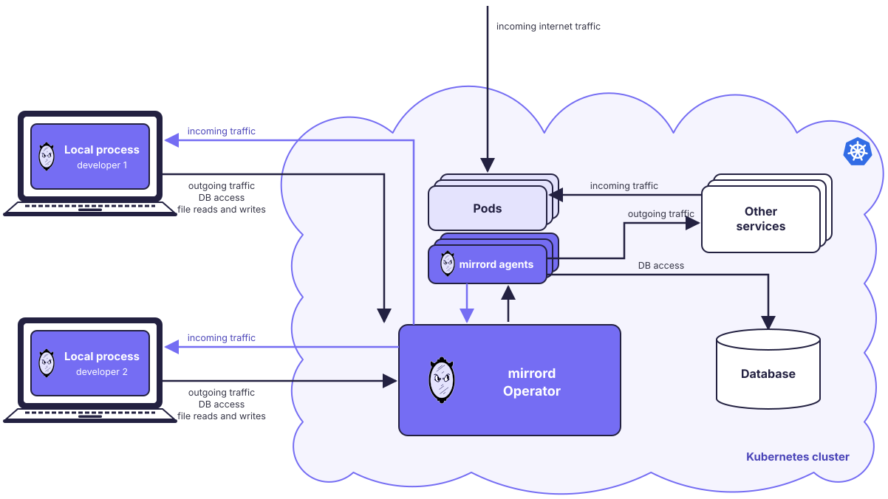

# mirrord Operator

The mirrord Operator is a Kubernetes operator that runs persistently in your cluster and manages mirrord sessions. It's the central component that enables all **\[Teams]** features.

## How it works

In the open-source version of mirrord, each session is standalone - mirrord injects itself into the local process and creates an agent pod directly. This works well for individual use, but doesn't support coordination between users.

The Operator solves this by acting as a centralized control plane. For what that enables, see [mirrord for Teams](../getting-started/what-is-mirrord.md#mirrord-for-teams).



## Installation

To install the Operator and check its requirements, see [Install the Operator](../getting-started/install-the-operator.md).

## Rotating the cloud API key

Rotate and revoke the key at [app.metalbear.com](https://app.metalbear.com). When you revoke, you can choose a grace window so the current key keeps working while you roll the Operator over to the new one.

## Single sign-on

Developers can log in to the Operator with your OIDC identity provider at a public HTTPS URL instead of through a kubeconfig. See [Single Sign-On](sso.md) for registering mirrord at the provider, the `sso` Helm values and granting groups access.

## Air-gapped / offline clusters (Enterprise)

See [Air-gapped Clusters](air-gapped.md).

## License key

If you run your own [License Server](license-server.md), the license key is the shared secret your Operators use to authenticate to it. See [Connecting Operators to the License Server](license-server.md#connecting-operators-to-the-license-server).


**⚠️ Deprecated for cloud authentication**

For clusters that reach the mirrord cloud, the license key is being replaced by the [cloud API key](../getting-started/install-the-operator.md#cloud-api-key), which is now the default way the Operator authenticates and obtains its license. Existing cloud license-key installations keep working, but new ones should use a cloud API key.


## Using an Internal Registry (Optional)

Using an internal registry reduces startup time, ingress costs, and removes dependency on GitHub's registry.

### Operator and agent images

These two images are always required. The Operator pulls its own image on install, and the agent image is pulled whenever a session starts. Copy both to your registry first (see [Copying images](#copying-images)), then add the feature-specific images below for the features you use.

| Image    | Default                          | Tag                                                                                         | Description                                          | Override               |
| -------- | -------------------------------- | ------------------------------------------------------------------------------------------- | ---------------------------------------------------- | ---------------------- |
| Operator | `ghcr.io/metalbear-co/operator`  | Chart `appVersion`                                                                          | The Operator itself.                                 | `operator.image`       |
| Agent    | `ghcr.io/metalbear-co/mirrord`   | Version in the Operator image's `metalbear.mirrord.version` label (changes with the Operator) | Agent the Operator starts for each mirrord session. | `agent.image.registry` |

### Feature-specific images

These images are only pulled when the corresponding feature is enabled:

| Image                   | Default                                     | Tag              | Description                                                                                   | Override                                                                  |
| ----------------------- | ------------------------------------------- | ---------------- | --------------------------------------------------------------------------------------------- | ------------------------------------------------------------------------- |
| Kafka splitting sidecar | `ghcr.io/metalbear-co/operator-kafka-proxy` | Same as operator | JVM sidecar for Kafka splitting (only when `operator.kafkaSplittingSidecar.enabled` is true). | `operator.kafkaSplittingSidecar.image`                                    |
| MSSQL tools             | `ghcr.io/metalbear-co/mssql-tools`          | Same as operator | Init container and sidecar for MSSQL DB branching (provides `sqlpackage` and `sqlcmd`). Table data is exported with the `bcp` in the branch's SQL Server image. | Env `MSSQL_TOOLS_IMAGE` via `operator.extraEnv`                           |
| Flyway                  | `flyway/flyway`                             | `13` from operator `3.232.0`; `12` on `3.182.0` through `3.231.0` | Flyway migration runner for DB branching.                                                     | Per-branch `migrations.image`, or `dbPod.migrationImages.flyway.registry` |
| Liquibase               | `liquibase/liquibase`                       | `4.33`           | Liquibase migration runner for DB branching.                                                  | Per-branch `migrations.image`, or `dbPod.migrationImages.liquibase.registry` |

### Code sync

A preview pod with [code sync](../use-cases/preview-environments-code-sync.md) runs the operator's image in an init container, and pulls it with the target pod's pull secrets. So when the operator image comes from a private registry, the target's pods must list a pull secret for that registry.

### DB branching default database images

DB branch pods pull a database image matching the engine. These are the defaults when no custom image is specified in the branch config:

| Engine      | Default image                                      | Override                                           |
| ----------- | -------------------------------------------------- | -------------------------------------------------- |
| PostgreSQL  | `docker.io/library/postgres:{version}`             | `operator.pgBranchConfig` - `dbPod.image`          |
| MySQL       | `docker.io/library/mysql:{version}`                | `operator.mysqlBranchConfig` - `dbPod.image`       |
| MariaDB     | `docker.io/library/mariadb:{version}`              | `operator.mariadbBranchConfig` - `dbPod.image`     |
| MongoDB     | `docker.io/library/mongo:{version}`                | `operator.mongodbBranchConfig` - `dbPod.image`     |
| MSSQL       | `mcr.microsoft.com/mssql/server:{version}`         | `operator.mssqlBranchConfig` - `dbPod.image`       |
| Redis       | `docker.io/library/redis:{version}`                | `operator.redisBranchConfig` - `dbPod.image`       |
| DynamoDB    | `amazon/dynamodb-local:{version}`                  | `operator.dynamodbBranchConfig` - `dbPod.image`    |
| ClickHouse  | `docker.io/clickhouse/clickhouse-server:{version}` | `operator.clickhouseBranchConfig` - `dbPod.image`  |
| CockroachDB | `docker.io/cockroachdb/cockroach:{version}`        | `operator.cockroachdbBranchConfig` - `dbPod.image` |
| Spanner     | `gcr.io/cloud-spanner-emulator/emulator:{version}` | `operator.spannerBranchConfig` - `dbPod.image`     |

[Generic branches](../sharing-the-cluster/db-branching/generic.md) have no default image - the user supplies the full image reference per branch. To limit which images users can run, or to pull from a private registry, see [Restricting Branch Images](../sharing-the-cluster/db-branching.md#restricting-branch-images) and [Custom Branch Image](../sharing-the-cluster/db-branching.md#custom-branch-image).

### Copying images

We recommend [regctl](https://regclient.org/) for copying multi-arch images:

```sh
# Get the operator image version
IMAGE_VERSION=$(helm show chart metalbear/mirrord-operator | grep 'appVersion:' | awk '{print $2}')

# Copy operator image
regctl image copy ghcr.io/metalbear-co/operator:$IMAGE_VERSION your-registry/operator:$IMAGE_VERSION

# Get and copy agent image
AGENT_IMAGE_VERSION=$(regctl image config ghcr.io/metalbear-co/operator:$IMAGE_VERSION | jq -r '.config.Labels."metalbear.mirrord.version"')
regctl image copy ghcr.io/metalbear-co/mirrord:$AGENT_IMAGE_VERSION your-registry/mirrord:$AGENT_IMAGE_VERSION
```

Then set in your `values.yaml`:

```yaml
operator:
  image: your-registry/operator
agent:
  image:
    registry: your-registry/mirrord
```

### OpenShift

Apply the following SecurityContextConstraints:

```yaml
kind: SecurityContextConstraints
apiVersion: security.openshift.io/v1
metadata:
  name: scc-mirrord
allowHostPID: true
allowPrivilegedContainer: false
allowHostDirVolumePlugin: true
allowedCapabilities: ["SYS_ADMIN", "SYS_PTRACE", "NET_RAW", "NET_ADMIN"]
runAsUser:
  type: RunAsAny
seLinuxContext:
  type: MustRunAs
users:
  - system:serviceaccount:mirrord:mirrord-operator
  - system:serviceaccount:mirrord:default
```

### GKE Autopilot

In GKE Autopilot the mirrord Operator can be run as a [customer-owned privileged workload](https://docs.cloud.google.com/kubernetes-engine/docs/concepts/about-autopilot-privileged-workloads#customer-owned-privileged-workloads).

mirrord is an approved [GKE Autopilot partner](https://docs.cloud.google.com/kubernetes-engine/docs/resources/autopilot-partners). Because of this, you should **not** manually apply a [WorkloadAllowlist](https://docs.cloud.google.com/kubernetes-engine/docs/how-to/autopilot-privileged-allowlists) for the mirrord-agent workload: GKE Autopilot clusters reject direct manual installation of it with an admission error. Manual installation only worked previously in specially-configured test projects, not in standard customer clusters.

Instead, apply the following [AllowlistSynchronizer](https://docs.cloud.google.com/kubernetes-engine/docs/reference/crds/allowlistsynchronizer), which automatically syncs the current and future approved versions of the mirrord-agent allowlist:

```yaml
apiVersion: auto.gke.io/v1
kind: AllowlistSynchronizer
metadata:
  name: mirrord-allowlist
spec:
  allowlistPaths:
    - "mirrord/mirrord-agent/*"
```

**Note:** some Operator configurations might produce mirrord-agent pods that don't match this specification. When that happens, you'll see agent spawn errors in the Operator logs. To get the correct WorkloadAllowlist embedded in those error messages, merge this snippet into your mirrord Operator `values.yaml`:

```yaml
agent:
  annotations:
    cloud.google.com/generate-allowlist: "true"
```
