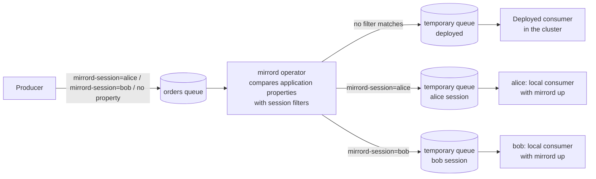

# How to Test Azure Service Bus Consumers in Kubernetes with Queue Splitting

A shared staging queue has one problem for developers: all consumers compete for the same messages. If you run a changed consumer on your machine, it takes messages from the deployed consumer and from your teammates. With mirrord queue splitting, you get only the messages that match your filter. The deployed consumer keeps the rest.

This tutorial uses a small sample app: a Python consumer that reads an Azure Service Bus queue, and a Python producer that sends test messages with the application properties `user` and `baggage`. You deploy the consumer to Kubernetes, then run a second copy on your machine with `mirrord up`. It gets only the messages where `baggage` is `mirrord-session=alice`.

Queue splitting needs no changes to the consumer code. You do not add an SDK, an interceptor, or a routing check to the consumer. The mirrord operator changes the queue name that each consumer reads, and it routes each message to the correct queue.

**Estimated time:** 20 to 30 minutes.

## How Azure Service Bus changes the isolation problem

Azure Service Bus queues are point-to-point. Each message goes to one receiver only. When two processes read the same queue, they are competing consumers, and Service Bus gives each message to one of them without a rule that you control.

Thus, a local consumer that reads the staging queue takes a random part of the traffic. Your test messages can go to the deployed consumer, and messages from other people can come to you. You cannot fix this with a second queue unless you change the producers.

Azure Service Bus also has a managed-only model. You cannot run the real service in your cluster. The mirrord operator connects to your Service Bus namespace with credentials that you give it, and it creates temporary queues in that namespace.

## What you will deploy

- An Azure resource group, a Service Bus namespace, and one queue, `orders`.
- A Kubernetes namespace, `sb-demo`.
- A Secret with the Service Bus connection string.
- A ConfigMap with the consumer script, and a Deployment `orders-consumer` that runs it from the public `python:3.12-slim` image. You do not build an image.
- Two mirrord operator resources: a `MirrordPropertyList` with the connection details, and a `MirrordSplitConfig` that tells the operator which queue to split.

## Prerequisites

Before you start, make sure that you have these items:

1. A Kubernetes cluster, version `1.30` or later. Queue splitting needs this version.
2. `kubectl`, configured for that cluster.
3. The Azure CLI (`az`), logged in to a subscription where you can create resources.
4. Python 3.9 or later on your machine.
5. The mirrord CLI, version `3.243.0` or later. From this version, `mirrord up` tells the operator to skip the queue types that it does not split.
6. The mirrord operator, version `3.183.0` or later, installed with a license. Queue splitting with `mirrord up` needs this version.

The `azure-servicebus` SDK (version 7.15) needs Python 3.9 or later.

Enable Azure Service Bus splitting in the operator Helm chart. Run the command in the namespace where you installed the operator release (usually `default`):

```shell
helm upgrade mirrord-operator metalbear/mirrord-operator \
  --reuse-values \
  --set operator.azureServiceBusSplitting=true
```

Create a virtual environment in your working directory, and install the Service Bus SDK in it:

```shell
python3 -m venv .venv
source .venv/bin/activate
pip install azure-servicebus==7.15.0
```

## Deploy the demo

### Step 1: Create the Service Bus resources

Set names for the resources. The namespace name must be unique in Azure, so add a suffix:

```shell
export RG=mirrord-sb-demo
export LOCATION=eastus
export SB_NAMESPACE=mirrord-sb-demo-$RANDOM
```

Create the resource group, the namespace, and the queue:

```shell
az group create --name "$RG" --location "$LOCATION"

az servicebus namespace create \
  --resource-group "$RG" \
  --name "$SB_NAMESPACE" \
  --location "$LOCATION" \
  --sku Standard

az servicebus queue create \
  --resource-group "$RG" \
  --namespace-name "$SB_NAMESPACE" \
  --name orders
```

### Step 2: Get the credentials for the operator

The operator needs **Manage**, **Send**, and **Listen** rights on the namespace. It sends and receives messages, and it creates and deletes the temporary queues. The `RootManageSharedAccessKey` rule that Azure creates with the namespace has all three rights.

Get its connection string:

```shell
export SB_CONN=$(az servicebus namespace authorization-rule keys list \
  --resource-group "$RG" \
  --namespace-name "$SB_NAMESPACE" \
  --name RootManageSharedAccessKey \
  --query primaryConnectionString \
  --output tsv)
```


**Workload Identity instead of a key.** On AKS with Workload Identity, the operator can use its managed identity, and you store no key for the operator. Workload Identity applies only to the operator. The demo consumer in this tutorial still uses the connection string from Step 2. Get the client ID of the managed identity:

```shell
export OPERATOR_IDENTITY_CLIENT_ID=$(az identity show \
  --resource-group <identity-resource-group> \
  --name <identity-name> \
  --query clientId \
  --output tsv)
```

Give the identity the **Azure Service Bus Data Owner** role on the namespace:

```shell
az role assignment create \
  --role "Azure Service Bus Data Owner" \
  --assignee "$OPERATOR_IDENTITY_CLIENT_ID" \
  --scope "$(az servicebus namespace show --resource-group "$RG" --name "$SB_NAMESPACE" --query id --output tsv)"
```

Then put only `fully_qualified_namespace` in the `MirrordPropertyList` (see Step 4). The operator uses `DefaultAzureCredential`. A service principal with a client secret is a third option. The [Azure Service Bus reference page](../../sharing-the-cluster/queue-splitting/azure-service-bus.md) shows all three forms.

To attach the identity to the operator pod, set `sa.azureClientId` to `$OPERATOR_IDENTITY_CLIENT_ID` in the operator Helm values. The chart then adds the `azure.workload.identity/use` pod label and the `azure.workload.identity/client-id` service account annotation.


### Step 3: Deploy the consumer

Save this script as `consumer.py`. It reads the queue name and the connection string from environment variables, and prints each message with its `user` property and its `order_id` field.

```python
import json
import os
import signal
import sys

from azure.servicebus import ServiceBusClient

# Stop at once when Kubernetes stops the pod. As PID 1, Python ignores SIGTERM by default.
signal.signal(signal.SIGTERM, lambda *_: sys.exit(0))

NAME = sys.argv[1] if len(sys.argv) > 1 else "consumer"
CONN = os.environ["SERVICE_BUS_CONNECTION_STRING"]
QUEUE = os.environ["SERVICE_BUS_QUEUE_NAME"]


def text(value):
    return value.decode() if isinstance(value, bytes) else value


def main():
    print(f"[{NAME}] reading queue {QUEUE}", flush=True)
    with ServiceBusClient.from_connection_string(CONN) as client:
        receiver = client.get_queue_receiver(queue_name=QUEUE, max_wait_time=None)
        with receiver:
            for msg in receiver:
                props = {text(k): text(v) for k, v in (msg.application_properties or {}).items()}
                body = json.loads(str(msg))
                print(
                    f"[{NAME}] order_id={body.get('order_id')} user={props.get('user', '-')}",
                    flush=True,
                )
                receiver.complete_message(msg)


if __name__ == "__main__":
    try:
        main()
    except KeyboardInterrupt:
        pass
```

Create the Kubernetes namespace, the Secret, and the ConfigMap:

```shell
kubectl create namespace sb-demo

kubectl create secret generic servicebus-credentials \
  --namespace sb-demo \
  --from-literal=connection-string="$SB_CONN"

kubectl create configmap consumer-script \
  --namespace sb-demo \
  --from-file=consumer.py
```

Save this manifest as `consumer.yaml`. The container installs the SDK when it starts, then runs the script. The `exec` makes Python the main process of the container. Python then gets the stop signal, so the consumer stops immediately when Kubernetes stops the pod.


The operator can read the queue name only from an environment variable in the pod template, with the value in `value` or in a ConfigMap reference, or from a ConfigMap loaded with `envFrom`. Do not move `SERVICE_BUS_QUEUE_NAME` into a Secret.


```yaml
apiVersion: apps/v1
kind: Deployment
metadata:
  name: orders-consumer
  namespace: sb-demo
spec:
  replicas: 1
  selector:
    matchLabels:
      app: orders-consumer
  template:
    metadata:
      labels:
        app: orders-consumer
    spec:
      containers:
        - name: consumer
          image: python:3.12-slim
          command: ["sh", "-c"]
          args:
            - pip install --quiet --root-user-action=ignore --disable-pip-version-check azure-servicebus==7.15.0 && exec python -u /app/consumer.py deployed
          env:
            - name: SERVICE_BUS_QUEUE_NAME
              value: orders
            - name: SERVICE_BUS_CONNECTION_STRING
              valueFrom:
                secretKeyRef:
                  name: servicebus-credentials
                  key: connection-string
          volumeMounts:
            - name: script
              mountPath: /app
      volumes:
        - name: script
          configMap:
            name: consumer-script
```

Apply it:

```shell
kubectl apply -f consumer.yaml
kubectl rollout status deployment/orders-consumer --namespace sb-demo
```

### Step 4: Create the mirrord operator resources

Save this manifest as `mirrord-split.yaml`. The `MirrordPropertyList` tells the operator how to connect to Service Bus. The `MirrordSplitConfig` tells the operator that the Deployment reads the queue name from `SERVICE_BUS_QUEUE_NAME`, and it gives the queue the ID `orders-queue`. A custom filter in `mirrord-up.yaml` uses this ID.

```yaml
apiVersion: mirrord.metalbear.co/v1
kind: MirrordPropertyList
metadata:
  name: servicebus-config
  namespace: sb-demo
spec:
  properties:
    - name: connection_string
      valueFrom:
        secretKeyRef:
          name: servicebus-credentials
          key: connection-string
---
apiVersion: queues.mirrord.metalbear.co/v1
kind: MirrordSplitConfig
metadata:
  name: orders-consumer-split
  namespace: sb-demo
spec:
  targetRef:
    apiVersion: apps/v1
    kind: Deployment
    name: orders-consumer
  clientConfigs:
    azureServiceBus: servicebus-config
  restart:
    timeout: 120
  drainTimeout: 60
  queues:
    - id: orders-queue
      kind: azureServiceBus
      appConfig:
        queue:
          - env: SERVICE_BUS_QUEUE_NAME
```

The demo pod installs the SDK each time it starts, so `restart.timeout` gives it 120 seconds to become ready. `drainTimeout: 60` keeps the cleanup short for the demo. Apply the manifest:

```shell
kubectl apply -f mirrord-split.yaml
```

### Step 5: Create the producer

Save this script as `producer.py`. It sends a number of messages. If you give a user name, each message gets the application property `user` with that value, and the property `baggage` with the value `mirrord-session=<user>`. If you give `none`, the messages have no properties.

```python
import json
import os
import sys

from azure.servicebus import ServiceBusClient, ServiceBusMessage

CONN = os.environ["SB_CONN"]
USER = sys.argv[1]
COUNT = int(sys.argv[2]) if len(sys.argv) > 2 else 3
START = int(sys.argv[3]) if len(sys.argv) > 3 else 1

with ServiceBusClient.from_connection_string(CONN) as client:
    with client.get_queue_sender(queue_name="orders") as sender:
        for order_id in range(START, START + COUNT):
            # mirrord up sends a message to the session whose key is in "baggage".
            props = None if USER == "none" else {"user": USER, "baggage": f"mirrord-session={USER}"}
            body = json.dumps({"order_id": order_id})
            sender.send_messages(ServiceBusMessage(body, application_properties=props))
            print(f"sent order_id={order_id} user={USER}")
```

The producer runs on your machine and uses the `SB_CONN` variable from Step 2.

## Confirm the baseline

Before you start a mirrord session, confirm that the deployed consumer gets all messages. Open a terminal and follow the consumer logs:

```shell
kubectl logs --follow deployment/orders-consumer --namespace sb-demo
```

Open a second terminal for the producer. In this terminal, activate the virtual environment and set `SB_CONN` again with the command from Step 2:

```shell
source .venv/bin/activate
export SB_CONN=$(az servicebus namespace authorization-rule keys list \
  --resource-group "$RG" \
  --namespace-name "$SB_NAMESPACE" \
  --name RootManageSharedAccessKey \
  --query primaryConnectionString \
  --output tsv)
```

The command also needs `RG` and `SB_NAMESPACE` from Step 1. If this terminal does not have them, export them again with the same values.

Send three messages for `alice` and three messages with no property:

```shell
python3 producer.py alice 3 1
python3 producer.py none 3 4
```

The deployed consumer prints all six messages:

```
[deployed] reading queue orders
[deployed] order_id=1 user=alice
[deployed] order_id=2 user=alice
[deployed] order_id=3 user=alice
[deployed] order_id=4 user=-
[deployed] order_id=5 user=-
[deployed] order_id=6 user=-
```

## Create sessions and test

### Step 1: Write the mirrord configuration

Save this file as `mirrord-up.yaml`:

```yaml
common:
  operator: true
services:
  orders-consumer:
    target:
      path: deployment/orders-consumer
      namespace: sb-demo
    run:
      command: ["python3", "consumer.py", "{{ key }}"]
```

The file has one service, `orders-consumer`, that runs `consumer.py` against the `orders-consumer` Deployment. `{{ key }}` is the session key. The consumer prints it in front of each line.

The file has no queue configuration. `mirrord up` splits the queues of the target automatically. Your local consumer gets only the messages with an application property value that contains `mirrord-session=<key>`.

### Step 2: Start the local consumer

Open a new terminal. Activate the virtual environment, and run the same `consumer.py` on your machine with `mirrord up` and the session key `alice`:

```shell
source .venv/bin/activate
mirrord up --key alice
```

mirrord gives the local process the environment of the deployed pod, so the script gets the connection string from the cluster. The operator changes `SERVICE_BUS_QUEUE_NAME` for your process to the name of a temporary queue that only your session reads. The local consumer prints a name like this. `mirrord up` puts the service name in front of each line of the consumer:

<!-- TODO: confirm on a cluster -->

```
orders-consumer: [alice] reading queue mirrord-tmp-<random>-orders
```

When the first session starts, the operator also restarts the pods of the deployed consumer with a new value in `SERVICE_BUS_QUEUE_NAME`. Watch the `kubectl logs` terminal. When the log stops, run the `kubectl logs --follow` command again to see the new pod. The new pod reads its own temporary queue:

```
[deployed] reading queue mirrord-tmp-<random>-main-orders
```


Wait until the old pod is gone before you send messages. Until it stops, the old pod still reads the `orders` queue and can take messages for your session. Make sure that `kubectl get pods --namespace sb-demo` shows only one pod.


### Step 3: Send messages with and without the session key

In the producer terminal, send messages for `alice` and messages with no property:

```shell
python3 producer.py alice 3 10
python3 producer.py none 3 20
```

Your local consumer gets only the `alice` messages:

```
orders-consumer: [alice] order_id=10 user=alice
orders-consumer: [alice] order_id=11 user=alice
orders-consumer: [alice] order_id=12 user=alice
```

The deployed consumer gets the other messages:

```
[deployed] order_id=20 user=-
[deployed] order_id=21 user=-
[deployed] order_id=22 user=-
```

To test a change, edit `consumer.py` on your machine and run the `mirrord up` command again. You do not rebuild or deploy anything.

### Step 4: Add a second developer

The operator supports more than one session on the same queue. Each new session gets its own temporary queue and its own filter.

Keep the `alice` session open. Open a new terminal in the same directory. Activate the virtual environment and start a second session with the same `mirrord-up.yaml` and the key `bob`:

```shell
source .venv/bin/activate
mirrord up --key bob
```

Send one message for each user and one with no properties:

```shell
python3 producer.py alice 1 30
python3 producer.py bob 1 40
python3 producer.py none 1 50
```

Each consumer gets only its messages:

```
orders-consumer: [alice] order_id=30 user=alice
orders-consumer: [bob] order_id=40 user=bob
[deployed] order_id=50 user=-
```


If the filters of two sessions both match a message, the operator gives the message to one of the two sessions at random. Use a different session key for each developer. Do not use a key that is the start of a different key, for example `ali` and `alice`.


### Step 5: Stop the sessions

Press `Ctrl+C` in the `bob` terminal. The operator does not stop the routing immediately. About 30 seconds after you stop the session, the operator ends it. About one minute after that, it deletes bob's temporary queue. The messages that are still in that queue are lost. This includes the `bob` messages that you send before the operator deletes the queue.

Wait until bob's temporary queue is gone. This command must show only `orders` and the two temporary queues of the `alice` session:

```shell
az servicebus queue list \
  --resource-group "$RG" \
  --namespace-name "$SB_NAMESPACE" \
  --query "[].name" \
  --output tsv
```

```
mirrord-tmp-<random>-main-orders
mirrord-tmp-<random>-orders
orders
```

Messages with `user=bob` now match no filter, so they go to the deployed consumer:

```shell
python3 producer.py bob 1 60
```

```
[deployed] order_id=60 user=bob
```

Press `Ctrl+C` in the `alice` terminal. This is the last session on the queue. The operator then waits for the deployed consumer to read all messages in its temporary queue. It waits up to `drainTimeout` (60 seconds in this demo). After that, it deletes the temporary queues and puts the deployed consumer back on the `orders` queue.

The operator restarts the pods of the Deployment again. Run the `kubectl logs --follow` command again. The new pod reads the original queue:

```
[deployed] reading queue orders
```

The `az servicebus queue list` command from above now shows only `orders`.

If you do not set `drainTimeout`, the operator waits until the temporary queue of the deployed consumer is empty. If you set `drainTimeout: 0`, the operator deletes the temporary queues immediately, and unread messages can be lost. Scheduled messages keep the drain open until they are due and the deployed consumer reads them. Deferred messages do not keep the drain open.

## How it works

When the first session starts, the operator creates two temporary queues in your Service Bus namespace: one for the deployed consumer and one for your local consumer. It changes the queue name environment variable in each consumer so that each reads only its own temporary queue. The operator then reads every message from the original `orders` queue, compares its application properties with the filter of each session, and sends it to the temporary queue of the session that matches. Messages that match no filter go to the temporary queue of the deployed consumer. Each new session adds one more temporary queue and one more filter.



## Behavior and tradeoffs

- **The filter of `mirrord up` matches application properties.** `mirrord up` makes a `jq_filter` for each session. The filter matches a message when a string value in its application properties contains `mirrord-session=<key>`. The property name does not matter. A key that is the start of a different key, for example `ali` and `alice`, matches the messages of both keys.
- **Custom filters.** In a `config_patch`, a `message_filter` entry is a property name and a regular expression for its value. Values are compared as plain strings. If you give more than one entry, a message must match all of them.
- **You can filter on the body.** In a `config_patch`, a `jq_filter` runs on a JSON object with the fields `body`, `application_properties`, `message_id`, `content_type`, and `subject`. For example, `.body | fromjson | .priority == "high"`. If you set `message_filter` and `jq_filter` together, a message must match both.
- **The producer must set the property.** If the producers do not put the property on the message, no filter matches and the message goes to the deployed consumer. To carry a value such as `baggage` across services, see [Header Propagation](../../sharing-the-cluster/header-propagation.md).
- **Overlapping filters give random results.** If two filters match one message, one of the two sessions gets it at random.
- **The queue model restarts the deployed consumer.** The operator restarts the pods of the workload with a new queue name when the split starts and when it ends. The Topic/Subscription model does not restart the deployed application.
- **The queue name must come from a place that the operator can read.** This is an environment variable with a direct value or a ConfigMap reference, a ConfigMap loaded with `envFrom`, a mounted ConfigMap or Secret file, or a file that Vault or a CSI driver injects.
- **Messages go through the operator.** Each message takes one more hop: from the original queue, through the operator, to a temporary queue. The operator forwards one message at a time, in the order that it receives them. Do not rely on a strict order, because a retry after an error can change it.
- **Temporary queues live in your namespace.** The operator needs Manage rights to create and delete them. Their names are limited to 260 characters. If a name is longer, the operator shortens the original part and adds a hash.
- **KEDA.** If KEDA scales the consumer on queue depth, set `operator.manageKedaScaledObjects` in the operator Helm values. The operator then points the trigger at the temporary queue that the deployed consumer reads.

## Adapt this to your stack

To use queue splitting with your own consumer, change these items:

1. **Target.** Set `targetRef` in the `MirrordSplitConfig` and `target` in `mirrord-up.yaml` to your Deployment, StatefulSet, or Argo Rollout.
2. **Queue name source.** Set `appConfig.queue[].env` to the variable that your consumer reads. If the queue name is inside a connection string as `EntityPath`, use `valuePattern: "EntityPath=(?P<value>[^;]+)"`. The operator then changes only the queue name in the string.
3. **Topics.** If your consumer reads a topic subscription, use `appConfig.topic` and `appConfig.subscription` instead of `appConfig.queue`. If the topic name is not in an environment variable (for example with MassTransit), give it in `fallback`.
4. **Authentication.** Use Workload Identity, a connection string, or a service principal in the `MirrordPropertyList`. To share one property list between namespaces, put it in the operator namespace.
5. **Session key in the messages.** Make your producers set an application property with `mirrord-session=<key>`, for example `baggage`. Each developer uses a different key.
6. **Queue ID.** For a custom filter, use the same ID in the `MirrordSplitConfig` and in `feature.split_queues`. To use one filter for all queues in the split config, use the ID `*`.

You do not change the consumer code. The consumer reads its queue name in the same way in the cluster and on your machine. The operator changes only the value.

To use your own filter instead of the session key, set `feature.split_queues` in the `config_patch` of the service. A `config_patch` that sets `split_queues` replaces all the queue splits that `mirrord up` makes for that service. This `mirrord-up.yaml` filters on the `user` property. `config_patch` needs mirrord CLI `3.251.0` or later:

```yaml
common:
  operator: true
services:
  orders-consumer:
    target:
      path: deployment/orders-consumer
      namespace: sb-demo
    run:
      command: ["python3", "consumer.py", "{{ key }}"]
    config_patch:
      feature:
        split_queues:
          orders-queue:
            queue_type: AzureServiceBus
            message_filter:
              user: "^{{ key }}$"
```

## Cleanup

Stop all `mirrord up` sessions and wait for the drain to end. Then delete the demo resources:

```shell
kubectl delete -f mirrord-split.yaml
kubectl delete namespace sb-demo
az group delete --name "$RG" --yes --no-wait
```

Delete the local virtual environment:

```shell
rm -rf .venv
```

To turn off Azure Service Bus splitting in the operator:

```shell
helm upgrade mirrord-operator metalbear/mirrord-operator \
  --reuse-values \
  --set operator.azureServiceBusSplitting=false
```

## Frequently asked questions

### How do I test an Azure Service Bus consumer locally without stealing messages from staging?

Use mirrord queue splitting with `mirrord up` and a session key. The operator gives your local consumer only the messages with your session key in an application property. The deployed consumer and your teammates keep all other messages.

### Do I need to change my consumer code to use queue splitting?

No. The consumer must read the queue name from an environment variable, a mounted file, or an injected file. The operator changes that value for each consumer. You do not add a library or a routing check.

### Does queue splitting work with Azure Service Bus topics and subscriptions?

Yes. In the Topic/Subscription model, the operator adds temporary subscriptions with Service Bus rules on the original topic. It does not create a temporary topic, and it does not restart the deployed application.

### What happens to my messages when I stop mirrord?

About 30 seconds after you stop mirrord, the operator ends the session. It deletes your session queue about one minute later, and messages that are still in it are lost. New messages that match your filter go to the deployed consumer. After the last session ends, the operator drains the temporary queue of the deployed consumer before it deletes the temporary queues.

### Can the operator use Workload Identity instead of a connection string?

Yes. On AKS with Workload Identity, give the operator identity the **Azure Service Bus Data Owner** role on the namespace. Then put only `fully_qualified_namespace` in the `MirrordPropertyList`. The operator uses `DefaultAzureCredential` to get a token.

### What happens if two developers use filters that match the same message?

The operator gives the message to one of the two sessions at random. Each developer must use a session key that no other session uses.

## See also

- [Azure Service Bus queue splitting reference](../../sharing-the-cluster/queue-splitting/azure-service-bus.md)
- [Queue splitting overview](../../sharing-the-cluster/queue-splitting.md)
- [Setting a filter for a mirrord run](../../sharing-the-cluster/queue-splitting.md#setting-a-filter-for-a-mirrord-run)
- [`feature.split_queues` configuration option](https://metalbear.com/mirrord/docs/config/options#feature-split_queues)
- [Header Propagation](../../sharing-the-cluster/header-propagation.md)
