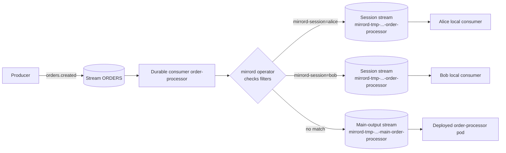

# How to Test NATS Consumers in Kubernetes with Queue Splitting

A shared staging stream has one problem for developers: all consumers compete for the same messages. If you run a changed consumer on your machine, it takes messages from the deployed consumer and from your teammates. With mirrord queue splitting, you get only the messages that match your filter. The deployed consumer keeps the rest.

This tutorial uses a small sample app: a Python consumer that reads a NATS JetStream stream through a durable pull consumer, and a Python producer that sends test messages with the headers `x-user` and `baggage`. You deploy NATS and the consumer to Kubernetes. Then you run a second copy of the consumer on your machine with `mirrord up`. It gets only the messages where `baggage` is `mirrord-session=alice`.

Queue splitting needs no changes to the consumer code. You do not add an SDK, an interceptor, or code that decides which consumer gets a message. The mirrord operator changes the stream and consumer names that each consumer reads, and it sends each message to the correct stream.

**Estimated time:** 20 to 30 minutes.


NATS has two models: JetStream (streams with durable consumers) and core NATS pub/sub (plain subject subscriptions, nothing is stored). mirrord can split both. This tutorial uses JetStream, because JetStream delivery is at-least-once, and because `mirrord up` splits JetStream streams automatically. For core NATS pub/sub, see [Core NATS pub/sub](#core-nats-pub-sub) below.


## How NATS changes the isolation problem

In JetStream, a durable pull consumer is a shared cursor on a stream. All processes that pull from the same durable consumer share its messages. Each message goes to one of them, and you do not control which one.

Thus, a local process that binds to the staging consumer takes a random part of the traffic. Your test messages can go to the deployed consumer, and messages from other people can come to you. A new durable consumer on the same stream does not help either: it gets a copy of every message, and the deployed consumer still processes your test messages.

The mirrord operator solves this with temporary streams. It reads the original durable consumer and republishes each message to a temporary stream: one stream for each developer session, and one main-output stream for the deployed consumer. The filter in your mirrord config decides which stream gets the message.

## What you will deploy

- A Kubernetes namespace, `nats-demo`.
- A single NATS server with JetStream turned on, from the official `nats` image. This setup is for development only: one replica and no persistent volume.
- A ConfigMap with three Python scripts: `setup.py`, `consumer.py`, and `producer.py`.
- A Job that creates the stream `ORDERS` and the durable pull consumer `order-processor`.
- A Deployment `order-processor` that runs `consumer.py` from the public `python:3.12-slim` image. You do not build an image.
- Two mirrord operator resources: a `MirrordPropertyList` with the NATS connection, and a `MirrordSplitConfig` that tells the operator which stream and consumer to split.

## Prerequisites

Before you start, make sure that you have these items:

1. A Kubernetes cluster for development or staging, version `1.30` or later. Queue splitting needs this version. Do not use a production cluster.
2. `kubectl`, configured for that cluster.
3. Python 3.9 or later on your machine.
4. The mirrord CLI, version `3.254.0` or later. From this version, `mirrord up` splits NATS JetStream streams automatically.
5. The mirrord operator, version `3.203.0` or later, installed with a license.

The cluster pods must have access to PyPI, because the pods install `nats-py` when they start.

Enable NATS JetStream splitting in the operator Helm chart. Run this command in the kube context and namespace where you installed the operator release:

```shell
helm upgrade mirrord-operator metalbear/mirrord-operator \
  --reuse-values \
  --set operator.natsSplitting=true
```

Make sure that the operator defines the `MirrordSplitConfig` resource type:

```shell
kubectl get crd mirrordsplitconfigs.queues.mirrord.metalbear.co
```

Install the NATS client on your machine:

```shell
python3 -m venv .venv
source .venv/bin/activate
pip install nats-py==2.12.0
```

## Deploy the demo

### Step 1: Deploy NATS

Save this manifest as `nats.yaml`. The `-js` flag turns on JetStream. Splitting needs NATS server `2.2` or later, because it uses message headers.

```yaml
apiVersion: v1
kind: Namespace
metadata:
  name: nats-demo
---
apiVersion: apps/v1
kind: Deployment
metadata:
  name: nats
  namespace: nats-demo
spec:
  replicas: 1
  selector:
    matchLabels:
      app: nats
  template:
    metadata:
      labels:
        app: nats
    spec:
      containers:
        - name: nats
          image: nats:2.10
          args: ["-js"]
          ports:
            - containerPort: 4222
---
apiVersion: v1
kind: Service
metadata:
  name: nats
  namespace: nats-demo
spec:
  selector:
    app: nats
  ports:
    - port: 4222
      targetPort: 4222
```

Apply it and wait for the server:

```shell
kubectl apply -f nats.yaml
kubectl rollout status -n nats-demo deployment/nats
```

### Step 2: Create the scripts

Save the three scripts in one directory on your machine. You use `consumer.py` locally later, and the cluster uses all three from a ConfigMap.

`setup.py` creates the stream and the durable pull consumer. The stream captures the subjects `orders.>`.

```python
import asyncio
import os

import nats
from nats.js.api import AckPolicy, ConsumerConfig
from nats.js.errors import BadRequestError


async def main():
    nc = await nats.connect(os.environ["NATS_URL"])
    js = nc.jetstream()
    stream = os.environ["NATS_STREAM"]
    consumer = os.environ["NATS_CONSUMER"]
    try:
        await js.add_stream(name=stream, subjects=["orders.>"])
    except BadRequestError:
        pass  # The stream exists already.
    await js.add_consumer(
        stream,
        ConsumerConfig(durable_name=consumer, ack_policy=AckPolicy.EXPLICIT),
    )
    print(f"stream {stream} and consumer {consumer} are ready", flush=True)
    await nc.close()


asyncio.run(main())
```

`consumer.py` binds to the durable consumer and prints each order, its `x-user` header, and its subject. It reads the stream and consumer names from environment variables. This is the only thing that queue splitting needs from your code.

```python
import asyncio
import json
import os

import nats
from nats.errors import TimeoutError as FetchTimeout


async def main():
    nc = await nats.connect(os.environ["NATS_URL"])
    js = nc.jetstream()
    stream = os.environ["NATS_STREAM"]
    consumer = os.environ["NATS_CONSUMER"]
    # Bind to the durable consumer. The consumer does not create streams.
    sub = await js.pull_subscribe_bind(durable=consumer, stream=stream)
    print(f"reading stream={stream} consumer={consumer}", flush=True)
    while True:
        try:
            msgs = await sub.fetch(10, timeout=5)
        except FetchTimeout:
            continue
        for msg in msgs:
            user = (msg.headers or {}).get("x-user", "-")
            order = json.loads(msg.data)
            print(f"order={order['id']} x-user={user} subject={msg.subject}", flush=True)
            await msg.ack()


asyncio.run(main())
```

`producer.py` publishes orders to the subject `orders.created`. The first argument is the value of the `x-user` header. The producer also sets the `baggage` header to `mirrord-session=<user>`. Use `none` to send messages without headers.

```python
import asyncio
import json
import os
import sys

import nats


async def main():
    user = sys.argv[1]  # Use "none" to send messages without headers.
    count = int(sys.argv[2]) if len(sys.argv) > 2 else 3
    nc = await nats.connect(os.environ["NATS_URL"])
    js = nc.jetstream()
    # mirrord up sends a message to the session whose key is in "baggage".
    headers = None if user == "none" else {"x-user": user, "baggage": f"mirrord-session={user}"}
    for i in range(1, count + 1):
        order = {"id": f"{user}-{i}", "item": "book"}
        await js.publish("orders.created", json.dumps(order).encode(), headers=headers)
        print(f"sent order={order['id']} x-user={user}", flush=True)
    await nc.close()


asyncio.run(main())
```

Put the scripts in a ConfigMap:

```shell
kubectl create configmap orders-app -n nats-demo \
  --from-file=setup.py --from-file=consumer.py --from-file=producer.py
```

### Step 3: Create the stream and the durable consumer

The durable consumer must exist before a split starts, because the operator copies its settings. Save this Job as `setup-job.yaml`:

```yaml
apiVersion: batch/v1
kind: Job
metadata:
  name: orders-setup
  namespace: nats-demo
spec:
  backoffLimit: 4
  template:
    spec:
      restartPolicy: OnFailure
      containers:
        - name: setup
          image: python:3.12-slim
          command: ["sh", "-c", "pip install --quiet nats-py==2.12.0 && python -u /app/setup.py"]
          env:
            - name: NATS_URL
              value: nats://nats.nats-demo.svc.cluster.local:4222
            - name: NATS_STREAM
              value: ORDERS
            - name: NATS_CONSUMER
              value: order-processor
          volumeMounts:
            - name: app
              mountPath: /app
      volumes:
        - name: app
          configMap:
            name: orders-app
```

Apply it and wait for it to complete:

```shell
kubectl apply -f setup-job.yaml
kubectl wait -n nats-demo --for=condition=complete job/orders-setup --timeout=180s
```

### Step 4: Deploy the consumer

Save this manifest as `consumer.yaml`. The stream and consumer names are in the environment variables `NATS_STREAM` and `NATS_CONSUMER`, with values set directly in the pod template. The operator can read and change these variables.

The value `terminationGracePeriodSeconds: 5` makes an old pod stop quickly when the operator restarts the pods. The consumer runs as PID 1 and does not stop on `SIGTERM`. Without this value, an old pod reads the original consumer for 30 seconds after a session starts.

```yaml
apiVersion: apps/v1
kind: Deployment
metadata:
  name: order-processor
  namespace: nats-demo
spec:
  replicas: 1
  selector:
    matchLabels:
      app: order-processor
  template:
    metadata:
      labels:
        app: order-processor
    spec:
      terminationGracePeriodSeconds: 5
      containers:
        - name: consumer
          image: python:3.12-slim
          command: ["sh", "-c", "pip install --quiet nats-py==2.12.0 && python -u /app/consumer.py"]
          env:
            - name: NATS_URL
              value: nats://nats.nats-demo.svc.cluster.local:4222
            - name: NATS_STREAM
              value: ORDERS
            - name: NATS_CONSUMER
              value: order-processor
          volumeMounts:
            - name: app
              mountPath: /app
      volumes:
        - name: app
          configMap:
            name: orders-app
```

Apply it:

```shell
kubectl apply -f consumer.yaml
kubectl rollout status -n nats-demo deployment/order-processor
```

### Step 5: Create the mirrord operator resources

Save this manifest as `split.yaml`. The `MirrordPropertyList` gives the operator the NATS URL. The `MirrordSplitConfig` tells the operator that the `consumer` container reads one stream and one durable consumer, and gives that pair the queue ID `orders`.

```yaml
apiVersion: mirrord.metalbear.co/v1
kind: MirrordPropertyList
metadata:
  name: nats-config
  namespace: nats-demo
spec:
  properties:
    - name: url
      value: nats://nats.nats-demo.svc.cluster.local:4222
---
apiVersion: queues.mirrord.metalbear.co/v1
kind: MirrordSplitConfig
metadata:
  name: order-processor-split
  namespace: nats-demo
spec:
  targetRef:
    apiVersion: apps/v1
    kind: Deployment
    name: order-processor
  clientConfigs:
    nats: nats-config
  queues:
    - id: orders
      kind: nats
      appConfig:
        stream:
          - env: NATS_STREAM
        consumer:
          - env: NATS_CONSUMER
```

Apply it:

```shell
kubectl apply -f split.yaml
```

## Confirm the baseline

Before you start a mirrord session, make sure that the deployed consumer gets all messages. In one terminal, follow the consumer logs:

```shell
kubectl logs -n nats-demo deployment/order-processor -f
```

In a second terminal, send two orders for `alice` and one order without headers. The producer runs in the consumer pod, because that pod already has `nats-py` and the scripts.

```shell
kubectl exec -n nats-demo deployment/order-processor -- python /app/producer.py alice 2
kubectl exec -n nats-demo deployment/order-processor -- python /app/producer.py none 1
```

The deployed consumer prints all three orders, with the original subject:

```
reading stream=ORDERS consumer=order-processor
order=alice-1 x-user=alice subject=orders.created
order=alice-2 x-user=alice subject=orders.created
order=none-1 x-user=- subject=orders.created
```

## Create sessions and test

### Step 1: Write the mirrord config

Save this file as `mirrord-up.yaml`, in the directory with `consumer.py`:

```yaml
common:
  operator: true
services:
  order-processor:
    target:
      path: deployment/order-processor/container/consumer
      namespace: nats-demo
    run:
      command: ["python3", "consumer.py"]
```

The file has one service, `order-processor`, that runs `consumer.py` against container `consumer` of the `order-processor` Deployment. The file has no queue configuration. `mirrord up` splits the JetStream streams of the target automatically. Your local consumer gets only the messages with a header value that contains `mirrord-session=<key>`, where `<key>` is your session key.

### Step 2: Start the local consumer

Run the same `consumer.py` on your machine with `mirrord up` and the session key `alice`. If you use a new terminal, activate the virtual environment first:

```shell
source .venv/bin/activate
mirrord up --key alice
```

mirrord gives your local process the environment of the target pod, and the operator changes `NATS_STREAM` and `NATS_CONSUMER` to the names of your session stream and consumer. `mirrord up` puts the service name in front of each line of the consumer. After the session messages, the output ends with lines similar to this:

```
order-processor: Session key: alice
order-processor: running process
order-processor: Ready!
order-processor: reading stream=mirrord-tmp-<random>-order-processor consumer=mirrord-tmp-<random>-order-processor-consumer
```

When the first session starts, the operator also restarts the deployed pods with the names of the main-output stream and consumer. The operator sets these values in the new pods. The Deployment manifest does not change.

Make sure that only one `order-processor` pod is in the list before you send messages. An old pod that stops reads the original consumer until it terminates:

```shell
kubectl get pods -n nats-demo -l app=order-processor
```

Stop the `kubectl logs` command and start it again for the new pod:

```shell
kubectl logs -n nats-demo deployment/order-processor -f
```

The new pod prints the main-output names:

```
reading stream=mirrord-tmp-<random>-main-order-processor consumer=mirrord-tmp-<random>-main-order-processor-consumer
```

### Step 3: Send messages with and without the session key

In a third terminal, send orders for `alice`, for `bob`, and without headers:

```shell
kubectl exec -n nats-demo deployment/order-processor -- python /app/producer.py alice 2
kubectl exec -n nats-demo deployment/order-processor -- python /app/producer.py bob 2
kubectl exec -n nats-demo deployment/order-processor -- python /app/producer.py none 1
```

Your local consumer gets only the orders for `alice`:

```
order-processor: order=alice-1 x-user=alice subject=mirrord-tmp-<random>-order-processor.orders.created
order-processor: order=alice-2 x-user=alice subject=mirrord-tmp-<random>-order-processor.orders.created
```

The deployed consumer gets all other orders:

```
order=bob-1 x-user=bob subject=mirrord-tmp-<random>-main-order-processor.orders.created
order=bob-2 x-user=bob subject=mirrord-tmp-<random>-main-order-processor.orders.created
order=none-1 x-user=- subject=mirrord-tmp-<random>-main-order-processor.orders.created
```

The subject now has a prefix: the name of the temporary stream. The operator keeps the original subject as a suffix. Read about this in [Behavior and tradeoffs](#behavior-and-tradeoffs).

### Step 4: Add a second developer

Many developers can split the same stream at the same time. Each session gets its own temporary stream.

Keep the first session open. Open a new terminal in the same directory. Activate the virtual environment and start a second session with the same `mirrord-up.yaml` and the key `bob`:

```shell
source .venv/bin/activate
mirrord up --key bob
```

Send the same three batches of orders again. Now the `alice` session gets `alice-1` and `alice-2`, the `bob` session gets `bob-1` and `bob-2`, and the deployed consumer gets only `none-1`. The second session does not restart the deployed pods again, because the deployment already reads the main-output stream.

Use a different session key for each developer. Do not use a key that is the start of a different key, for example `ali` and `alice`. When the filters of two sessions match the same message, the operator sends the message to one session only. The operator does not define which session gets it.

### Step 5: Stop the sessions

Press Ctrl+C in each `mirrord up` terminal. When a session ends, the operator deletes its temporary stream. Messages in that stream that your local consumer did not read are deleted with it.

When the last session ends, the deployed consumer continues to read the main-output stream until that stream is empty. Then the operator restores the original `NATS_STREAM` and `NATS_CONSUMER` values, and the deployed pods restart. The operator deletes the main-output stream. Messages that producers publish in this period stay in the original stream, and the deployed consumer reads them after the restart.

The restart starts less than a minute after the last session ends. Make sure that only one `order-processor` pod is in the list:

```shell
kubectl get pods -n nats-demo -l app=order-processor
```

Start the `kubectl logs` command again for the new pod. Then send one more order to confirm the result:

```shell
kubectl exec -n nats-demo deployment/order-processor -- python /app/producer.py alice 1
```

The deployed consumer prints it with the original subject:

```
reading stream=ORDERS consumer=order-processor
order=alice-1 x-user=alice subject=orders.created
```

## How it works

When the first session starts, the operator makes a main-output stream and a durable consumer that copy the settings of the originals. It restarts the workload pods with stream and consumer environment variables that point to these copies. For each session, the operator makes one more temporary stream and consumer. Then it reads each message through the original durable consumer and republishes the message to `<temporary stream>.<original subject>`. A message that matches a session filter goes to that session stream. A message that matches no filter goes to the main-output stream. The operator acknowledges a message on the original consumer only after JetStream acknowledges the republish.



The operator records each temporary resource in a `MirrordClusterExternalResource`. Thus, it removes the resources even when the operator restarts during a session.

## Behavior and tradeoffs

- **Delivery is at-least-once.** The operator acknowledges a message on the original consumer only after the republish succeeds. Your consumer can get a message two times, but it does not lose a message.
- **The subject has a prefix during a split.** Republished messages use the subject `<temporary stream>.<original subject>`. If your consumer routes messages on the exact subject, match on the end of the subject or use a wildcard.
- **Split is the default mode.** In the `split` mode of `mirrord up`, a message that matches goes only to your session. Start the session with `mirrord up --mode mirror` (CLI `3.258.0` or later) to also send a copy to the deployed consumer.
- **The filter of `mirrord up`.** `mirrord up` makes a `jq_filter` for each session. The filter matches a message when a string value in its headers contains `mirrord-session=<key>`. The header name does not matter. A key that is the start of a different key, for example `ali` and `alice`, matches the messages of both keys.
- **What a custom filter can match.** In a `config_patch`, `message_filter` matches header values with regexes, and all entries must match. `jq_filter` runs a jq program on a JSON object with the fields `subject`, `headers`, and `payload`. `payload` is the parsed message body when the body is valid JSON, and a string when it is not. For example, `"jq_filter": ".payload.id | startswith(\"alice\")"` matches the orders of `alice` by the body.
- **Durable pull consumers only.** Each queue entry in the `MirrordSplitConfig` describes one stream and one durable pull consumer. The operator does not split a push consumer. If a workload reads through several consumers, add one queue entry for each consumer.
- **The deployed pods restart.** The operator restarts the workload pods with new environment variable values when the first session starts and when the split ends. The workload manifest does not change.
- **The names must be in environment variables or files.** The operator reads environment variables only when they are set in the pod template (with `value`, or with `valueFrom` from a ConfigMap) or loaded from a ConfigMap with `envFrom`. Names in mounted config files are also supported.
- **Temporary streams copy the source settings.** They copy retention, acknowledgement wait, and replicas from the source stream and consumer. To change these values, see [Configuring temporary streams](../../sharing-the-cluster/queue-splitting/nats.md#configuring-temporary-streams). A higher `ack_wait_seconds` gives you more time on a breakpoint before JetStream sends the message again.

## Adapt this to your stack

To use queue splitting with a real service, change these items. The consumer code does not change.

1. **The target.** Set `targetRef` in the `MirrordSplitConfig` to your Deployment, StatefulSet, or Argo Rollout. Set `target` in `mirrord-up.yaml` to the same workload and container.
2. **The name sources.** Change `appConfig.stream` and `appConfig.consumer` to the environment variables that your service reads. If the names are in a mounted config file, use a `volume` source. See [Queue names in mounted config files](../../sharing-the-cluster/queue-splitting.md#queue-names-in-mounted-config-files).
3. **The connection and auth.** Add the auth properties that your NATS server needs to the `MirrordPropertyList`: `username` and `password`, `token`, `credentials`, or `nkey`. For TLS, use a `tls://` URL or the `tls`, `ca_cert`, `client_cert`, and `client_key` properties. Keep secrets in a Kubernetes Secret and reference them with `valueFrom`.
4. **The session key in the messages.** Make your producers send `mirrord-session=<key>` in a header. If your stack propagates `baggage`, the session key can go in it. See [Header propagation](../../sharing-the-cluster/header-propagation.md).
5. **The CRD names.** Give the `MirrordPropertyList` and the `MirrordSplitConfig` names that match your service. To share one property list across namespaces, put it in the operator namespace.

To use your own filter instead of the session key, set `feature.split_queues` in the `config_patch` of the service. A `config_patch` that sets `split_queues` replaces all the queue splits that `mirrord up` makes for that service. This `mirrord-up.yaml` filters on the `x-user` header. `config_patch` needs mirrord CLI `3.251.0` or later:

```yaml
common:
  operator: true
services:
  order-processor:
    target:
      path: deployment/order-processor/container/consumer
      namespace: nats-demo
    run:
      command: ["python3", "consumer.py"]
    config_patch:
      feature:
        split_queues:
          orders:
            queue_type: NATS
            message_filter:
              x-user: "^{{ key }}$"
```

The key `orders` is the queue ID from the `MirrordSplitConfig`. `queue_type` is `NATS` for JetStream. Header names are case-sensitive.

### Core NATS pub/sub

If your service subscribes to plain subjects without JetStream, use the queue kind `natsPubSub` instead. Enable it with the Helm value `operator.natsPubsubSplitting`. It needs operator and Helm chart `3.205.0` or later, and mirrord CLI `3.256.0` or later. In the `MirrordSplitConfig`, the queue entry uses `kind: natsPubSub` and an `appConfig.subject` source. The NATS property list goes in `clientConfigs.nats`, the same as for JetStream.

`mirrord up` does not split core NATS subjects automatically. Set the split in the `config_patch` of the service, with `queue_type: NATSPubSub`. This `config_patch` replaces all the automatic queue splits of the service:

```yaml
common:
  operator: true
services:
  my-subscriber:
    target:
      path: deployment/my-subscriber/container/main
      namespace: my-namespace
    run:
      command: ["python3", "subscriber.py"]
    config_patch:
      feature:
        split_queues:
          events:
            queue_type: NATSPubSub
            message_filter:
              baggage: ".*mirrord-session={{ key }}.*"
```

The key `events` is the queue ID of the `natsPubSub` entry in the `MirrordSplitConfig`.


Core NATS stores nothing, so delivery is best-effort. The operator does not replay messages that producers publish while a split starts or stops, or while the operator is not available. Use JetStream for messages that you must not lose.


## Cleanup

Stop all mirrord sessions first. Then delete the demo resources:

```shell
kubectl delete namespace nats-demo
```

On your machine, remove the virtual environment:

```shell
deactivate
rm -rf .venv
```

To turn off NATS splitting in the operator:

```shell
helm upgrade mirrord-operator metalbear/mirrord-operator \
  --reuse-values \
  --set operator.natsSplitting=false
```

## Frequently asked questions

### How do I test a NATS consumer locally without taking messages from staging?

Use mirrord queue splitting with `mirrord up` and a session key. The operator sends the messages with your session key in a header to your local consumer, and the deployed consumer keeps all other messages. You do not need a separate NATS server or a copy of your producers.

### Does mirrord queue splitting work with NATS JetStream and core NATS?

Yes. For JetStream, `mirrord up` splits a durable pull consumer automatically, and the delivery is at-least-once. For core NATS pub/sub, set `queue_type: NATSPubSub` in a `config_patch`, and the delivery is best-effort. The two modes have separate Helm values.

### Do I need to change my NATS consumer code?

No. The consumer must read the stream and consumer names from environment variables or from a mounted config file. The operator changes these names for the deployed pods and for your local process. You do not add a library or code that decides where a message goes.

### Can I filter NATS messages by the message body?

Yes. Set a `jq_filter` in the `config_patch` of the service, under `feature.split_queues`. The jq program gets a JSON object with `subject`, `headers`, and `payload`. When the body is valid JSON, `payload` is the parsed body, so a filter such as `.payload.user_id == "test-user"` works.

### Why does my consumer see a different subject during a split?

The operator republishes each message to `<temporary stream>.<original subject>`, so the subject gets a prefix. The original subject stays at the end. If your code checks the exact subject, change the check to match the end of the subject or a wildcard.

### What happens to messages when I stop my mirrord session?

The operator deletes your session stream, and the messages that you did not read are deleted with it. Messages for the deployed consumer stay in the main-output stream until the deployed consumer reads them. Then the operator moves the deployed consumer back to the original stream.

## See also

- [NATS queue splitting reference](../../sharing-the-cluster/queue-splitting/nats.md)
- [Queue splitting overview](../../sharing-the-cluster/queue-splitting.md)
- [Setting a filter for a mirrord run](../../sharing-the-cluster/queue-splitting.md#setting-a-filter-for-a-mirrord-run)
- [Header propagation](../../sharing-the-cluster/header-propagation.md)
