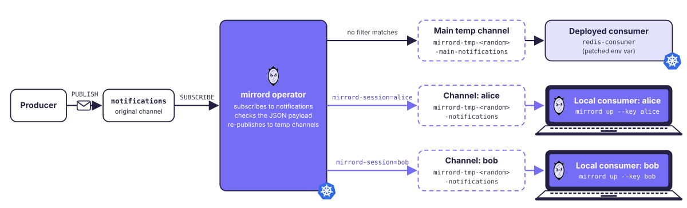

# How to Test Redis Pub/Sub Consumers in Kubernetes with Queue Splitting

A Redis Pub/Sub consumer in a shared staging cluster is hard to test. If you run a second copy of the consumer on your machine, it subscribes to the same channel as the deployed consumer. Redis sends every message to every subscriber, so both copies process all messages, and the messages of your teammates reach your local code too.

This tutorial shows how to use mirrord queue splitting with `mirrord up` to fix this. Your local consumer gets only the messages whose JSON payload contains your session key. The deployed consumer gets all the other messages. You do not change the consumer code: there is no SDK, no client wrapper, and no filter logic in the application. The mirrord operator does the split outside the application.

You deploy a small sample app: one Redis server, one Python consumer, and the mirrord resources for queue splitting. All the code is in this page.

**Estimated time:** 20 minutes.

## How Redis Pub/Sub changes the isolation problem

Redis Pub/Sub is different from a work queue in two ways that matter here:

1. **Every subscriber gets every message.** A work queue gives each message to one consumer. Redis Pub/Sub gives each message to all subscribers of the channel. A local copy of the consumer does not "compete" for messages. It gets duplicates of all of them.
2. **Redis does not keep messages.** If a channel has no subscriber when a message arrives, Redis drops the message. There is no backlog to read later.

Redis Pub/Sub messages also have no headers or attributes. Thus the only data that a filter can use is the message payload. The payload must be valid JSON for the filter to match it.

mirrord queue splitting puts the mirrord operator between the original channel and the consumers. The operator subscribes to the original channel and publishes each message again to one temporary channel. The deployed consumer reads one temporary channel, and each mirrord session reads its own temporary channel.

## What you will deploy

| Component | Kind | Purpose |
| --- | --- | --- |
| `redis` | Deployment and Service | A single Redis server for the demo (no persistence, no password). |
| `consumer-code` | ConfigMap | The Python consumer script. |
| `redis-consumer` | Deployment | The deployed consumer. It subscribes to the channel in `REDIS_CHANNEL`. |
| `redis-config` | `MirrordPropertyList` | The Redis connection that the operator uses. |
| `redis-consumer-split` | `MirrordSplitConfig` | Tells the operator which workload and which channel to split. |

All resources go in the namespace `redis-demo`. The channel name is `notifications`. Each test message is a JSON object, for example `{"user": "alice", "order_id": 1, "baggage": "mirrord-session=alice"}`. The `baggage` field holds the session key. `mirrord up` makes a filter that matches this value.

## Prerequisites

Make sure that you have these items before you start:

* A Kubernetes cluster, version `1.30` or later. Queue splitting needs this version.
* `kubectl`, configured for the cluster.
* Helm, to install or upgrade the mirrord operator.
* The mirrord CLI, version `3.243.0` or later. From this version, `mirrord up` tells the operator to skip the queue types that it does not split.
* The mirrord operator, version `3.183.0` or later, with a mirrord Team or Enterprise license. Queue splitting with `mirrord up` needs this version. Queue splitting is not available in the free tier. `SSUBSCRIBE` (sharded channels, `appConfig.shardChannel`) needs operator `3.234.0` or later.
* Python 3 on your machine, with the `redis` package version `5.0.8`.

Create a virtual environment in your working directory and install `redis` in it:

```bash
python3 -m venv .venv
source .venv/bin/activate
pip install redis==5.0.8
```


Use a staging or development cluster. Do not use a production cluster for this tutorial.


### Enable Redis Pub/Sub splitting in the operator

Redis Pub/Sub splitting is off by default. Set the Helm value `operator.redisPubsubSplitting` to `true`.

If you install the operator for the first time, add this value to your `values.yaml`:

```yaml
operator:
  redisPubsubSplitting: true
```

Then install the chart:

```bash
helm repo add metalbear https://metalbear-co.github.io/charts
helm install -f values.yaml mirrord-operator metalbear/mirrord-operator
```

For the operator license and the cloud API key, follow the [operator installation guide](../../getting-started/install-the-operator.md).

If the operator is already installed, upgrade it and keep your other values:

```bash
helm upgrade mirrord-operator metalbear/mirrord-operator \
  --reuse-values \
  --set operator.redisPubsubSplitting=true
```

Make sure that the `MirrordSplitConfig` resource type exists:

```bash
kubectl get crd mirrordsplitconfigs.queues.mirrord.metalbear.co
```

## Deploy the demo

### Step 1: Write the consumer

Save this script as `consumer.py`. You use the same file in the cluster and on your machine.

```python
import json
import os
import sys

import redis

# The label shows which copy printed a line: "deployed" or a name you give.
label = sys.argv[1] if len(sys.argv) > 1 else "deployed"

# The operator changes REDIS_CHANNEL to a temporary channel during a split.
redis_url = os.environ["REDIS_URL"]
channel = os.environ["REDIS_CHANNEL"]

client = redis.Redis.from_url(redis_url)
pubsub = client.pubsub(ignore_subscribe_messages=True)
pubsub.subscribe(channel)
print(f"[{label}] subscribed to channel={channel}", flush=True)

for message in pubsub.listen():
    payload = message["data"].decode("utf-8", errors="replace")
    try:
        user = json.loads(payload).get("user", "<no user field>")
    except (ValueError, AttributeError):
        user = "<not a JSON object>"
    print(f"[{label}] user={user} payload={payload}", flush=True)
```

The consumer reads the channel name from the `REDIS_CHANNEL` environment variable. This is the only requirement that queue splitting puts on the application. The operator must be able to change the channel name, so the name must come from an environment variable, a mounted config file, or an injected file.

### Step 2: Create the manifests

Save these manifests as `redis-demo.yaml`:

```yaml
apiVersion: v1
kind: Namespace
metadata:
  name: redis-demo
---
apiVersion: apps/v1
kind: Deployment
metadata:
  name: redis
  namespace: redis-demo
spec:
  replicas: 1
  selector:
    matchLabels:
      app: redis
  template:
    metadata:
      labels:
        app: redis
    spec:
      containers:
        - name: redis
          image: redis:7-alpine
          args: ["--save", "", "--appendonly", "no"]
          ports:
            - containerPort: 6379
---
apiVersion: v1
kind: Service
metadata:
  name: redis
  namespace: redis-demo
spec:
  selector:
    app: redis
  ports:
    - port: 6379
      targetPort: 6379
---
apiVersion: apps/v1
kind: Deployment
metadata:
  name: redis-consumer
  namespace: redis-demo
spec:
  replicas: 1
  selector:
    matchLabels:
      app: redis-consumer
  template:
    metadata:
      labels:
        app: redis-consumer
    spec:
      # The consumer does not handle SIGTERM. A short grace period stops an old pod quickly.
      terminationGracePeriodSeconds: 1
      containers:
        - name: consumer
          image: python:3.12-slim
          command: ["sh", "-c"]
          args:
            - pip install --quiet --root-user-action=ignore --disable-pip-version-check redis==5.0.8 && python -u /app/consumer.py
          env:
            - name: REDIS_URL
              value: redis://redis.redis-demo.svc.cluster.local:6379
            - name: REDIS_CHANNEL
              value: notifications
          # The pod becomes ready when a client subscribes to the channel in REDIS_CHANNEL.
          startupProbe:
            exec:
              command:
                - python
                - -c
                - import os, redis; c = redis.Redis.from_url(os.environ["REDIS_URL"]); exit(0 if c.pubsub_numsub(os.environ["REDIS_CHANNEL"])[0][1] > 0 else 1)
            periodSeconds: 2
            timeoutSeconds: 10
            failureThreshold: 90
          volumeMounts:
            - name: code
              mountPath: /app
      volumes:
        - name: code
          configMap:
            name: consumer-code
```

The consumer uses a public Python image and gets the script from a ConfigMap, so you do not build an image. The container installs the `redis` package when it starts, so the cluster must have network access to PyPI.

The startup probe asks Redis if a client subscribes to the channel. Thus `kubectl rollout status` and the mirrord operator wait until the consumer can get messages. Do not use a readiness probe for this check. If a readiness probe fails one time during a session, the operator stops the mirrord agent and your session ends. Without the probe, the pod is ready while `pip` runs, and Redis drops the first messages. The short `terminationGracePeriodSeconds` stops the old pod quickly when the operator starts a new pod. Without it, the old pod reads the original channel for 30 more seconds and prints duplicate messages.


The `REDIS_CHANNEL` value is in the pod template with `value`. The operator can read environment variables that are set with `value`, with `valueFrom` from a ConfigMap, or with `envFrom` from a ConfigMap.


### Step 3: Create the mirrord resources

Save these resources as `mirrord-split.yaml`:

```yaml
apiVersion: mirrord.metalbear.co/v1
kind: MirrordPropertyList
metadata:
  name: redis-config
  namespace: redis-demo
spec:
  properties:
    - name: url
      value: redis://redis.redis-demo.svc.cluster.local:6379
---
apiVersion: queues.mirrord.metalbear.co/v1
kind: MirrordSplitConfig
metadata:
  name: redis-consumer-split
  namespace: redis-demo
spec:
  targetRef:
    apiVersion: apps/v1
    kind: Deployment
    name: redis-consumer
  clientConfigs:
    redisPubSub: redis-config
  queues:
    - id: notifications
      kind: redisPubSub
      appConfig:
        channel:
          - env: REDIS_CHANNEL
```

These resources tell the operator four things:

1. The operator connects to Redis with the URL in the `redis-config` property list.
2. The split applies to the Deployment `redis-consumer`.
3. The consumer subscribes with `SUBSCRIBE` to the channel in `REDIS_CHANNEL`.
4. A custom filter in a mirrord config refers to this channel with the queue ID `notifications`.

### Step 4: Apply everything

```bash
kubectl apply -f redis-demo.yaml
kubectl -n redis-demo create configmap consumer-code --from-file=consumer.py
kubectl apply -f mirrord-split.yaml
kubectl -n redis-demo rollout status deployment/redis
kubectl -n redis-demo rollout status deployment/redis-consumer
```

If the consumer pod starts before the ConfigMap exists, Kubernetes waits for the ConfigMap and then starts the pod.

## Confirm the baseline

Before you start a mirrord session, make sure that the deployed consumer gets all messages.

In a terminal, follow the logs of the deployed consumer:

```bash
kubectl -n redis-demo logs deployment/redis-consumer -f
```

You see this line:

```
[deployed] subscribed to channel=notifications
```

In a second terminal, define a small shell function that publishes a message through the Redis pod:

```bash
send() {
  kubectl -n redis-demo exec deployment/redis -- redis-cli PUBLISH notifications "$1"
}
```

Send three messages:

```bash
send '{"user": "alice", "order_id": 1, "baggage": "mirrord-session=alice"}'
send '{"user": "bob", "order_id": 2, "baggage": "mirrord-session=bob"}'
send '{"user": "carol", "order_id": 3}'
```

`redis-cli` prints the number of subscribers that got each message. The deployed consumer prints all three messages:

```
[deployed] user=alice payload={"user": "alice", "order_id": 1, "baggage": "mirrord-session=alice"}
[deployed] user=bob payload={"user": "bob", "order_id": 2, "baggage": "mirrord-session=bob"}
[deployed] user=carol payload={"user": "carol", "order_id": 3}
```

## Create sessions and test

### Step 1: Write the mirrord config

On your machine, save this file as `mirrord-up.yaml`, in the same directory as `consumer.py`:

```yaml
common:
  operator: true
services:
  redis-consumer:
    target:
      path: deployment/redis-consumer/container/consumer
      namespace: redis-demo
    run:
      command: ["python3", "consumer.py", "local-{{ key }}"]
```

The config has these parts:

* `services.redis-consumer` is one service. `mirrord up` runs `run.command` for it.
* `target` is the deployed consumer container.
* `{{ key }}` is the session key. The consumer prints `local-<key>` in front of each line.

The config has no queue configuration. `mirrord up` splits the channels of the target automatically. Your local consumer gets only the messages with a string value in the JSON payload that contains `mirrord-session=<key>`.

### Step 2: Start the local consumer

Start the local consumer with `mirrord up` and the session key `alice`:

```bash
mirrord up --key alice
```

mirrord starts a queue splitting session. First, the operator replaces the `redis-consumer` pod with a new pod. In the new pod, `REDIS_CHANNEL` is a temporary "main" channel. The operator does not change the Deployment, so `kubectl rollout status` does not show this restart. mirrord waits until the new pod is ready. Then your local process starts.

The local consumer gets the environment of the deployed pod. The operator sets `REDIS_CHANNEL` to a temporary channel for your session. The local consumer prints a line similar to this one. `mirrord up` puts the service name in front of each line of the consumer:

```
redis-consumer: [local-alice] subscribed to channel=mirrord-tmp-<random>-notifications
```

In the second terminal, make sure that only one consumer pod runs:

```bash
kubectl -n redis-demo get pods -l app=redis-consumer
```

```
NAME                             READY   STATUS    RESTARTS   AGE
redis-consumer-<random>          1/1     Running   0          30s
```


Redis drops a message when the channel has no subscriber. Wait until the local consumer prints its `subscribed` line and only one consumer pod runs. Then send test messages. If you send messages before that time, some of them can be lost or can go to the old pod.


Follow the logs of the new deployed pod again:

```bash
kubectl -n redis-demo logs deployment/redis-consumer -f
```

The deployed consumer now reads the main temporary channel:

```
[deployed] subscribed to channel=mirrord-tmp-<random>-main-notifications
```

### Step 3: Send messages with and without the session key

Send the same three messages again:

```bash
send '{"user": "alice", "order_id": 4, "baggage": "mirrord-session=alice"}'
send '{"user": "bob", "order_id": 5, "baggage": "mirrord-session=bob"}'
send '{"user": "carol", "order_id": 6}'
```

The local consumer prints only the message for `alice`:

```
redis-consumer: [local-alice] user=alice payload={"user":"alice","order_id":4,"baggage":"mirrord-session=alice","mirrord-key":"alice"}
```

The operator adds a `mirrord-key` field with your session key to the payload. The operator also writes the JSON again without spaces.

The deployed consumer prints the other two messages:

```
[deployed] user=bob payload={"user": "bob", "order_id": 5, "baggage": "mirrord-session=bob"}
[deployed] user=carol payload={"user": "carol", "order_id": 6}
```

The default mode of `mirrord up` is `split`, so the `alice` message does not reach the deployed consumer. Send a message that is not JSON:

```bash
send 'plain text'
```

The filter cannot match a payload that is not JSON. The message goes to the deployed consumer:

```
[deployed] user=<not a JSON object> payload=plain text
```


The Helm value `operator.injectSessionKeyHeader` controls the `mirrord-key` field. The default is `true`. If you set it to `false`, the operator does not add the field. The message that the deployed consumer gets does not change.


### Step 4: Add a second developer

Redis Pub/Sub splitting supports more than one session on the same channel. Each session gets its own temporary channel, and the operator adds its filter to the list of filters that it checks.

Keep the `alice` session open. Open a new terminal in the same directory. Activate the virtual environment and start a second local consumer with the same `mirrord-up.yaml` and the key `bob`:

```bash
source .venv/bin/activate
mirrord up --key bob
```

Wait for the `[local-bob] subscribed` line. Then send three messages:

```bash
send '{"user": "alice", "order_id": 7, "baggage": "mirrord-session=alice"}'
send '{"user": "bob", "order_id": 8, "baggage": "mirrord-session=bob"}'
send '{"user": "carol", "order_id": 9}'
```

Each copy prints one message:

```
redis-consumer: [local-alice] user=alice payload={"user":"alice","order_id":7,"baggage":"mirrord-session=alice","mirrord-key":"alice"}
redis-consumer: [local-bob] user=bob payload={"user":"bob","order_id":8,"baggage":"mirrord-session=bob","mirrord-key":"bob"}
[deployed] user=carol payload={"user": "carol", "order_id": 9}
```

The second session does not restart the deployed consumer. Only the first session does.


Make sure that the filters of two sessions do not match the same messages. Use a different session key for each developer, and do not use a key that is the start of a different key, for example `ali` and `alice`. If two filters match one message, the operator gives the message to only one of the two sessions, and you cannot know which one.


### Step 5: Stop the sessions

Stop the `bob` session with `Ctrl+C`. The `alice` session continues. The operator removes the `bob` filter when the session expires, about 30 seconds later. Then messages for `bob` go to the deployed consumer again. Before that time, the operator sends `bob` messages to the old `bob` channel, and Redis drops them.

Stop the `alice` session with `Ctrl+C`. This is the last session on the target. The operator replaces the consumer pod with a pod that reads `notifications` again. This can take some minutes. Check the phase of the split:

```bash
kubectl -n redis-demo get mirrordsplitconfig redis-consumer-split
```

The phase goes from `active` to `draining` to `inactive`. When the phase is `inactive`, read the logs of the new pod:

```bash
kubectl -n redis-demo logs deployment/redis-consumer
```

The deployed consumer subscribes to the original channel again:

```
[deployed] subscribed to channel=notifications
```

Redis does not keep messages, so there are no buffered messages to move. A message that the operator publishes to a session channel after the local consumer stops is lost. After the last session ends, the operator removes the split resources. To keep the split for a short time so that a new session can use it again, set `spec.ttl` in seconds on the `MirrordSplitConfig`.

## How it works

When the first session starts, the operator creates a temporary main channel for the deployed workload. It replaces the pods of the workload with pods whose channel environment variable is that channel. The operator then subscribes to the original channel with the same command as the application (`SUBSCRIBE`, `PSUBSCRIBE`, or `SSUBSCRIBE`). For each message, the operator checks the session filters. A message that matches a filter goes to the temporary channel of that session. All other messages go to the main channel. Redis creates channels when a message is published, so there are no Redis objects to delete after the sessions end.



## Behavior and tradeoffs

* **The filter sees only the JSON payload.** Redis Pub/Sub messages have no headers or attributes. The filter of `mirrord up` is a `jq_filter` that matches a message when a string value anywhere in the parsed JSON payload contains `mirrord-session=<key>`. The field name does not matter. A payload that is not valid JSON never matches, and goes to the deployed consumer.
* **Custom filters.** In a `config_patch`, `message_filter` matches regexes against top-level string, number, and boolean fields, and all entries must match. `jq_filter` runs a jq program against the parsed JSON payload. If you set `message_filter` and `jq_filter` together, a message must match both.
* **Split or mirror.** In the default `split` mode of `mirrord up`, a message that matches goes only to your local consumer. With `mirrord up --mode mirror` (CLI `3.258.0` or later), the message also goes to the deployed consumer, so both process a copy.
* **Filters that overlap.** If the filters of two sessions match the same message, only one session gets it, and you cannot know which one. A key that is the start of a different key, for example `ali` and `alice`, matches the messages of both keys.
* **No buffer.** Redis Pub/Sub does not store messages. A message published when the target channel has no subscriber is lost. This applies while the operator replaces the deployed consumer pod, before your local consumer subscribes, and until the operator removes the filter of a session that stopped.
* **Extra hop.** Each message goes through the operator before it reaches a consumer. This adds a small delay. The operator forwards one message at a time, in the order that it receives them.
* **The workload restarts.** The operator replaces the pods of the target when the first session starts and when the last session ends. It does not change the pod template, so `kubectl rollout status` does not show these restarts.
* **Supported subscribe types.** The operator supports exact channels (`SUBSCRIBE`), glob patterns (`PSUBSCRIBE`), and sharded channels (`SSUBSCRIBE`, Redis 7 and later). `SSUBSCRIBE` needs operator `3.234.0` or later.
* **Supported workloads.** The `MirrordSplitConfig` target can be a `Deployment`, a `StatefulSet`, or a `Rollout`.

## Adapt this to your stack

To use queue splitting on a real service, change these items. The consumer code does not change.

1. **Target.** Set `spec.targetRef` in the `MirrordSplitConfig` to your workload, and set `target` in `mirrord-up.yaml` to the same workload and container.
2. **Channel source.** Set `appConfig` to the way your application subscribes:
   * `channel` for an exact channel (`SUBSCRIBE`).
   * `channelPattern` for a glob pattern (`PSUBSCRIBE`).
   * `shardChannel` for a sharded channel (`SSUBSCRIBE`). This needs operator `3.234.0` or later.

   Each one takes an `env` reference, or another source such as a mounted config file. See the [reference page](../../sharing-the-cluster/queue-splitting/redis-pubsub.md).
3. **Redis connection.** Put your connection in the `MirrordPropertyList`. Use `url`, or use `host` with `port`, `password`, `tls`, and `db`. To share one property list between namespaces, create it in the operator namespace (operator `3.191.0` or later).
4. **Session key in the payload.** Make your producers put `mirrord-session=<key>` in a string field of the JSON payload, for example `baggage`.
5. **Custom filter.** To use your own filter instead of the session key, set `feature.split_queues` in the `config_patch` of the service. A `config_patch` that sets `split_queues` replaces all the queue splits that `mirrord up` makes for that service. This example uses `jq_filter` on a nested field:

   ```yaml
   common:
     operator: true
   services:
     redis-consumer:
       target:
         path: deployment/redis-consumer/container/consumer
         namespace: redis-demo
       run:
         command: ["python3", "consumer.py", "local-{{ key }}"]
       config_patch:
         feature:
           split_queues:
             notifications:
               queue_type: RedisPubSub
               jq_filter: '.user == "{{ key }}" and .order.total > 100'
   ```

   `config_patch` needs mirrord CLI `3.251.0` or later.
6. **CRD names.** Use your own names for the `MirrordSplitConfig`, the property list, and the queue ID. The queue ID in a `config_patch` must be the same as the `id` in the `MirrordSplitConfig`.

## Cleanup

Stop all mirrord sessions first. Then delete the demo:

```bash
kubectl delete -f mirrord-split.yaml
kubectl delete namespace redis-demo
```

Delete the local virtual environment:

```bash
rm -rf .venv
```

To turn off Redis Pub/Sub splitting in the operator, upgrade the chart again:

```bash
helm upgrade mirrord-operator metalbear/mirrord-operator \
  --reuse-values \
  --set operator.redisPubsubSplitting=false
```

## Frequently asked questions

### Can I filter Redis Pub/Sub messages by header?

No. Redis Pub/Sub messages have no headers or attributes. mirrord filters on the JSON payload. Put `mirrord-session=<key>` in a string field of the payload. For a custom filter, use `message_filter` or `jq_filter` in a `config_patch`.

### Do I need to change my Redis consumer code to use mirrord queue splitting?

No. The operator changes the channel name in the environment of the deployed consumer and of your local process. The consumer must read the channel name from an environment variable, a mounted config file, or an injected file. It does not need an SDK or filter logic.

### What happens to messages that do not match any filter?

The operator publishes them to the main temporary channel, and the deployed consumer gets them. A payload that is not valid JSON never matches a filter, so it also goes to the deployed consumer.

### Can two developers test the same Redis channel at the same time?

Yes. Each session gets its own temporary channel and its own filter. Use a different session key for each developer. If two filters match one message, only one session gets it, and you cannot know which one.

### Does queue splitting work with PSUBSCRIBE and sharded channels?

Yes. Use `channelPattern` in the `MirrordSplitConfig` for `PSUBSCRIBE`, and `shardChannel` for `SSUBSCRIBE` on Redis 7 and later. `SSUBSCRIBE` needs operator `3.234.0` or later. Use `channel` for a plain `SUBSCRIBE`.

### Does this work with Redis Streams or BullMQ?

This page is about Redis Pub/Sub only. For BullMQ, see the [BullMQ queue splitting page](../../sharing-the-cluster/queue-splitting/bullmq.md).

## See also

* [Redis Pub/Sub queue splitting reference](../../sharing-the-cluster/queue-splitting/redis-pubsub.md)
* [Queue splitting overview](../../sharing-the-cluster/queue-splitting.md)
* [Setting a filter for a mirrord run](../../sharing-the-cluster/queue-splitting.md#setting-a-filter-for-a-mirrord-run)
* [Migrating to MirrordSplitConfig](../../sharing-the-cluster/queue-splitting/migrating-to-mirrordsplitconfig.md)
