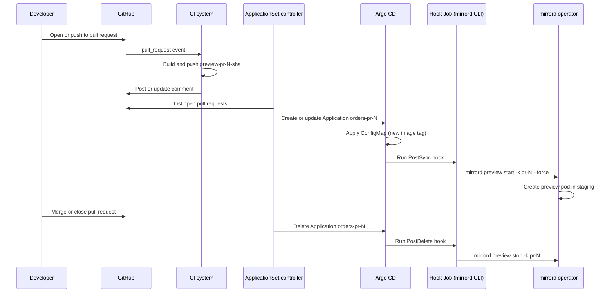

# Argo CD

Argo CD is a continuous delivery tool. It does not build code or run tests, but it often manages the staging cluster that your tests and previews use. This guide shows two flows:

1. **Test each pull request against a staging cluster that Argo CD manages.** Your CI system runs `mirrord ci start`. This guide tells you what mirrord changes in the cluster, and which Argo CD settings keep Argo CD from a fight with the operator.
2. **A preview environment for each pull request.** An ApplicationSet with the pull request generator makes one Argo CD Application for each pull request. Hook Jobs in that Application run `mirrord preview start` and `mirrord preview stop`.

Each flow takes about 30 minutes to set up if the mirrord operator is already in the cluster.

## Prerequisites

* **mirrord CLI 3.181.0 or later** for `mirrord ci`. **CLI 3.189.0 or later** for `mirrord preview`.
* **mirrord operator 3.142.0 or later** with `operator.previewEnv: true` in the Helm values, for preview environments.
* **An Enterprise plan** for preview environments and for the CI API key.
* **Argo CD 2.10 or later** for the `PostDelete` hook that stops the preview.
* The setup in this guide needs the operator. Flow 1 can also run with mirrord OSS: the CLI then starts the agent Job itself and needs no API key. The CI identity then needs permissions to create Jobs and to port-forward to pods in the target namespace, which this guide does not give. Queue splitting, `copy_target`, and preview environments need the operator.

## Cluster access

Each flow needs a Kubernetes identity bound to the `mirrord-operator-ci` ClusterRole. The operator Helm chart creates this role for machine sessions such as `mirrord ci` and `mirrord preview`.

Create the namespace, the ServiceAccount, the bindings, and a token Secret. Do not put these objects in the chart of a per-PR Application, because a `PostDelete` hook runs after Argo CD deletes the resources of its Application. This guide uses the namespace `mirrord-previews`. The target `deployment/orders` is in the namespace `staging`.

```yaml
apiVersion: v1
kind: Namespace
metadata:
  name: mirrord-previews
---
apiVersion: v1
kind: ServiceAccount
metadata:
  name: mirrord-ci
  namespace: mirrord-previews
---
apiVersion: rbac.authorization.k8s.io/v1
kind: ClusterRoleBinding
metadata:
  name: mirrord-ci
subjects:
  - kind: ServiceAccount
    name: mirrord-ci
    namespace: mirrord-previews
roleRef:
  kind: ClusterRole
  name: mirrord-operator-ci
  apiGroup: rbac.authorization.k8s.io
---
# Lets the CLI read the target in the staging namespace.
apiVersion: rbac.authorization.k8s.io/v1
kind: Role
metadata:
  name: mirrord-ci-target
  namespace: staging
rules:
  - apiGroups: ["apps"]
    resources: ["deployments"]
    verbs: ["get"]
  - apiGroups: [""]
    resources: ["pods"]
    verbs: ["list"]
---
apiVersion: rbac.authorization.k8s.io/v1
kind: RoleBinding
metadata:
  name: mirrord-ci-target
  namespace: staging
subjects:
  - kind: ServiceAccount
    name: mirrord-ci
    namespace: mirrord-previews
roleRef:
  kind: Role
  name: mirrord-ci-target
  apiGroup: rbac.authorization.k8s.io
---
# A long-lived token. Only the CI system outside the cluster (flow 1) needs it.
apiVersion: v1
kind: Secret
metadata:
  name: mirrord-ci-token
  namespace: mirrord-previews
  annotations:
    kubernetes.io/service-account.name: mirrord-ci
type: kubernetes.io/service-account-token
```

The `mirrord-operator-ci` role does not give access to deployments or pods, and the CLI reads the target with its own identity. Without the `mirrord-ci-target` Role, `mirrord ci start` fails with `deployments.apps "orders" is forbidden` or `cannot list resource "pods"`, and `mirrord preview start` fails with `does not have the permissions required for targeting deployment/orders`. `mirrord preview stop` needs only `mirrord-operator-ci`. If your target is a different kind, such as a rollout or a statefulset, change the first rule to match it.

You can keep these objects in Git and let Argo CD sync them with your platform Application.

**Hook Jobs in the cluster (flow 2)** use the ServiceAccount directly. The mirrord CLI finds no kubeconfig and then uses the in-cluster configuration, so the Job needs no kubeconfig file.

**A CI runner outside the cluster (flow 1)** needs a kubeconfig. Build it from the token:

```bash
SERVER=$(kubectl config view --minify -o jsonpath='{.clusters[0].cluster.server}')
CA=$(kubectl -n mirrord-previews get secret mirrord-ci-token -o jsonpath='{.data.ca\.crt}')
TOKEN=$(kubectl -n mirrord-previews get secret mirrord-ci-token -o jsonpath='{.data.token}' | base64 -d)

cat > mirrord-ci.kubeconfig <<EOF
apiVersion: v1
kind: Config
clusters:
- name: staging
  cluster:
    server: ${SERVER}
    certificate-authority-data: ${CA}
users:
- name: mirrord-ci
  user:
    token: ${TOKEN}
contexts:
- name: mirrord-ci
  context:
    cluster: staging
    user: mirrord-ci
current-context: mirrord-ci
EOF
```

### What the CI identity can do

The CI identity cannot change staging. It has `mirrord-operator-ci`, `get` on the target deployment, and `list` on pods in `staging`. It can start CI and preview sessions, which steal only the requests with their header. It cannot edit or delete workloads.

A session can read the environment and files of the target, and a preview runs the pull request image with the environment of the target. Thus a CI job from a branch of the repository has the same access as a developer with staging access. This is the intended use.

Do not give the credentials to code from outside the repository. GitHub does not pass secrets to workflows of pull requests from forks. Keep this default: use the `pull_request` trigger, not `pull_request_target`. The CI job of flow 1 also skips pull requests from forks. See [Using secrets in GitHub Actions](https://docs.github.com/en/actions/security-for-github-actions/security-guides/using-secrets-in-github-actions#using-secrets-in-a-workflow).

Store the kubeconfig as a secret in your CI system, not in Argo CD. In GitHub Actions, open **Settings > Secrets and variables > Actions > New repository secret**. Or use the GitHub CLI:

```bash
base64 < mirrord-ci.kubeconfig | tr -d '\n' | gh secret set KUBECONFIG_DATA
```

### The CI API key

With an operator on the Enterprise plan, `mirrord ci` needs a CI API key. The key needs an Enterprise plan. On the Free and Team plans, operator 3.224.0 or later and CLI 3.272.0 or later do not need the key, and `mirrord ci` uses the identity of the kubeconfig. Sessions that use the key are machine sessions: they take no seats, and they count toward the concurrent machine sessions of your plan.

```bash
mirrord ci api-key
```

Run the command in a terminal. If stderr is not a terminal, for example in a script or with a redirect, the command creates a key but prints nothing and exits with code 0. Then set `MIRRORD_PROGRESS_MODE=simple`, which prints the key to stdout:

```bash
MIRRORD_PROGRESS_MODE=simple mirrord ci api-key
```

Save the output as the secret `MIRRORD_CI_API_KEY` in your CI system:

```bash
gh secret set MIRRORD_CI_API_KEY
```

The hook Jobs of flow 2 do not need this key. `mirrord preview` does not read `MIRRORD_CI_API_KEY`, and authenticates as the `mirrord-ci` ServiceAccount.

### The mirrord CLI

* **In a CI job**, install the CLI with the install script of a release tag, and set `VERSION` to the same release. To check the download against the checksum of the release, also set `MIRRORD_VERIFY=1`, which needs `unzip`.

  ```bash
  curl -fsSL https://raw.githubusercontent.com/metalbear-co/mirrord/3.288.0/scripts/install.sh | VERSION=3.288.0 bash
  ```

* **In a hook Job**, use the CLI image that each mirrord release publishes: `ghcr.io/metalbear-co/mirrord-cli:<version>`, for example `ghcr.io/metalbear-co/mirrord-cli:3.288.0`. The image is a Debian image with `mirrord` on the `PATH`. Do not use the `latest` tag, because the CLI and operator versions must stay compatible.

## Flow 1: mirrord on a staging cluster that Argo CD manages

In this flow, the CI system starts the changed service on the runner with `mirrord ci start`. The service takes the test requests that carry its header. The `orders` Deployment in staging keeps all other traffic.

### The mirrord configuration

Commit this file as `.mirrord/mirrord-ci.json`:

```json
{
  "target": {
    "path": "deployment/orders",
    "namespace": "staging"
  },
  "feature": {
    "network": {
      "incoming": {
        "mode": "steal",
        "http_filter": {
          "header_filter": "^x-mirrord-ci: {{ key }}$"
        }
      }
    }
  }
}
```

mirrord replaces `{{ key }}` with the key that you give to `mirrord ci start -k`. Each pipeline run uses a different key, so two runs do not take each other's requests.

### The CI job

This example uses GitHub Actions. The steps are the same in any CI system. For a full guide to one CI system, see [GitLab CI](gitlab-ci.md) or [Jenkins](jenkins.md).

```yaml
name: mirrord staging tests
on:
  pull_request:
    types: [opened, synchronize, reopened]

concurrency:
  group: mirrord-ci-${{ github.event.pull_request.number }}
  cancel-in-progress: true

jobs:
  test:
    # Workflows of pull requests from forks get no secrets.
    if: github.event.pull_request.head.repo.full_name == github.repository
    runs-on: ubuntu-latest
    env:
      MIRRORD_CI_API_KEY: ${{ secrets.MIRRORD_CI_API_KEY }}
      CI_KEY: ci-${{ github.event.pull_request.number }}-${{ github.run_id }}
    steps:
      - uses: actions/checkout@v4

      - name: Configure cluster access
        env:
          KUBECONFIG_DATA: ${{ secrets.KUBECONFIG_DATA }}
        run: |
          echo "$KUBECONFIG_DATA" | base64 -d > "$RUNNER_TEMP/kubeconfig"
          echo "KUBECONFIG=$RUNNER_TEMP/kubeconfig" >> "$GITHUB_ENV"

      - name: Install mirrord
        run: curl -fsSL https://raw.githubusercontent.com/metalbear-co/mirrord/3.288.0/scripts/install.sh | VERSION=3.288.0 bash

      - name: Start the service with mirrord
        run: |
          npm ci
          mirrord ci start -f .mirrord/mirrord-ci.json -k "$CI_KEY" node server.js
          # Wait until the local service listens on its port (8080 in this example).
          for i in $(seq 1 60); do
            curl -fs http://localhost:8080/healthz > /dev/null 2>&1 && break
            sleep 2
          done
          # Fail here if the service did not start.
          curl -fsS http://localhost:8080/healthz > /dev/null

      - name: Run the tests against staging
        env:
          BASE_URL: https://orders.staging.example.com
          TEST_HEADER: "x-mirrord-ci: ${{ env.CI_KEY }}"
        run: ./scripts/test.sh

      - name: Stop mirrord
        if: always()
        run: mirrord ci stop
```

`mirrord ci start` returns before the service listens. Until the service listens, the deployed `orders` answers the requests with the header. The loop waits until the service answers on the runner, and the last `curl` fails the job if the service did not start. Use the port and the health path of your service.

The tests send their requests to the staging address of `orders`, for example the staging Ingress. Each request must carry the header. In `scripts/test.sh`, add the header to every call:

```bash
curl -fsS -H "$TEST_HEADER" "$BASE_URL/orders/42"
```

The Ingress and any proxy in front of `orders` must forward the `x-mirrord-ci` header. If one service calls another, propagate the header. See [Header Propagation](../../sharing-the-cluster/header-propagation.md).

### What mirrord changes in the cluster

Argo CD compares the resources in Git with the live resources. It reverts only the fields that Git sets. The table shows what mirrord changes, and whether Argo CD reverts it.

| mirrord feature | What changes in the cluster | Effect on Argo CD |
|-----------------|-----------------------------|-------------------|
| Steal or mirror (flow 1) | The operator starts an agent pod with the label `app: mirrord` in the operator namespace, or an ephemeral container in the target pod. | None. The Deployment does not change. Argo CD does not compare pods with Git. |
| Preview environments (flow 2) | The operator creates a Deployment and a headless Service. Their only labels are operator labels, and their owner is the `PreviewSession` resource. | None. Argo CD does not track these objects. |
| Queue splitting (env and volume changes) | A mutating webhook changes new pods. To restart the old pods, the operator adds the pod template annotation `kube.kubernetes.io/restartedAt` to the Deployment or StatefulSet, or sets `spec.restartAt` on an Argo Rollout. | None in most cases. Git does not set this annotation, so the Application stays Synced and self-heal does not remove it. See the `ignoreDifferences` example below if Argo CD shows a difference. |
| `copy_target` with `scale_down` | The operator sets `spec.replicas` of the target to 0. | Conflict. With `selfHeal`, Argo CD sets the replicas back to the value in Git. |
| Queue splitting with KEDA | With `operator.manageKedaScaledObjects`, the operator changes the triggers of the `ScaledObject`. | Conflict, if Argo CD deploys the `ScaledObject`. |
| `copy_target` | The operator creates a pod with the labels and annotations of the target's pod template. The pod has no owner. | None with annotation tracking. Conflict with label tracking: Argo CD can prune the copy pod. See [Behavior and limits](#behavior-and-limits). |

### Let the operator pause Argo CD

For the two conflicts, set `operator.applicationPauseAutoSync` in the operator Helm values:

```yaml
operator:
  applicationPauseAutoSync: true
```

While a session scales a workload or changes a `ScaledObject`, the operator removes `syncPolicy.automated` from the Applications that deploy it. It also pauses each parent Application in an app-of-apps tree. When the session ends, the operator puts back the `syncPolicy.automated` that it saved. The chart then grants the operator `get`, `list`, and `patch` on `applications.argoproj.io`.


If the operator runs with `namespaced: true`, add the Argo CD namespace to `allowedNamespaces`. Otherwise the operator cannot find the Applications.


While an Application is paused, Argo CD does not sync it. Changes in Git for that Application wait until the session ends.

If an ApplicationSet generates the staging Application, the ApplicationSet controller puts `syncPolicy` back to the value in its template. Tell the controller to ignore that field:

```yaml
apiVersion: argoproj.io/v1alpha1
kind: ApplicationSet
metadata:
  name: staging
  namespace: argocd
spec:
  ignoreApplicationDifferences:
    - jsonPointers:
        - /spec/syncPolicy
  # generators and template as before
```

### ignoreDifferences, only for a real difference

Do not add `ignoreDifferences` by default. Add a rule only when Argo CD shows the field as OutOfSync.

* **Replicas, if you do not use `applicationPauseAutoSync`.** Add the rule and the `RespectIgnoreDifferences=true` sync option, so a sync does not set the replicas back. Argo CD then also ignores replica changes in Git.
* **The restart annotation, if Argo CD shows it as a difference.**

```yaml
apiVersion: argoproj.io/v1alpha1
kind: Application
metadata:
  name: orders-staging
  namespace: argocd
spec:
  ignoreDifferences:
    - group: apps
      kind: Deployment
      name: orders
      namespace: staging
      jsonPointers:
        - /spec/replicas
        - /spec/template/metadata/annotations/kube.kubernetes.io~1restartedAt
  syncPolicy:
    automated:
      prune: true
      selfHeal: true
    syncOptions:
      - RespectIgnoreDifferences=true
```

## Flow 2: A preview environment for each pull request

In this flow, each pull request gets a preview pod in `staging`. The pod runs the image of the pull request, with the pod spec of `deployment/orders`. It takes only the requests that carry `baggage: mirrord-session=pr-<number>`.

The work is split between the two systems:

* **The CI system** builds and pushes the image, and posts the comment on the pull request.
* **Argo CD** runs `mirrord preview start` on each new commit, and `mirrord preview stop` when the pull request closes.

### Why hook Jobs

The operator copies the preview from the live target, so the Application of a pull request does not deploy the service itself. It deploys a ConfigMap and two hook Jobs:

* A `PostSync` hook Job runs `mirrord preview start`. A `PostSync` hook runs after Argo CD applies the ConfigMap, so the Job can mount it. A `Sync` hook runs at the same time as the apply, so the ConfigMap can be missing when its pod starts.
* A `PostDelete` hook Job runs `mirrord preview stop`. It runs after Argo CD deletes the resources of the Application.

The Jobs run as the `mirrord-ci` ServiceAccount, so they need no kubeconfig and no cluster-admin access. The ConfigMap holds the image tag. Each new commit changes the ConfigMap, which makes the Application OutOfSync, so automated sync runs the hook again. Argo CD does not compare hooks with Git, so a change to the hook alone does not start a sync.

### 1. Add the preview chart to the repository

Add a small Helm chart at `deploy/mirrord-preview/` in the application repository, and merge it to the default branch. The ApplicationSet uses the chart from that branch, so a pull request cannot change the Jobs that run as `mirrord-ci`.

`deploy/mirrord-preview/Chart.yaml`:

```yaml
apiVersion: v2
name: mirrord-preview
version: 0.1.0
```

`deploy/mirrord-preview/mirrord.json`:

```json
{
  "target": {
    "path": "deployment/orders",
    "namespace": "staging"
  },
  "feature": {
    "preview": {
      "ttl_mins": 1440,
      "creation_timeout_secs": 600
    },
    "network": {
      "incoming": {
        "mode": "steal",
        "http_filter": {
          "header_filter": "^baggage: (.*[,; ])?mirrord-session={{ key }}([,; ]|$)"
        }
      }
    }
  }
}
```

mirrord replaces `{{ key }}` with the key from `-k`. Do not write a fixed key in the filter, because all pull requests share this file. The filter matches the whole `mirrord-session` member of `baggage`, so the key `pr-1` does not match `pr-12`.

`deploy/mirrord-preview/templates/preview.yaml`:

```yaml
apiVersion: v1
kind: ConfigMap
metadata:
  name: mirrord-preview-{{ .Values.key }}
data:
  image: {{ .Values.image | quote }}
  mirrord.json: |
{{ .Files.Get "mirrord.json" | indent 4 }}
---
apiVersion: batch/v1
kind: Job
metadata:
  name: mirrord-preview-start-{{ .Values.key }}
  annotations:
    argocd.argoproj.io/hook: PostSync
    argocd.argoproj.io/hook-delete-policy: BeforeHookCreation
spec:
  backoffLimit: 2
  template:
    spec:
      serviceAccountName: mirrord-ci
      restartPolicy: Never
      containers:
        - name: mirrord
          image: ghcr.io/metalbear-co/mirrord-cli:3.288.0
          env:
            - name: MIRRORD_PROGRESS_MODE
              value: simple
          command: ["mirrord"]
          args:
            - preview
            - start
            - -f
            - /config/mirrord.json
            - -i
            - {{ .Values.image | quote }}
            - -k
            - {{ .Values.key | quote }}
            - --force
            - --timeout
            - "600"
          volumeMounts:
            - name: config
              mountPath: /config
      volumes:
        - name: config
          configMap:
            name: mirrord-preview-{{ .Values.key }}
---
apiVersion: batch/v1
kind: Job
metadata:
  name: mirrord-preview-stop-{{ .Values.key }}
  annotations:
    argocd.argoproj.io/hook: PostDelete
    argocd.argoproj.io/hook-delete-policy: HookSucceeded
spec:
  backoffLimit: 2
  template:
    spec:
      serviceAccountName: mirrord-ci
      restartPolicy: Never
      containers:
        - name: mirrord
          image: ghcr.io/metalbear-co/mirrord-cli:3.288.0
          env:
            - name: MIRRORD_PROGRESS_MODE
              value: simple
          command: ["sh", "-c"]
          args:
            - |
              STATUS=0
              OUT=$(mirrord preview stop -k {{ .Values.key | quote }} -n staging 2>&1) || STATUS=$?
              echo "$OUT"
              # Fail the Job, except when the preview is already gone.
              [ "$STATUS" -eq 0 ] || echo "$OUT" | grep -q "No preview sessions found"
```

`--force` replaces the preview of an earlier commit with the same key. In CLI 3.288.0 this is the default behavior and `--force` has no effect, but older CLIs need it. `MIRRORD_PROGRESS_MODE=simple` writes each step and the session name to the Job log. Without it, the CLI in a pod prints nothing when it succeeds. If the preview is already gone, `mirrord preview stop` fails with `No preview sessions found`, and the stop Job ignores only this error. If a `PostDelete` hook fails, the Application stays with a `DeletionError` condition.

### 2. Store the GitHub token for the generator

The pull request generator reads pull requests through the GitHub API. Create a token that can read the repository's pull requests, and store it in the Argo CD namespace:

```bash
kubectl -n argocd create secret generic github-token --from-literal=token=<token>
```

### 3. Create the ApplicationSet

```yaml
apiVersion: argoproj.io/v1alpha1
kind: ApplicationSet
metadata:
  name: orders-previews
  namespace: argocd
spec:
  goTemplate: true
  goTemplateOptions: ["missingkey=error"]
  generators:
    - pullRequest:
        github:
          owner: my-org
          repo: orders
          tokenRef:
            secretName: github-token
            key: token
          labels:
            - preview
        requeueAfterSeconds: 300
  template:
    metadata:
      name: 'orders-pr-{{.number}}'
      finalizers:
        - resources-finalizer.argocd.argoproj.io
    spec:
      project: default
      source:
        repoURL: https://github.com/my-org/orders.git
        targetRevision: main
        path: deploy/mirrord-preview
        helm:
          parameters:
            - name: key
              value: 'pr-{{.number}}'
            - name: image
              value: 'ghcr.io/my-org/orders:preview-pr-{{.number}}-{{.head_short_sha}}'
      destination:
        server: https://kubernetes.default.svc
        namespace: mirrord-previews
      syncPolicy:
        automated:
          prune: true
        retry:
          limit: 5
          backoff:
            duration: 30s
            factor: 2
            maxDuration: 5m
```

Some notes on the template:

* **The trigger.** The generator returns open pull requests with the `preview` label. Remove `labels` to give every pull request a preview.
* **Trust.** The preview pod runs the image of the pull request with the pod spec of `deployment/orders`, so it gets the ServiceAccount and secrets of that pod. See [What the CI identity can do](#what-the-ci-identity-can-do).
* **The chart revision.** `targetRevision: main` takes the chart and `mirrord.json` from the default branch. Only the image tag comes from the pull request. Without webhooks, the controller polls every `requeueAfterSeconds`. To react at once, configure the ApplicationSet webhook for the `opened`, `synchronize`, and `closed` events.
* **The key.** `pr-{{.number}}` stays the same for all commits of a pull request.
* **The image tag.** `{{.head_short_sha}}` has 8 characters. The CI system must push the same tag.
* **Retries.** Argo CD can create the Application before the CI system pushes the image. Then the preview pod gets `ErrImagePull`, and `mirrord preview start` fails in less than a minute. It does not wait for `--timeout`. When the start Job fails, `retry` runs the sync again with a longer delay each time, and each retry runs the `PostSync` hook Job again. A retry uses the revision and parameters of its first attempt, so a new commit waits until the retries of the earlier commit end.
* **Cleanup.** When the pull request closes or loses the label, the generator does not return it. The ApplicationSet controller deletes the Application, and the `PostDelete` hook stops the preview.
* **Concurrency.** Argo CD runs one sync operation at a time for each Application. The `BeforeHookCreation` policy deletes the start Job of the earlier commit before it creates the new one.
* **Other providers.** The pull request generator also supports GitLab, Gitea, Bitbucket Server, Bitbucket Cloud, and Azure DevOps. Replace the `github` block with the block for your provider, and change the token Secret and `repoURL` to match. The parameters that this template uses (`number` and `head_short_sha`) are the same for all providers. See the [pull request generator](https://argo-cd.readthedocs.io/en/stable/operator-manual/applicationset/Generators-Pull-Request/).

### 4. Build the image and comment on the pull request

The CI system builds the image with the tag that the ApplicationSet expects. In a `pull_request` workflow, `GITHUB_SHA` is the merge commit, so use the head commit of the pull request.

```yaml
name: mirrord preview image
on:
  pull_request:
    types: [opened, synchronize, reopened]

concurrency:
  group: mirrord-preview-${{ github.event.pull_request.number }}
  cancel-in-progress: true

permissions:
  contents: read
  packages: write
  pull-requests: write

jobs:
  image:
    runs-on: ubuntu-latest
    env:
      PR: ${{ github.event.pull_request.number }}
      HEAD_SHA: ${{ github.event.pull_request.head.sha }}
    # GITHUB_TOKEN cannot push packages for a pull request from a fork.
    if: github.event.pull_request.head.repo.full_name == github.repository
    steps:
      - uses: actions/checkout@v4
        with:
          ref: ${{ github.event.pull_request.head.sha }}

      - name: Build and push the image
        run: |
          TAG="preview-pr-${PR}-${HEAD_SHA::8}"
          echo "${{ secrets.GITHUB_TOKEN }}" | docker login ghcr.io -u "${{ github.actor }}" --password-stdin
          docker build -t "ghcr.io/my-org/orders:${TAG}" .
          docker push "ghcr.io/my-org/orders:${TAG}"

      - name: Post or update the preview comment
        env:
          GH_TOKEN: ${{ secrets.GITHUB_TOKEN }}
        run: |
          BODY=$(cat <<EOF
          ## mirrord Preview Environment

          | Field | Value |
          |-------|-------|
          | Key | \`pr-${PR}\` |
          | Header | \`baggage: mirrord-session=pr-${PR}\` |
          | Commit | \`${HEAD_SHA::8}\` |

          Send the header with the [mirrord Browser Extension](https://metalbear.com/mirrord/docs/using-mirrord/incoming-traffic/debug-from-browser), or with:
          \`curl -H "baggage: mirrord-session=pr-${PR}" https://orders.staging.example.com/\`
          EOF
          )
          # --paginate reads all pages of comments. Keep the first ID that it finds.
          IDS=$(gh api --paginate "repos/${{ github.repository }}/issues/${PR}/comments" \
            --jq '.[] | select(.body | startswith("## mirrord Preview Environment")) | .id')
          ID=${IDS%%$'\n'*}
          if [ -n "$ID" ]; then
            gh api -X PATCH "repos/${{ github.repository }}/issues/comments/${ID}" -f body="$BODY"
          else
            gh pr comment "$PR" --body "$BODY"
          fi
```

Push the preview image to the registry and repository that `deployment/orders` already pulls from. The preview pod uses the pull credentials of the target, and the operator sets `imagePullPolicy: Always` on the preview container. An image that is only on the node, and not in a registry, does not work. A new `ghcr.io` package that a workflow creates is private at first. Pull requests from forks get no image, so do not add the `preview` label to them.

## How it works

Argo CD keeps staging equal to Git. mirrord adds sessions next to the staging workloads and does not change the fields that Git sets, with two exceptions: `scale_down` and KEDA trigger changes. For these, the operator pauses automated sync and resumes it after the session. For previews, the pull request generator makes one Application for each pull request. Its `PostSync` hook asks the operator for a preview, and its `PostDelete` hook removes the preview.



## Behavior and limits

* **Auto-sync pauses.** With `applicationPauseAutoSync`, Git changes to a paused Application wait until the session ends. A long `scale_down` session in a shared staging cluster blocks deploys for that Application.
* **Label tracking.** A `copy_target` pod gets the labels of the target's pod template and has no owner. Argo CD 3.0 and later uses annotation tracking by default, and the copy pod has no tracking annotation. With label tracking, a copied `app.kubernetes.io/instance` label makes Argo CD treat the pod as part of the Application. With `prune: true`, automated sync then deletes the copy pod, and the session fails with `copied pod is being deleted`. Use annotation tracking, or remove that label from pod templates.
* **Preview readiness.** Preview pods never become `Ready`. This is intentional: a readiness gate that never passes keeps the target's Service from sending unfiltered traffic to them. This is not true for a Service with `publishNotReadyAddresses: true`.
* **TTL.** The `PostDelete` hook is the main cleanup. The `ttl_mins` value is a guard if the hook does not run. A preview on a pull request with no new commits stops when the TTL ends. Sync the Application again to start it again.
* **Preview namespace.** All preview Applications deploy to `mirrord-previews`. The preview pods themselves run in the target's namespace, `staging`.
* **Plan.** Preview environments and the CI API key need an Enterprise plan. Sessions with the CI API key take no seats and count toward concurrent machine sessions. Previews from the hook Jobs also take no seats. `mirrord operator status` shows them under `Preview Environment Sessions`.

## Troubleshooting

| Symptom | Cause and fix |
|---------|---------------|
| The target scales back up during a `scale_down` session | Argo CD self-heal set `spec.replicas` back. Set `operator.applicationPauseAutoSync: true`. If an ApplicationSet generates the Application, add `ignoreApplicationDifferences` for `/spec/syncPolicy`. |
| The operator log says that it is not allowed to list Argo CD applications | The operator has no RBAC on `applications.argoproj.io`. Upgrade the chart with `operator.applicationPauseAutoSync: true`. With `namespaced: true`, add the Argo CD namespace to `allowedNamespaces`. |
| The start Job log shows `ErrImagePull` for the preview pod | The image is not in the registry yet, or the cluster cannot pull it. Check the tag (8 characters of the head SHA). Push to the repository the target pulls from. The sync `retry` runs the Job again. |
| A new commit does not start a new preview | The Application did not become OutOfSync. Check that the ConfigMap holds the image tag, and that the generator sees the new `head_sha`. Without webhooks, wait for `requeueAfterSeconds`. If the Application is OutOfSync, a sync of the earlier commit can still be in retry. Wait for it to end, or stop it with `argocd app terminate-op orders-pr-<number>`. |
| The Application of a closed pull request stays with `DeletionError` | The `PostDelete` hook failed. Read the Job logs with `kubectl -n mirrord-previews logs job/mirrord-preview-stop-pr-<number>`. Check the `mirrord-ci` ServiceAccount and its binding. |
| The preview fails and the cause is in the application | Run `mirrord preview logs --key pr-<number> -n staging`, or read the start Job logs. `mirrord preview status --failed -n staging` lists failed sessions. |
| Requests with the header reach the normal `orders` pods | The header value must match the key exactly. Check `mirrord preview status -n staging`. Make sure the services between the caller and `orders` [propagate the header](../../sharing-the-cluster/header-propagation.md). |

## Frequently asked questions

### Does Argo CD self-heal undo mirrord sessions?

Not for normal steal or mirror sessions. These add an agent and change no fields that Git sets. Only `copy_target` with `scale_down` and KEDA trigger changes conflict with self-heal. Set `operator.applicationPauseAutoSync` to let the operator pause automated sync during those sessions.

### Do I need ignoreDifferences to use mirrord with Argo CD?

Usually not. Use `operator.applicationPauseAutoSync` for the replica conflict. Add `ignoreDifferences` only for a field that Argo CD shows as OutOfSync.

### Can Argo CD create a mirrord preview environment for each pull request?

Yes. An ApplicationSet with the pull request generator creates one Application for each pull request. A `PostSync` hook Job in that Application runs `mirrord preview start`, and a `PostDelete` hook Job runs `mirrord preview stop`.

### Is there a container image with the mirrord CLI?

Yes. Each mirrord release publishes `ghcr.io/metalbear-co/mirrord-cli:<version>`. Pin the version that matches your operator, and do not use `latest`.

### Why does the CI system build the image instead of Argo CD?

Argo CD deploys manifests and does not build images. The preview needs an image in a registry that the cluster can pull from, so the CI system builds and pushes it first.

### Does this work with GitLab or Bitbucket instead of GitHub?

Yes. The pull request generator supports GitLab, Gitea, Bitbucket Server, Bitbucket Cloud, and Azure DevOps. Replace the `github` block in the ApplicationSet, and post the comment from your CI system.

## See also

* [mirrord for CI](../mirrord-for-ci.md)
* [Preview Environments](../preview-environments.md)
* [Preview Environments in CI](../preview-environments-in-ci.md)
* [Security](../../managing-mirrord/security.md)
* [Filter Incoming Traffic](../../using-mirrord/incoming-traffic/filter-incoming-traffic.md)
* [Queue Splitting](../../sharing-the-cluster/queue-splitting.md)
* [Copy Target](../../using-mirrord/copy-target.md)
* [Argo CD resource hooks](https://argo-cd.readthedocs.io/en/stable/user-guide/sync-waves/)
* [Argo CD pull request generator](https://argo-cd.readthedocs.io/en/stable/operator-manual/applicationset/Generators-Pull-Request/)
