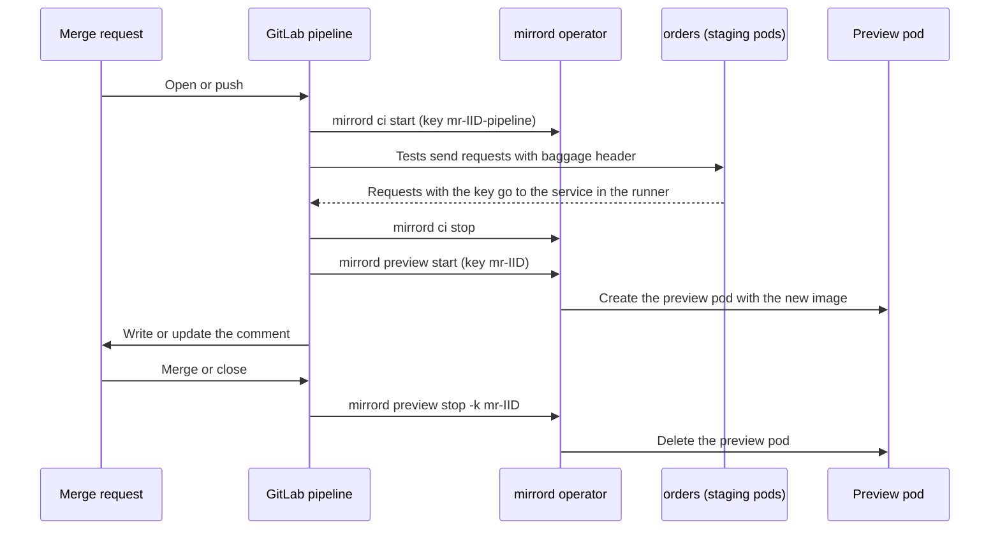

# GitLab CI

This guide shows how to connect GitLab CI/CD pipelines to a shared staging cluster with mirrord. You get two flows, each with configuration that you can copy into your repository:

1. **Merge request tests against staging.** The pipeline starts the changed service in the CI job with `mirrord ci start`. The tests then send requests to the real staging service. mirrord sends only the requests of this pipeline to the CI job.
2. **A preview environment for each merge request.** The pipeline builds an image, starts a preview pod with `mirrord preview start`, and writes the key and header in a merge request comment. GitLab stops the preview when the merge request is merged or closed.

Each flow takes about 30 minutes to set up if the mirrord operator is already in the cluster.


The setup in this guide needs the mirrord operator. Flow 1 can also run with open-source mirrord, but then the CLI creates the agent Job itself. The CI identity then needs permissions to create Jobs and to port-forward to pods in the target namespace, which this guide does not give. Preview environments need the **Enterprise** plan.


## Prerequisites

- mirrord CLI `3.181.0` or later for `mirrord ci`. mirrord CLI `3.189.0` or later for `mirrord preview`. The examples pin `3.288.0`.
- For flow 2: mirrord operator `3.142.0` or later, with `operator.previewEnv: true` in the Helm values. See [Preview Environments](../preview-environments.md#prerequisites).
- A GitLab runner that can reach the Kubernetes API server of the staging cluster.
- For flow 2: a runner that can run Docker-in-Docker with TLS. On the Docker executor, set `privileged = true` and add `/certs/client` to `volumes`. For other executors, see [Use Docker-in-Docker](https://docs.gitlab.com/ci/docker/docker_in_docker/).
- A Linux runner image on `x86_64` or `aarch64` with glibc, `bash`, and `curl`. The mirrord install script needs `bash` and `curl`. The mirrord binary needs glibc, so it does not run on Alpine (musl) images, also not with `gcompat`. Use a Debian or Ubuntu image, as the examples do.
- The Maintainer role in the GitLab project, to add CI/CD variables and access tokens.

## Cluster access

The CI job needs a kubeconfig. Do not give it cluster-admin credentials. The operator Helm chart includes the `mirrord-operator-ci` ClusterRole for machine sessions such as `mirrord ci` and `mirrord preview`. See [Security](../../managing-mirrord/security.md).

### 1. Create a ServiceAccount and a token

Apply these objects to the staging cluster. The ServiceAccount is the identity of the pipeline. The ClusterRoleBinding gives it the `mirrord-operator-ci` role. The Role lets the CLI read the target and find its pods. The Secret makes Kubernetes issue a long-lived token for the ServiceAccount.

```yaml
apiVersion: v1
kind: ServiceAccount
metadata:
  name: gitlab-ci
  namespace: staging
---
apiVersion: rbac.authorization.k8s.io/v1
kind: ClusterRoleBinding
metadata:
  name: gitlab-ci-mirrord
subjects:
  - kind: ServiceAccount
    name: gitlab-ci
    namespace: staging
roleRef:
  kind: ClusterRole
  name: mirrord-operator-ci
  apiGroup: rbac.authorization.k8s.io
---
apiVersion: rbac.authorization.k8s.io/v1
kind: Role
metadata:
  name: gitlab-ci-target
  namespace: staging
rules:
  - apiGroups: ["apps"]
    resources: ["deployments"]
    verbs: ["get"]
  - apiGroups: [""]
    resources: ["pods"]
    verbs: ["list"]
---
apiVersion: rbac.authorization.k8s.io/v1
kind: RoleBinding
metadata:
  name: gitlab-ci-target
  namespace: staging
subjects:
  - kind: ServiceAccount
    name: gitlab-ci
    namespace: staging
roleRef:
  kind: Role
  name: gitlab-ci-target
  apiGroup: rbac.authorization.k8s.io
---
apiVersion: v1
kind: Secret
metadata:
  name: gitlab-ci-token
  namespace: staging
  annotations:
    kubernetes.io/service-account.name: gitlab-ci
type: kubernetes.io/service-account-token
```

The `mirrord-operator-ci` role does not give access to deployments or pods. Without the `gitlab-ci-target` Role, `mirrord ci start` fails with `deployments.apps "orders" is forbidden` or `cannot list resource "pods"`. If your target is a different kind, such as a rollout or a statefulset, change the first rule to match it.

### 2. Build a kubeconfig from the token

```bash
SERVER=$(kubectl config view --minify -o jsonpath='{.clusters[0].cluster.server}')
CA=$(kubectl -n staging get secret gitlab-ci-token -o jsonpath='{.data.ca\.crt}')
TOKEN=$(kubectl -n staging get secret gitlab-ci-token -o jsonpath='{.data.token}' | base64 -d)

cat > gitlab-ci.kubeconfig <<EOF
apiVersion: v1
kind: Config
clusters:
- name: staging
  cluster:
    server: ${SERVER}
    certificate-authority-data: ${CA}
users:
- name: gitlab-ci
  user:
    token: ${TOKEN}
contexts:
- name: gitlab-ci
  context:
    cluster: staging
    user: gitlab-ci
current-context: gitlab-ci
EOF
```

### 3. Store the kubeconfig as a File variable

In GitLab, a variable of type **File** writes its value to a temporary file. The environment variable then holds the path of that file. `kubectl` and mirrord read the `KUBECONFIG` path, so no decode step is necessary.

1. In the project, go to **Settings > CI/CD** and expand **Variables**.
2. Select **Add variable**.
3. Set **Type** to **File**.
4. Set **Key** to `KUBECONFIG`.
5. Paste the content of `gitlab-ci.kubeconfig` into **Value**.
6. Clear **Protect variable**, so that merge request pipelines get the variable.
7. Select **Add variable**.


GitLab can mask only single-line values, so it cannot mask the kubeconfig. Do not print the file in a job. If you want a masked value, store `base64 -w0 gitlab-ci.kubeconfig` as a masked variable and decode it in `before_script`.


### 4. Store the CI API key

With an operator on the Enterprise plan, `mirrord ci` commands need a CI API key. Sessions with the key are machine sessions: they take no seats, and they count toward the concurrent machine sessions of your [plan](https://metalbear.com/mirrord/pricing/). To make the key, you need the Enterprise plan. On the Free and Team plans, operator `3.224.0` or later and CLI `3.272.0` or later do not need the key. `mirrord ci` then uses the identity of the kubeconfig.

1. In a terminal on a machine with access to the cluster, run `mirrord ci api-key`. If you run it from a script or another program that is not a terminal, run `MIRRORD_PROGRESS_MODE=simple mirrord ci api-key`. Without a terminal, the default progress mode prints nothing, and the key is lost.
2. In **Settings > CI/CD > Variables**, add a variable with the key `MIRRORD_CI_API_KEY`.
3. Set **Type** to **Variable** and **Visibility** to **Masked**.
4. Clear **Expand variable reference** and **Protect variable**.

The key is one line that starts with `mci-v1:`, so GitLab can mask it. Without the operator, or without a key on the Free and Team plans, skip this step.

### 5. What the CI identity can do

The CI identity cannot change staging. It has `mirrord-operator-ci`, `get` on the target deployment, and `list` on pods in `staging`. It can start CI and preview sessions, which steal only the requests with their header. It cannot edit or delete workloads.

A session can read the environment and files of the target, and a preview runs the merge request image with the environment of the target. Thus a pipeline from a branch of the project has the same access as a developer with staging access. This is the intended use.

Do not give the credentials to code from outside the project. A pipeline for a merge request from a fork runs in the fork project, with the variables of the fork. A project member can run that pipeline in the parent project, where it gets your variables. Do not do this for merge requests from forks. See [Run pipelines in the parent project](https://docs.gitlab.com/ci/pipelines/merge_request_pipelines/#run-pipelines-in-the-parent-project).

## Install the mirrord CLI in a job

Use the install script of a release tag, and set `VERSION` to the same release. Then each pipeline uses the same script and the same CLI:

```bash
curl -fsSL https://raw.githubusercontent.com/metalbear-co/mirrord/3.288.0/scripts/install.sh | VERSION=3.288.0 bash
```

To check the download against the checksum of the release, also set `MIRRORD_VERIFY=1`. This needs `unzip` in the image.

The script puts the binary in `/usr/local/bin`. If that fails, it tries again with `sudo`. Most runner images run as root, so no `sudo` is necessary.

## Flow 1: Test each merge request against staging

In this flow, the service from the merge request runs in the CI job. mirrord connects it to the `orders` deployment in the `staging` namespace. The tests send requests to the normal staging URL with a `baggage` header. mirrord steals only the requests with this pipeline's key. All other requests go to the staging pods as usual.

### The mirrord configuration

Commit this file as `.mirrord/ci.json`:

```json
{
  "target": {
    "path": "deployment/orders",
    "namespace": "staging"
  },
  "feature": {
    "network": {
      "incoming": {
        "mode": "steal",
        "http_filter": {
          "header_filter": "^baggage: (.*[,; ])?mirrord-session={{ key }}([,; ]|$)"
        }
      }
    }
  },
  "internal_proxy": {
    "idle_timeout": 30
  },
  "ci": {
    "output_dir": "{{ get_env(name='CI_PROJECT_DIR', default='/tmp') }}/mirrord-logs"
  }
}
```

mirrord replaces `{{ key }}` with the session key from `-k`. Do not write a fixed key in the filter. Each pipeline must steal only its own requests. The filter matches the whole `mirrord-session` member of `baggage`, so the key `mr-1-100` does not match `mr-1-1000`. `ci.output_dir` puts the stdout and stderr of the service in the project directory, so the job can keep them as an artifact.

`internal_proxy.idle_timeout` keeps the mirrord proxy alive for 30 seconds when no process is connected. The default is 5 seconds. `npm start` runs `/usr/bin/env`, which then replaces itself with `node`. On a busy runner, `node` can take more than 5 seconds to connect, and the service then fails with `failed to initialize proxy connection`.

### The pipeline

Add these parts to `.gitlab-ci.yml`. The `workflow` rules are from the GitLab docs. They stop duplicate branch and merge request pipelines for the same push.

```yaml
workflow:
  rules:
    - if: $CI_PIPELINE_SOURCE == "merge_request_event"
    - if: $CI_COMMIT_BRANCH && $CI_OPEN_MERGE_REQUESTS
      when: never
    - if: $CI_COMMIT_BRANCH
  auto_cancel:
    on_new_commit: interruptible

stages:
  - test
  - build
  - preview

variables:
  MIRRORD_VERSION: "3.288.0"
  # A GitLab job has no terminal. Without this, mirrord CLI commands print no progress or results.
  MIRRORD_PROGRESS_MODE: simple
  TARGET_NAMESPACE: staging
  # The public URL of the orders service in staging.
  STAGING_URL: "https://orders.staging.example.com"

.install-mirrord:
  before_script:
    - curl -fsSL "https://raw.githubusercontent.com/metalbear-co/mirrord/${MIRRORD_VERSION}/scripts/install.sh" | VERSION="$MIRRORD_VERSION" bash
    - mirrord --version

mr-staging-tests:
  stage: test
  extends: .install-mirrord
  image: node:22-bookworm
  interruptible: true
  rules:
    - if: $CI_PIPELINE_SOURCE == "merge_request_event"
  variables:
    # One key for each pipeline, so two pipelines of the same MR do not share requests.
    MIRRORD_KEY: "mr-${CI_MERGE_REQUEST_IID}-${CI_PIPELINE_ID}"
  script:
    - npm ci
    # Start the service from this MR in the background, connected to deployment/orders.
    - >
      mirrord ci start -f .mirrord/ci.json -k "$MIRRORD_KEY"
      --environment staging
      --pipeline "$CI_JOB_NAME"
      --triggered-by merge_request_event
      npm start
    # Wait until the local service listens on its port (8080 in this example).
    - |
      for i in $(seq 1 60); do
        curl -fs http://localhost:8080/healthz > /dev/null 2>&1 && break
        sleep 2
      done
      # Fail here if the service did not start. Its output is in mirrord-logs/.
      curl -fsS http://localhost:8080/healthz > /dev/null
    # The tests read STAGING_URL and MIRRORD_KEY.
    - npm test
  after_script:
    - mirrord ci stop || true
  artifacts:
    when: always
    paths:
      - mirrord-logs/
```

`after_script` runs in a new shell. When the script succeeds or fails, that shell runs in the same container, so `mirrord ci stop` finds the session that `mirrord ci start` saved and stops it. When GitLab cancels the job, it runs `after_script` in a new container that does not have the mirrord binary or the session files, so `mirrord ci stop` does not run. When the job times out, GitLab does not run `after_script`. In both cases, the runner removes the job container. The operator then sees that the connection closed and ends the session within about 30 seconds. The `|| true` keeps `after_script` from failing in these cases.

### Where the tests send requests

The tests send requests to the staging URL, not to `localhost`. Each request carries the header `baggage: mirrord-session=<key>`. The staging ingress sends the request to an `orders` pod. mirrord sees the header and sends the request to the service in the CI job. This test does it with `fetch`:

```javascript
const res = await fetch(`${process.env.STAGING_URL}/orders`, {
  method: "POST",
  headers: {
    "content-type": "application/json",
    baggage: `mirrord-session=${process.env.MIRRORD_KEY}`,
  },
  body: JSON.stringify({ sku: "test-sku", quantity: 1 }),
});
```

You can do the same check with `curl`:

```bash
curl -H "baggage: mirrord-session=$MIRRORD_KEY" "$STAGING_URL/orders"
```

If the tests call a different service first, and that service calls `orders`, each service must forward the `baggage` header. See [Header Propagation](../../sharing-the-cluster/header-propagation.md).

## Flow 2: A preview environment for each merge request

In this flow, each merge request gets a preview pod in the cluster. The pod runs the image from the merge request and keeps the configuration of `deployment/orders`. The key is `mr-<IID>`, so it stays the same for all pushes to the merge request. Reviewers send the header `baggage: mirrord-session=mr-<IID>` to reach the preview pod.

### The mirrord configuration

Commit this file as `.mirrord/preview.json`:

```json
{
  "target": {
    "path": "deployment/orders",
    "namespace": "staging"
  },
  "feature": {
    "preview": {
      "ttl_mins": 1440,
      "creation_timeout_secs": 600
    },
    "network": {
      "incoming": {
        "mode": "steal",
        "http_filter": {
          "header_filter": "^baggage: (.*[,; ])?mirrord-session={{ key }}([,; ]|$)"
        }
      }
    }
  }
}
```

The TTL is a guard against preview pods that nobody stops. The main cleanup is the stop job below.

### The merge request comment token

The job uses a project access token to write the merge request comment.

1. In the project, go to **Settings > Access tokens** and select **Add new token**.
2. Select the **Developer** role and the `api` scope.
3. Set an expiry date. By default, GitLab sets 365 days.
4. Store the token as a masked CI/CD variable with the key `GITLAB_NOTES_TOKEN`.

GitLab makes a bot user for the token. The comments show that bot user as the author.

### The pipeline

Add these jobs to the `.gitlab-ci.yml` from flow 1:

```yaml
.preview-vars:
  variables:
    PREVIEW_KEY: "mr-${CI_MERGE_REQUEST_IID}"
    PREVIEW_IMAGE: "${CI_REGISTRY_IMAGE}/orders:preview-mr-${CI_MERGE_REQUEST_IID}-${CI_COMMIT_SHORT_SHA}"

build-preview-image:
  stage: build
  extends: .preview-vars
  image: docker:27
  services:
    - docker:27-dind
  variables:
    DOCKER_TLS_CERTDIR: "/certs"
  interruptible: true
  rules:
    - if: $CI_PIPELINE_SOURCE == "merge_request_event"
  script:
    - echo "$CI_REGISTRY_PASSWORD" | docker login -u "$CI_REGISTRY_USER" --password-stdin "$CI_REGISTRY"
    - docker build -t "$PREVIEW_IMAGE" .
    - docker push "$PREVIEW_IMAGE"

preview-start:
  stage: preview
  extends: [.install-mirrord, .preview-vars]
  image: debian:bookworm-slim
  resource_group: preview-mr-$CI_MERGE_REQUEST_IID
  rules:
    - if: $CI_PIPELINE_SOURCE == "merge_request_event"
  environment:
    name: preview/mr-$CI_MERGE_REQUEST_IID
    on_stop: preview-stop
    auto_stop_in: 1 day
  before_script:
    - apt-get update && apt-get install -y --no-install-recommends curl ca-certificates jq
    - !reference [.install-mirrord, before_script]
  script:
    # --force replaces the preview of an earlier push. CLI 3.288.0 and later replace it by default.
    - set -o pipefail
    - >
      mirrord preview start -f .mirrord/preview.json
      -i "$PREVIEW_IMAGE" -k "$PREVIEW_KEY"
      --force --timeout 600 2>&1 | tee preview.log
    # The CLI prints a `preview URL:` line only when share links are configured.
    # MIRRORD_PROGRESS_MODE: simple makes it a plain line in preview.log.
    - |
      PREVIEW_URL=$(grep -o 'preview URL: [^ ]*' preview.log | sed 's/preview URL: //' || true)
      MARKER="## mirrord Preview Environment"
      BODY=$(cat <<EOF
      $MARKER

      | Field | Value |
      |-------|-------|
      | Key | \`$PREVIEW_KEY\` |
      | Header | \`baggage: mirrord-session=$PREVIEW_KEY\` |
      | Image | \`$PREVIEW_IMAGE\` |
      | Preview URL | ${PREVIEW_URL:-$STAGING_URL} |

      Set the header with the mirrord Browser Extension, or use:
      \`curl -H "baggage: mirrord-session=$PREVIEW_KEY" $STAGING_URL/orders\`
      EOF
      )
      API="$CI_API_V4_URL/projects/$CI_MERGE_REQUEST_PROJECT_ID/merge_requests/$CI_MERGE_REQUEST_IID/notes"
      # Read the notes page by page until the marker is found or a page is empty.
      NOTE_ID=""
      PAGE=1
      while [ -z "$NOTE_ID" ]; do
        NOTES=$(curl -fsS -H "PRIVATE-TOKEN: $GITLAB_NOTES_TOKEN" "$API?sort=asc&per_page=100&page=$PAGE")
        [ "$(printf '%s' "$NOTES" | jq length)" -gt 0 ] || break
        NOTE_ID=$(printf '%s' "$NOTES" | jq -r --arg m "$MARKER" '[.[] | select(.body | startswith($m))][0].id // empty')
        PAGE=$((PAGE + 1))
      done
      DATA=$(jq -n --arg body "$BODY" '{body: $body}')
      if [ -n "$NOTE_ID" ]; then
        curl -fsS -X PUT -H "PRIVATE-TOKEN: $GITLAB_NOTES_TOKEN" -H "Content-Type: application/json" \
          --data "$DATA" "$API/$NOTE_ID" > /dev/null
      else
        curl -fsS -X POST -H "PRIVATE-TOKEN: $GITLAB_NOTES_TOKEN" -H "Content-Type: application/json" \
          --data "$DATA" "$API" > /dev/null
      fi

preview-stop:
  stage: preview
  extends: [.install-mirrord, .preview-vars]
  image: debian:bookworm-slim
  resource_group: preview-mr-$CI_MERGE_REQUEST_IID
  rules:
    - if: $CI_PIPELINE_SOURCE == "merge_request_event"
      when: manual
  allow_failure: true
  environment:
    name: preview/mr-$CI_MERGE_REQUEST_IID
    action: stop
  variables:
    # The source branch can be gone after a merge, so do not check out the code.
    GIT_STRATEGY: none
  before_script:
    - apt-get update && apt-get install -y --no-install-recommends curl ca-certificates
    - !reference [.install-mirrord, before_script]
  script:
    - |
      STATUS=0
      OUT=$(mirrord preview stop -k "$PREVIEW_KEY" -n "$TARGET_NAMESPACE" 2>&1) || STATUS=$?
      echo "$OUT"
      # Fail the job, except when the preview is already gone.
      [ "$STATUS" -eq 0 ] || echo "$OUT" | grep -q "No preview sessions found"
```

These are the GitLab rules that this pipeline uses:

- **Triggers.** `$CI_PIPELINE_SOURCE == "merge_request_event"` is true when a merge request is created or updated. `$CI_MERGE_REQUEST_IID` is the merge request number from its URL.
- **Cleanup.** The `preview-start` job starts the `preview/mr-<IID>` environment and names `preview-stop` as its `on_stop` job. GitLab runs the stop job when the merge request is merged or closed. The stop job must have the same rules as the start job. `when: manual` also lets a reviewer stop the preview from the environment page.
- **Second guard.** `auto_stop_in: 1 day` makes GitLab run the stop job after one day. The GitLab worker for this runs one time each hour. The preview TTL of 1440 minutes does the same in the cluster.
- **Concurrency.** `interruptible: true` with `auto_cancel: on_new_commit: interruptible` cancels the build and test jobs of an older pipeline after a new push. `resource_group` lets only one start or stop job run for each merge request at a time. To run the newest pipeline first, set the `process_mode` of the group to `newest_first` with the [resource groups API](https://docs.gitlab.com/api/resource_groups/).
- **Registry.** The cluster must be able to pull the image. The preview pod uses the pull credentials of `deployment/orders`. If the deployment does not pull from the GitLab container registry, push the image to the registry that it uses.

## How it works

In flow 1, `mirrord ci start` starts the service in the runner and connects it to a target in staging, then returns. The tests send requests to the staging service with a header that holds the session key. mirrord compares the header with the filter of each session. It sends the requests that match to the runner, and all other requests to the staging pods. In flow 2, `mirrord preview start` makes a preview pod in the cluster from the target's pod spec and the new image. The pod stays after the job ends, until the stop job or the TTL removes it.



## Behavior and limits

- **Header filter.** Only requests with the header go to the CI session or the preview pod. A request without the header goes to the staging pods. Calls between services keep the header only if each service forwards it.
- **Concurrent sessions.** Without the operator, one CI session at a time can steal from a target with a filter. With the operator, many pipelines can use the same target at the same time. The operator counts each session with the CI API key as a machine session.
- **Readiness.** A preview pod never shows `Ready`. mirrord adds a readiness gate that never passes, so the Service does not send unfiltered traffic to the preview pod. This is not true for a Service with `publishNotReadyAddresses: true`. Use `mirrord preview status -n staging` to see the real state. Without `-n`, the command looks only in the namespace of the kubeconfig context.
- **Timeouts and cancels.** GitLab does not run `after_script` when a job times out, and it runs `after_script` in a new container when you cancel a job. In both cases `mirrord ci stop` does not stop the session. The runner removes the job container, and the operator ends the session within about 30 seconds.
- **Several services.** For more than one service in a merge request, use the same key for all of them. `mirrord preview up` and `mirrord preview down` start and stop all services of a `mirrord-up.yaml`. See [Previewing Several Services](../preview-environments.md#previewing-several-services).

## Troubleshooting

| Symptom | Cause and fix |
|---------|---------------|
| `` `MIRRORD_CI_API_KEY` is required for operator-backed `mirrord ci start` `` (CLI error) | The operator needs a key, and the job did not get the variable. Make sure that the variable is not protected, and that the pipeline does not run in a fork. See [Cluster access](#cluster-access). |
| mirrord cannot connect to the cluster, or `KUBECONFIG` is empty | The `KUBECONFIG` File variable is not set, or has a different environment scope. Or the variable is protected, so merge request pipelines from unprotected branches do not get it. See [Cluster access](#cluster-access). |
| `forbidden` errors for operator resources or the target | The ServiceAccount is not bound to `mirrord-operator-ci`, or it does not have the `gitlab-ci-target` Role. Check the ClusterRoleBinding and the RoleBinding in the target namespace. |
| The tests get answers from staging, not from the service in the runner | The header value is not the session key. Make sure the tests send `mirrord-session=$MIRRORD_KEY` and the filter uses `{{ key }}`. If the request passes through other services first, make sure they forward `baggage`. |
| The CI API key fails after a license change | Some operator versions check the key against the operator license. Run `mirrord ci api-key` again and update the variable. |
| `ErrImagePull` on the preview pod | The cluster cannot pull the preview image. Push it to the registry that the target already pulls from. |
| The preview is still there after the merge request closed | The stop job did not run. Stop the environment from the environments page of the project, or run `mirrord preview stop -k mr-<IID> -n staging`. Make sure both jobs have the same rules. |
| A new comment appears on each push | The job did not find the earlier comment. Make sure the comment starts with the marker and the token has the `api` scope. |
| `401` or `403` from the notes API | The project access token expired, has the wrong scope, or has a role that is too low. Make a new token. |
| The service fails in the runner and the job log shows nothing | `mirrord ci start` writes the service output to files. Open the `mirrord-logs/` artifact of the job. |
| `failed to initialize proxy connection` in `mirrord-logs/*/stderr`, and the health check fails | The mirrord proxy stopped before the service process connected to it. Set `internal_proxy.idle_timeout` to `30` or more in `.mirrord/ci.json`. |
| mirrord commands print nothing in the job log | The job has no terminal. Set the variable `MIRRORD_PROGRESS_MODE` to `simple`. |

## Frequently asked questions

### Can I run mirrord in GitLab CI without the mirrord operator?

Yes, for flow 1. Without the operator, `mirrord ci start` needs no API key. The CLI creates the agent Job itself, so the CI identity needs permissions to create Jobs and to port-forward to pods, which the ServiceAccount in this guide does not have. Only one CI session at a time can steal from a target with a filter, so parallel merge request pipelines can block each other. Preview environments need the operator and the Enterprise plan.

### Do GitLab CI jobs that use mirrord take user seats?

No, when you use the CI API key. Sessions that start with `MIRRORD_CI_API_KEY` are machine sessions. They count toward the concurrent machine sessions of your plan, not toward seats. `mirrord preview start` does not use the CI API key. It uses the identity of the kubeconfig, and the operator counts the preview as a preview environment session, not as a seat.

### How do I stop a mirrord preview environment when a GitLab merge request is merged?

Give the start job an environment with `on_stop`, and give the stop job `environment:action: stop` with the same rules. GitLab then runs the stop job when the merge request is merged or closed. Add `auto_stop_in` and a preview TTL as a second guard.

### Why does my GitLab merge request pipeline not see my CI/CD variables?

The variables are protected, or the pipeline runs in a fork. GitLab gives protected variables only to pipelines of protected branches, so clear **Protect variable** on the mirrord variables. A pipeline for a merge request from a fork gets no variables of your project. See [Cluster access](#cluster-access).

### Do I need to deploy the merge request to staging to test it with mirrord?

No. In flow 1 the service runs in the GitLab runner and mirrord connects it to the staging cluster. Nothing from the merge request is deployed. In flow 2 only the changed service runs as a preview pod. The other services stay as they are.

### Can I use a self-managed GitLab runner in the cluster?

Yes. The runner needs network access to the Kubernetes API server and the kubeconfig from this guide. The runner image must be Linux on `x86_64` or `aarch64`.

## See also

- [mirrord for CI](../mirrord-for-ci.md)
- [Preview Environments](../preview-environments.md)
- [Preview Environments in CI](../preview-environments-in-ci.md)
- [Security: the `mirrord-operator-ci` role](../../managing-mirrord/security.md)
- [Filtering Incoming Traffic](../../using-mirrord/incoming-traffic/filter-incoming-traffic.md)
- [Header Propagation](../../sharing-the-cluster/header-propagation.md)
- [GitLab: Merge request pipelines](https://docs.gitlab.com/ci/pipelines/merge_request_pipelines/)
- [GitLab: Environments](https://docs.gitlab.com/ci/environments/)
- [GitLab: CI/CD variables](https://docs.gitlab.com/ci/variables/)
- [GitLab: Notes API](https://docs.gitlab.com/api/notes/)
