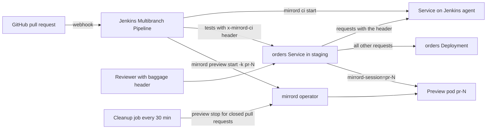

# Jenkins

This guide shows how to use mirrord in a Jenkins Multibranch Pipeline. You get two flows, each with a declarative `Jenkinsfile` that you can copy:

1. Each pull request runs its tests against the real staging cluster, without a deploy.
2. Each pull request gets a preview environment that reviewers open with one header.

The setup takes about 30 minutes if you already have a staging cluster with the mirrord operator.


The setup in this guide needs the mirrord operator. Flow 1 can also run with open-source mirrord, but then the CLI creates the agent Job itself. The CI identity then needs permissions to create Jobs and to port-forward to pods in the target namespace, which this guide does not give. Two or more concurrent sessions on the same service with HTTP filters need the operator. Flow 2 (preview environments) needs the operator and an **Enterprise** plan.


## Prerequisites

- A Jenkins controller with these plugins:
  - [Pipeline](https://plugins.jenkins.io/workflow-aggregator/) and [Pipeline: Multibranch](https://plugins.jenkins.io/workflow-multibranch/).
  - [GitHub Branch Source](https://plugins.jenkins.io/github-branch-source/), for pull request discovery.
  - [Credentials Binding](https://plugins.jenkins.io/credentials-binding/), for `withCredentials`.
- A Linux agent (x86_64 or aarch64) with `curl`, `jq`, `git`, and, for flow 2, `docker`.
- mirrord CLI `3.181.0` or later for `mirrord ci`, and `3.189.0` or later for `mirrord preview`. The cleanup job in flow 2 uses `--glob`, which needs CLI `3.248.0` or later. This guide uses `3.288.0`.
- For flow 2: mirrord operator `3.142.0` or later, with `operator.previewEnv` set to `true` in the Helm values. See [Preview Environments](../preview-environments.md).
- A Multibranch Pipeline job that uses the GitHub Branch Source, with the **Discover pull requests from origin** behavior.

Configure a GitHub webhook to Jenkins, or Jenkins finds new pull requests only when it scans the repository. See the [Multibranch Pipeline documentation](https://www.jenkins.io/doc/book/pipeline/multibranch/).

## Cluster access

The Jenkins job needs a kubeconfig, but it does not need cluster-admin credentials. The mirrord operator Helm chart includes the `mirrord-operator-ci` ClusterRole for machine sessions in CI, such as `mirrord ci` and `mirrord preview`. See [Security](../../managing-mirrord/security.md).

### 1. Create a ServiceAccount, bind the role, and get a token

Apply these objects to the staging cluster:

```yaml
# The identity that Jenkins authenticates as.
apiVersion: v1
kind: ServiceAccount
metadata:
  name: jenkins-ci
  namespace: staging
---
# Grants that identity the operator chart's CI role.
apiVersion: rbac.authorization.k8s.io/v1
kind: ClusterRoleBinding
metadata:
  name: jenkins-ci-mirrord
subjects:
  - kind: ServiceAccount
    name: jenkins-ci
    namespace: staging
roleRef:
  kind: ClusterRole
  name: mirrord-operator-ci
  apiGroup: rbac.authorization.k8s.io
---
# The operator checks that the caller can get the target.
apiVersion: rbac.authorization.k8s.io/v1
kind: Role
metadata:
  name: jenkins-ci-targets
  namespace: staging
rules:
  - apiGroups: ["apps"]
    resources: ["deployments"]
    verbs: ["get"]
  - apiGroups: [""]
    resources: ["pods"]
    verbs: ["get", "list"]
---
apiVersion: rbac.authorization.k8s.io/v1
kind: RoleBinding
metadata:
  name: jenkins-ci-targets
  namespace: staging
subjects:
  - kind: ServiceAccount
    name: jenkins-ci
    namespace: staging
roleRef:
  kind: Role
  name: jenkins-ci-targets
  apiGroup: rbac.authorization.k8s.io
---
# A long-lived token for the ServiceAccount.
apiVersion: v1
kind: Secret
metadata:
  name: jenkins-ci-token
  namespace: staging
  annotations:
    kubernetes.io/service-account.name: jenkins-ci
type: kubernetes.io/service-account-token
```

### 2. Make a kubeconfig from the token

```bash
SERVER=$(kubectl config view --minify -o jsonpath='{.clusters[0].cluster.server}')
CA=$(kubectl -n staging get secret jenkins-ci-token -o jsonpath='{.data.ca\.crt}')
TOKEN=$(kubectl -n staging get secret jenkins-ci-token -o jsonpath='{.data.token}' | base64 -d)

cat > jenkins-ci.kubeconfig <<EOF
apiVersion: v1
kind: Config
clusters:
- name: staging
  cluster:
    server: ${SERVER}
    certificate-authority-data: ${CA}
users:
- name: jenkins-ci
  user:
    token: ${TOKEN}
contexts:
- name: jenkins-ci
  context:
    cluster: staging
    user: jenkins-ci
    namespace: staging
current-context: jenkins-ci
EOF
```

This token can use the mirrord operator APIs and can read the Deployments and Pods in `staging`. It cannot read or change other cluster resources. The operator refuses a session on a target that the caller cannot `get`.

### 3. Store the credentials in Jenkins

Add each credential in **Manage Jenkins > Credentials > System > Global credentials (unrestricted) > Add Credentials**. Use the **ID** values below, because the `Jenkinsfile` refers to them. See [Using credentials](https://www.jenkins.io/doc/book/using/using-credentials/).

| ID | Kind | Value | Used by |
|----|------|-------|---------|
| `mirrord-ci-kubeconfig` | Secret file | The `jenkins-ci.kubeconfig` file | Both flows |
| `mirrord-ci-api-key` | Secret text | The output of `mirrord ci api-key` | Flow 1, with an Enterprise operator |
| `github-token` | Secret text | A GitHub token that can write pull request comments and read pull requests | Flow 2 |
| `registry` | Username with password | The login for your image registry | Flow 2 |

The `withCredentials` step with a `file` binding copies the Secret file to a temporary location and sets the variable to that path. Jenkins deletes the file when the `withCredentials` block ends. Thus you can set `KUBECONFIG` directly to the credential, with no base64 step.

### The CI API key

With a mirrord operator on the Enterprise plan, `mirrord ci` commands need a CI API key. Generate the key with this command. You need an Enterprise plan to generate it.

```sh
mirrord ci api-key
```

Run the command in a terminal. When its output is not a terminal, for example in a pipe or in a script, the command prints nothing. In that case, run `MIRRORD_PROGRESS_MODE=simple mirrord ci api-key`.
Store the key as the Secret text credential `mirrord-ci-api-key`. The `Jenkinsfile` sets it as the environment variable `MIRRORD_CI_API_KEY`. Sessions that use the key are machine sessions and take no seats. They count toward the concurrent machine sessions of your [plan](https://metalbear.com/mirrord/pricing/).

On the Free and Team plans, operator `3.224.0` or later and CLI `3.272.0` or later do not need the key. `mirrord ci` then uses the identity of the kubeconfig. If you do not use a key, do not create the `mirrord-ci-api-key` credential. Then remove the `string(credentialsId: 'mirrord-ci-api-key', ...)` line from both `withCredentials` blocks in flow 1, because Jenkins fails a binding to a credential that does not exist.

### 4. What the CI identity can do

The CI identity cannot change staging. It has `mirrord-operator-ci`, `get` on the target deployment, and `get` and `list` on pods in `staging`. It can start CI and preview sessions, which steal only the requests with their header. It cannot edit or delete workloads.

A session can read the environment and files of the target, and a preview runs the pull request image with the environment of the target. Thus a build from a branch of the repository has the same access as a developer with staging access. This is the intended use.

Do not give the credentials to code from outside the repository. Do not add the **Discover pull requests from forks** behavior to the job. Its **Trust** setting, for example **From users with Admin or Write permission** or **Nobody**, selects only which `Jenkinsfile` a fork build uses. An untrusted fork build uses the `Jenkinsfile` of the target branch, but it still runs the code of the fork with the credentials.

## Install the mirrord CLI in the job

The `Jenkinsfile` below installs a pinned version with the install script of the same release tag:

```bash
curl -fsSL https://raw.githubusercontent.com/metalbear-co/mirrord/3.288.0/scripts/install.sh | VERSION=3.288.0 bash
```

Without `VERSION`, the script installs the latest release. To check the download against the checksum of the release, also set `MIRRORD_VERIFY=1`. This needs `unzip` on the agent. The script moves the binary to `$HOME/.local/bin` if that directory is on `PATH`. Otherwise, it moves the binary to `/usr/local/bin` and uses `sudo` if the agent user cannot write there. For example, the official `jenkins/jenkins` image runs as the `jenkins` user, which has no `sudo` and cannot write to `/usr/local/bin`. Thus the `Jenkinsfile` adds `$HOME/.local/bin` to `PATH` in its `environment` block. You can also put mirrord in the agent image.

## Flow 1: test each pull request against staging

In this flow, the pipeline starts the changed service on the Jenkins agent with `mirrord ci start`. mirrord connects the service to the `orders` Deployment in the `staging` namespace. The tests send requests to the staging service with a header that is unique to the build. mirrord steals only the requests with that header, so the shared staging service keeps all other traffic.

### The mirrord config

Commit this file as `.mirrord/mirrord-ci.json`:

```json
{
  "target": {
    "path": "deployment/orders",
    "namespace": "staging"
  },
  "feature": {
    "network": {
      "incoming": {
        "mode": "steal",
        "http_filter": {
          "header_filter": "^x-mirrord-ci: {{ key }}$"
        }
      }
    }
  }
}
```

mirrord replaces `{{ key }}` with the value of `--key`. The pipeline uses `ci-pr-<pull request number>-<build number>`, so each build steals only its own requests. mirrord compares headers as `Name: Value`, without case sensitivity. See [Filtering Incoming Traffic](../../using-mirrord/incoming-traffic/filter-incoming-traffic.md).

### Where the tests send requests

The tests send requests to the address of the deployed staging service, not to the agent. Use the in-cluster address if the agent runs in the cluster, for example `http://orders.staging.svc.cluster.local:8080`. Otherwise, use the staging ingress, for example `https://orders.staging.example.com`. Each request must include the header:

```bash
curl -H "x-mirrord-ci: $MIRRORD_KEY" "$ORDERS_URL/api/orders"
```

Your test framework must add the same header to each request. The sample test script `./scripts/test-orders.sh` reads `ORDERS_URL` and `MIRRORD_KEY` from the environment.

### The Jenkinsfile

```groovy
pipeline {
  agent { label 'linux' }

  options {
    // One build for each pull request at a time. A new push aborts the build that runs now.
    disableConcurrentBuilds(abortPrevious: true)
  }

  environment {
    MIRRORD_VERSION = '3.288.0'
    ORDERS_URL      = 'https://orders.staging.example.com'
    // The install script puts mirrord in $HOME/.local/bin when that directory is on PATH.
    PATH            = "${env.HOME}/.local/bin:${env.PATH}"
  }

  stages {
    stage('Install mirrord') {
      steps {
        sh '''
          set -eu
          curl -fsSL "https://raw.githubusercontent.com/metalbear-co/mirrord/${MIRRORD_VERSION}/scripts/install.sh" | VERSION="$MIRRORD_VERSION" bash
          mirrord --version
        '''
      }
    }

    stage('Test against staging') {
      when { changeRequest() }
      steps {
        withCredentials([
          file(credentialsId: 'mirrord-ci-kubeconfig', variable: 'KUBECONFIG'),
          string(credentialsId: 'mirrord-ci-api-key', variable: 'MIRRORD_CI_API_KEY')
        ]) {
          sh '''
            set -eu
            # Keep the mirrord ci state of this build apart from other builds on the same agent.
            export TMPDIR="$WORKSPACE_TMP"
            mkdir -p "$TMPDIR"
            export MIRRORD_KEY="ci-pr-${CHANGE_ID}-${BUILD_NUMBER}"

            mirrord ci start -f .mirrord/mirrord-ci.json --key "$MIRRORD_KEY" go run ./cmd/orders

            # mirrord ci start returns before the service listens. Wait until the service answers on the agent.
            for i in $(seq 1 30); do
              if curl -fsS -o /dev/null "http://localhost:8080/healthz"; then
                break
              fi
              sleep 2
            done
            # Fail here if the service did not start.
            curl -fsS -o /dev/null "http://localhost:8080/healthz"

            ./scripts/test-orders.sh
          '''
        }
      }
      post {
        always {
          withCredentials([
            file(credentialsId: 'mirrord-ci-kubeconfig', variable: 'KUBECONFIG'),
            string(credentialsId: 'mirrord-ci-api-key', variable: 'MIRRORD_CI_API_KEY')
          ]) {
            sh 'TMPDIR="$WORKSPACE_TMP" mirrord ci stop'
          }
        }
      }
    }
  }
}
```

Read these points before you change the `Jenkinsfile`:

- **`when { changeRequest() }`** runs the stage only for pull request builds. The GitHub Branch Source sets `CHANGE_ID` to the pull request number for these builds.
- **The service runs in the background.** `mirrord ci start` starts the service in the background and returns. The service stays after the `sh` step ends, so the tests can also run in a later step. Jenkins stops the service when the build ends. The `post` block runs before that, so `mirrord ci stop` still finds the session. See [Spawning processes from build](https://www.jenkins.io/doc/book/managing/spawning-processes/).
- **The wait loop.** `mirrord ci start` returns before the service listens. Until the service listens, the deployed service answers the requests with the header. mirrord steals the port when the service starts to listen, so the loop waits until the service answers on the agent, at `localhost:8080`. The last `curl` fails the build if the service did not start. Use the port and the health path of your service.
- **`TMPDIR="$WORKSPACE_TMP"`.** `mirrord ci start` keeps the process IDs of the session in a file in the temporary directory, and `mirrord ci stop` reads that file. Two builds on the same agent share `/tmp` by default, so one `mirrord ci stop` stops the sessions of both builds. `WORKSPACE_TMP` is a temporary directory for each workspace. The two builds also share the ports of the agent. If both run the service on the same port, the service of the second build fails with `Address already in use`. Use agents with one executor, or a container agent for each build.
- **`post { always { ... } }`** runs `mirrord ci stop` when the tests pass, fail, or the build is aborted.
- **Single quotes for `sh`.** Jenkins tells you to keep secrets out of Groovy string interpolation. With single quotes, the shell expands the variables, not Groovy.
- **The application output.** mirrord writes the stdout and stderr of the service to a directory in the temporary directory, for example `$WORKSPACE_TMP/mirrord/go-<id>`. Set `ci.output_dir` in the config to use a different directory, and archive it with `archiveArtifacts` if you need it.

## Flow 2: a preview environment for each pull request

In this flow, each push to a pull request builds and pushes an image. Then `mirrord preview start` creates a preview pod in staging with the key `pr-<pull request number>`. The pipeline then posts a comment on the pull request with the key and the header, or updates the comment if it exists. Reviewers send the header with the [mirrord Browser Extension](../../using-mirrord/incoming-traffic/debug-from-browser.md) or `curl`.

### The mirrord config

Commit this file as `.mirrord/mirrord-preview.json`:

```json
{
  "target": {
    "path": "deployment/orders",
    "namespace": "staging"
  },
  "feature": {
    "preview": {
      "ttl_mins": 1440,
      "creation_timeout_secs": 600
    },
    "network": {
      "incoming": {
        "mode": "steal",
        "http_filter": {
          "header_filter": "^baggage: (.*[,; ])?mirrord-session={{ key }}([,; ]|$)"
        }
      }
    }
  }
}
```

mirrord replaces `{{ key }}` with the key that you give with `-k`. Do not write a fixed key in the filter, because all pull requests share this file. The filter matches the whole `mirrord-session` member of `baggage`, so the key `pr-1` does not match `pr-12`. If the `orders` service calls other services, propagate the `baggage` header. See [Header Propagation for Backend Testing](../preview-environments-in-ci.md#header-propagation-for-backend-testing).

### The Jenkinsfile stage

Add this stage to the `stages` block of the same `Jenkinsfile`, after `Install mirrord`:

```groovy
    stage('Preview environment') {
      when { changeRequest() }
      steps {
        withCredentials([
          file(credentialsId: 'mirrord-ci-kubeconfig', variable: 'KUBECONFIG'),
          string(credentialsId: 'github-token', variable: 'GITHUB_TOKEN'),
          usernamePassword(credentialsId: 'registry', usernameVariable: 'REGISTRY_USER', passwordVariable: 'REGISTRY_PASSWORD')
        ]) {
          sh '''
            set -eu
            PREVIEW_KEY="pr-${CHANGE_ID}"
            SHORT_SHA=$(git rev-parse --short HEAD)
            IMAGE="registry.example.com/orders:preview-${PREVIEW_KEY}-${SHORT_SHA}"

            # Build and push the image to the repository that the target already pulls from.
            echo "$REGISTRY_PASSWORD" | docker login registry.example.com -u "$REGISTRY_USER" --password-stdin
            docker build -t "$IMAGE" .
            docker push "$IMAGE"

            # Start the preview, or replace the preview of an earlier push.
            mirrord preview start \
              -f .mirrord/mirrord-preview.json \
              -i "$IMAGE" \
              -k "$PREVIEW_KEY" \
              --force \
              --timeout 600

            # Post the comment, or update it if it exists.
            REPO=$(echo "$CHANGE_URL" | sed -E 's#^https://github.com/([^/]+/[^/]+)/pull/[0-9]+$#\\1#')
            API="https://api.github.com/repos/${REPO}"
            MARKER="<!-- mirrord-preview -->"
            BODY=$(printf '%s\n## mirrord Preview Environment\n\n| Field | Value |\n|-------|-------|\n| Preview URL | `https://orders.staging.example.com` |\n| Header | `baggage: mirrord-session=%s` |\n| Image | `%s` |\n\nSet the header with the mirrord Browser Extension, or run `curl -H "baggage: mirrord-session=%s" https://orders.staging.example.com/api/orders`.\n' \
              "$MARKER" "$PREVIEW_KEY" "$IMAGE" "$PREVIEW_KEY")
            PAYLOAD=$(jq -n --arg body "$BODY" '{body: $body}')

            # Read the comments page by page until the marker is found or a page is empty.
            COMMENT_ID=""
            PAGE=1
            while [ -z "$COMMENT_ID" ]; do
              COMMENTS=$(curl -fsSL \
                -H "Authorization: Bearer $GITHUB_TOKEN" \
                -H "Accept: application/vnd.github+json" \
                "${API}/issues/${CHANGE_ID}/comments?per_page=100&page=${PAGE}")
              [ "$(printf '%s' "$COMMENTS" | jq length)" -gt 0 ] || break
              COMMENT_ID=$(printf '%s' "$COMMENTS" | jq -r --arg m "$MARKER" '[.[] | select(.body | startswith($m))][0].id // empty')
              PAGE=$((PAGE + 1))
            done

            if [ -n "$COMMENT_ID" ]; then
              curl -fsSL -X PATCH \
                -H "Authorization: Bearer $GITHUB_TOKEN" \
                -H "Accept: application/vnd.github+json" \
                "${API}/issues/comments/${COMMENT_ID}" -d "$PAYLOAD" > /dev/null
            else
              curl -fsSL -X POST \
                -H "Authorization: Bearer $GITHUB_TOKEN" \
                -H "Accept: application/vnd.github+json" \
                "${API}/issues/${CHANGE_ID}/comments" -d "$PAYLOAD" > /dev/null
            fi
          '''
        }
      }
    }
```

Read these points before you change the stage:

- **The key.** `pr-${CHANGE_ID}` is the same for each push to a pull request. Thus each push replaces the same preview, and the cleanup job can find the preview from the pull request number.
- **`--force`.** In CLI `3.288.0`, a start replaces the preview that has the same key and target by default, and `--force` has no effect. Keep `--force` if your agents use an older CLI.
- **`\\1` in `sed`.** In a Groovy `'''` string, `\\` becomes one backslash. The shell gets `\1`.
- **The comment.** The stage uses the GitHub REST API because it works with each Multibranch Pipeline. The [Pipeline GitHub plugin](https://plugins.jenkins.io/pipeline-github/) has `pullRequest.comment()` and `pullRequest.editComment()`, but its documentation says that the jobs must come from a GitHub Organization folder. For GitHub Enterprise Server, change `API` to the API address of your server.
- **The image.** Push the preview image to the registry and repository that the target already pulls from. The preview pod uses the pull credentials of the target. See [Registry Authentication](../preview-environments-in-ci.md#registry-authentication).

### Stop the preview when the pull request closes

Jenkins does not run a build when a pull request closes. A Multibranch Pipeline builds pull requests on open and on push, and the Pipeline GitHub plugin has no trigger for a closed pull request. Thus this guide uses two mechanisms together:

1. **A scheduled cleanup job.** A separate Pipeline job runs every 30 minutes. It lists the preview keys with `mirrord preview status --glob 'pr-*'`, asks the GitHub API for the state of each pull request, and runs `mirrord preview stop` for each closed pull request.
2. **The preview TTL as a backstop.** `ttl_mins` is `1440` (24 hours) in the config. If the cleanup job does not run, the operator still deletes the preview after the TTL. Each push replaces the preview and starts the TTL again.

Create a Pipeline job (not a Multibranch Pipeline) with the **Pipeline script from SCM** definition and the script path `jenkins/preview-cleanup.Jenkinsfile`. Commit this file:

```groovy
pipeline {
  agent { label 'linux' }

  triggers {
    cron('H/30 * * * *')
  }

  options {
    disableConcurrentBuilds()
  }

  environment {
    MIRRORD_VERSION = '3.288.0'
    GITHUB_REPO     = 'my-org/orders'
    PATH            = "${env.HOME}/.local/bin:${env.PATH}"
  }

  stages {
    stage('Stop previews of closed pull requests') {
      steps {
        withCredentials([
          file(credentialsId: 'mirrord-ci-kubeconfig', variable: 'KUBECONFIG'),
          string(credentialsId: 'github-token', variable: 'GITHUB_TOKEN')
        ]) {
          sh '''
            set -eu
            curl -fsSL "https://raw.githubusercontent.com/metalbear-co/mirrord/${MIRRORD_VERSION}/scripts/install.sh" | VERSION="$MIRRORD_VERSION" bash

            # MIRRORD_PROGRESS_MODE=off removes the progress output, so stdout holds only the table of sessions.
            # A separate assignment makes set -e fail the job if the status command fails.
            SESSIONS=$(MIRRORD_PROGRESS_MODE=off mirrord preview status --glob 'pr-*' -n staging)
            KEYS=$(printf '%s\n' "$SESSIONS" \
              | awk -F'|' '{ gsub(/ /, "", $2) } $2 ~ /^pr-[0-9]+$/ { print $2 }' | sort -u)

            for KEY in $KEYS; do
              NUMBER="${KEY#pr-}"
              STATE=$(curl -fsSL \
                -H "Authorization: Bearer $GITHUB_TOKEN" \
                -H "Accept: application/vnd.github+json" \
                "https://api.github.com/repos/${GITHUB_REPO}/pulls/${NUMBER}" | jq -r .state)
              if [ "$STATE" = "closed" ]; then
                echo "Pull request ${NUMBER} is closed. Stop preview ${KEY}."
                STATUS=0
                OUT=$(mirrord preview stop -k "$KEY" -n staging 2>&1) || STATUS=$?
                echo "$OUT"
                # Fail the job, except when the preview is already gone.
                [ "$STATUS" -eq 0 ] || echo "$OUT" | grep -q "No preview sessions found"
              fi
            done
          '''
        }
      }
    }
  }
}
```

`mirrord preview status` prints a table with one row for each preview, and the key in the first column. The `awk` command gets the keys from that column. `mirrord preview stop` needs the namespace: without `-n` or a config file, it uses the default namespace of the kubeconfig. If the preview is already gone, `mirrord preview stop` fails with `No preview sessions found`. The job ignores only this error.

If you prefer a build at the moment the pull request closes, send the GitHub `pull_request` webhook to a separate job. Run `mirrord preview stop -k "pr-<number>" -n staging` in it, and ignore only the `No preview sessions found` error.
## How it works

In flow 1, `mirrord ci start` runs the service on the Jenkins agent and connects it to the `orders` target in staging. The tests send requests to the staging service with the `x-mirrord-ci` header, and mirrord sends only those requests to the agent. The service on the agent reads files, environment, and outgoing connections from the cluster, so it talks to the real staging dependencies. In flow 2, `mirrord preview start` asks the operator for a preview pod, which is a copy of the target pod spec with the new image. The pod stays after the build ends, and the operator sends it the requests whose `baggage` header has the key. The cleanup job and the TTL remove it.



## Behavior and limits

- **Concurrency.** Each pull request is its own job in a Multibranch Pipeline. Thus `disableConcurrentBuilds(abortPrevious: true)` aborts only the older build of the same pull request.
- **Aborted builds.** When a new push aborts a build, the `post` block still runs `mirrord ci stop`. A preview that the aborted build did not finish starts again on the next push.
- **Many repositories, one cluster.** The key `pr-42` from two repositories is the same key. Add a prefix for each repository, for example `orders-pr-42`, and change the `--glob` pattern and the `awk` pattern to match.
- **Several services in one pull request.** Use the same key for each preview pod, or use `mirrord preview up` with a `mirrord-up.yaml`. See [Preview Environments in CI](../preview-environments-in-ci.md).
- **TTL.** A preview on a pull request with no new push for 24 hours expires. Run the build again to start it again. With `"ttl_mins": "infinite"`, only the cleanup job removes previews.
- **Readiness.** The `Ready` condition of the preview pod stays `False`, though `kubectl get pods` shows its container as ready. mirrord adds a readiness gate on purpose, so the Service does not send unfiltered traffic to the preview pod. This is not true for a Service with `publishNotReadyAddresses: true`.

## Troubleshooting

| Symptom | Cause and fix |
|---------|---------------|
| `` `MIRRORD_CI_API_KEY` is required for operator-backed `mirrord ci start` `` | The operator needs a key, and the stage has none. Add the `mirrord-ci-api-key` credential to `withCredentials`. On the Free and Team plans, upgrade the operator to `3.224.0` or later. |
| `... is forbidden ...` | The ServiceAccount has no binding to `mirrord-operator-ci`, or the kubeconfig uses a different identity. Check the ClusterRoleBinding. |
| `does not have the permissions required for targeting deployment/orders`, or `cannot list resource "pods"` | The ServiceAccount cannot get the target. Apply the `jenkins-ci-targets` Role and RoleBinding. |
| The tests get responses from the staging service, not from the agent | The tests do not send the header, the value does not match `--key`, or the tests started before the service listened. Print `$MIRRORD_KEY`, check the header in the test requests, and check the wait loop. |
| `Address already in use` in the service output | A different build on the same agent runs the same service on the same port. Use agents with one executor, or start a container agent for each build. |
| One build stops the session of a different build | Two builds on the same agent share the mirrord ci state file. Set `TMPDIR` to `$WORKSPACE_TMP` for `mirrord ci start` and for `mirrord ci stop`. |
| `ErrImagePull` on the preview pod | The cluster cannot pull the image. Push to the registry and repository that the target already pulls from. |
| The preview fails or times out | Read the pod output that `mirrord preview start` prints. If the log is gone, run `mirrord preview logs --key pr-<number>`. |
| The preview stays after the pull request closes | The cleanup job did not run or did not find the key. Run `mirrord preview status --glob 'pr-*' -n staging` and check the namespace. |
| `sudo: command not found` in `Install mirrord` | `$HOME/.local/bin` is not on `PATH`, and the agent user cannot write to `/usr/local/bin`. Keep the `PATH` line in the `environment` block, or put mirrord in the agent image. |
| `mirrord: command not found` in a later stage | The install script put mirrord in a directory that is not on `PATH`. Add the directory to `PATH`, or put mirrord in the agent image. |

## Frequently asked questions

### How do I run mirrord in a Jenkins pipeline?

Install the mirrord CLI in a stage, and give the stage a kubeconfig with `withCredentials`. Then run `mirrord ci start` with your service and run your tests in the same `sh` step. Run `mirrord ci stop` in a `post { always { ... } }` block.

### Can Jenkins test a pull request against staging without a deploy?

Yes. `mirrord ci start` runs the changed service on the Jenkins agent and connects it to the staging target. The tests send requests to staging with a header, and mirrord sends those requests to the agent. mirrord deploys nothing to the cluster.

### How do I clean up a preview environment when a pull request closes in Jenkins?

Jenkins does not build on a closed pull request. Run a scheduled job that lists preview keys with `mirrord preview status --glob 'pr-*'` and stops the ones whose pull request is closed. Set `ttl_mins` in the preview config as a backstop.

### Does each Jenkins build take a mirrord seat?

No, if the build uses the CI API key. Sessions that use `MIRRORD_CI_API_KEY` are machine sessions and take no seats. They count toward the concurrent machine sessions of your plan. `mirrord preview start` needs no key, and a preview also takes no seat. It counts as a preview environment session.

### Do I need the mirrord operator for Jenkins?

Not for one CI session at a time with open-source mirrord. Then the CLI creates the agent Job itself, so the CI identity needs permissions to create Jobs and to port-forward to pods, which the ServiceAccount in this guide does not have. You need the operator for concurrent sessions on the same service and for preview environments. Preview environments also need an Enterprise plan.

## See also

- [mirrord for CI](../mirrord-for-ci.md)
- [Preview Environments](../preview-environments.md)
- [Preview Environments in CI](../preview-environments-in-ci.md)
- [Filtering Incoming Traffic](../../using-mirrord/incoming-traffic/filter-incoming-traffic.md)
- [Security](../../managing-mirrord/security.md)
