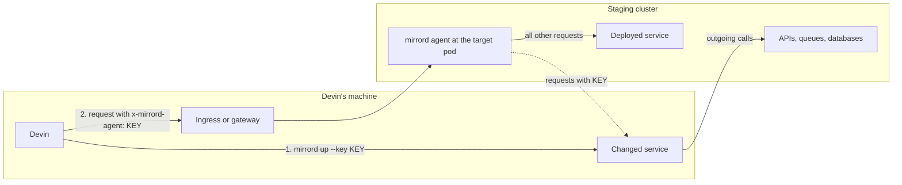

# Test Devin Changes Against Staging

Devin writes and ships code changes from its own cloud machine. To check that a change to a microservice works, Devin needs the things that the service talks to: other services, queues, databases, and the configuration of the real environment. In Devin's machine, those are missing or mocked.

mirrord lets Devin run the changed service against your real staging cluster. Devin starts the service in its machine, and mirrord connects the process to a pod in staging. The process gets the pod's environment variables, DNS, network access, and the incoming requests that carry Devin's header. Devin then calls the service, reads the real result, and fixes what breaks before it opens a pull request. Nothing is built or deployed.

Other developers and agents keep using staging at the same time. Each Devin session uses its own session key, and steals only the requests whose header carries that key. All other requests go to the deployed service.

## How it works

You install mirrord in Devin's machine setup and give Devin two secrets: a kubeconfig for a staging service account and a mirrord CI API key. An `AGENTS.md` file in the repository tells Devin when to verify a change, and how. For each verification, Devin makes a new session key, starts the service with `mirrord up`, sends requests with the key in a header, checks the result, and stops the session.



## Prerequisites

- The mirrord Operator in the staging cluster, on the Enterprise plan. You need the Enterprise plan for a CI API key.
- The setup in [Using mirrord with Cloud Agents](./cloud-agents.md): a CI API key, and a Kubernetes service account for your agents.
- Bind the service account to the `mirrord-operator-ci` ClusterRole. See [Security](../managing-mirrord/security.md). Also give it a Role with `get` on the target deployment and `list` on pods in its namespace.
- A kubeconfig for that service account, with a context named `devin-staging`. [Preview Environments in CI](../use-cases/preview-environments-in-ci.md#2-build-a-kubeconfig-from-the-token) shows how to build one from a token.
- Network access from Devin's machine to the Kubernetes API server of the staging cluster. If your API server allows only known IP addresses, add the addresses that Devin publishes for allowlists ([Devin docs](https://docs.devin.ai/admin/common-issues.md)). Traffic from Devin's sessions comes from the `140.232.64.0/26` range on that list.


Use a **staging or development** cluster. Do not give Devin a kubeconfig for a production cluster.


## 1. Install mirrord in Devin's machine setup

Devin boots each session from a snapshot that its repository setup builds ([Devin docs](https://docs.devin.ai/onboard-devin/environment.md)). The setup is a blueprint, and its `initialize` steps install tools ([blueprint reference](https://docs.devin.ai/onboard-devin/environment/blueprint-reference.md)). Install mirrord there, so every session has the CLI.

Add these steps to the `initialize` section of the repository's blueprint:

```yaml
initialize:
  - name: Install mirrord
    run: curl -fsSL https://raw.githubusercontent.com/metalbear-co/mirrord/main/scripts/install.sh | bash
  - name: Check mirrord
    run: mirrord --version
```

The mirrord binary for Linux needs glibc. Devin's machine runs Ubuntu 22.04 on x86_64, with glibc 2.35. The install script puts mirrord in `~/.local/bin`, which is on the PATH of Devin's sessions.

For other install methods, see [Install mirrord](../getting-started/install-mirrord.md).

## 2. Add the kubeconfig and the CI API key as Devin secrets

Devin gives secrets to its sessions as environment variables ([Devin docs](https://docs.devin.ai/product-guides/secrets.md)). Add the secrets as repository secrets in the repository's blueprint settings, or as organization secrets in **Settings > Resources > Secrets**.

1. Encode the kubeconfig as one line: `base64 -w0 devin-staging.kubeconfig`.
2. Add a secret named `KUBECONFIG_B64` with the encoded value.
3. Add a secret named `MIRRORD_CI_API_KEY` with the key from `mirrord ci api-key`.

The encoded value is one line, so it also works in the **Bulk add secrets** form, which takes one `KEY=value` per line.

Do not write the decoded kubeconfig in a blueprint step. Files that blueprint steps write can stay in the snapshot. The instruction in step 3 decodes it in each session.

Keep the secrets away from untrusted code. Do not give them to sessions that run code from forks or from other untrusted sources. The code that Devin writes is the code under test, and it gets the same staging access as a developer's code.

## 3. Tell Devin when and how to verify with mirrord

Devin reads `AGENTS.md` files in the repository and adds them to its context ([Devin docs](https://docs.devin.ai/onboard-devin/agents-md.md)). Devin also has Knowledge entries, but its docs mark Knowledge as deprecated ([Devin docs](https://docs.devin.ai/onboard-devin/knowledge-onboarding.md)). Use `AGENTS.md`.

Add a `mirrord-up.yaml` file at the root of the repository:

```yaml
common:
  context: devin-staging
services:
  orders:
    target:
      path: deployment/orders
      namespace: staging
    default_mode: split
    http_filter:
      header_filter: "^x-mirrord-agent: {{ key }}$"
    run:
      command: ["npm", "run", "start"]
```

Change `orders`, the namespace, and the command for your service. The `^...$` anchors end the filter at the end of the header value, so one key does not match a longer key.

Then add this section to `AGENTS.md`:

```markdown
## Verify changes against staging with mirrord

Before you open a pull request that changes the orders service, test the change against staging with mirrord.

Run all the commands below in one shell that has the secrets KUBECONFIG_B64 and MIRRORD_CI_API_KEY in its environment.

1. Set up cluster access:
   mkdir -p ~/.kube && echo "$KUBECONFIG_B64" | base64 -d > ~/.kube/devin-staging && export KUBECONFIG=~/.kube/devin-staging
2. Make a new session key for this verification:
   export MIRRORD_SESSION_KEY=$(cat /proc/sys/kernel/random/uuid)
3. Start the service in the background, and keep the log:
   MIRRORD_PROGRESS_MODE=simple nohup mirrord up --no-ui --key "$MIRRORD_SESSION_KEY" > /tmp/mirrord-up.log 2>&1 & echo $! > /tmp/mirrord-up.pid
4. Wait until /tmp/mirrord-up.log shows the line "orders: Ready!", and then until `curl -fs http://localhost:8080/healthz` answers. If the log shows an error, stop and report it.
5. Send requests to https://orders.staging.example.com with the header x-mirrord-agent: $MIRRORD_SESSION_KEY.
6. Check the real responses and the service log. If the result is not correct, fix the code, stop the session as in step 7, and repeat from step 2.
7. Stop the session: kill -INT "$(cat /tmp/mirrord-up.pid)"
8. In the pull request, write the requests you sent and the results you got.

Rules:
- Use a new session key for each verification. Do not share a key with another session.
- Every request you send must carry your header. Requests without it go to the deployed service.
- Never target a production cluster.
- After two failures to start mirrord, stop and report the error. Do not retry in a loop.
```

Devin does not put secrets in every shell. It adds them to a shell when a command needs them, so `AGENTS.md` names the secrets that the shell needs.

`MIRRORD_PROGRESS_MODE=simple` makes mirrord print its progress as plain lines. Without a terminal, the default progress mode prints nothing. `--no-ui` stops `mirrord up` from starting the `mirrord ui` daemon, which stays alive after the session ends.

The `mirrord up` process that `nohup` starts stays alive while Devin runs other commands in the same shell.

If requests reach the service through other services, those services must forward the header. See [header propagation](../sharing-the-cluster/header-propagation.md).

## 4. Give Devin a task

An example task:

> Add a `currency` field to the `/orders` response. Verify it against staging with mirrord as `AGENTS.md` says, then open a pull request.

A good run looks like this:

1. Devin changes the code and runs the unit tests.
2. Devin decodes the kubeconfig, makes a session key, and starts `mirrord up`.
3. Devin calls `/orders` on staging with its header, and reads a response with real data.
4. If the field is missing or wrong, Devin fixes the code, restarts the session, and calls `/orders` again.
5. Devin stops the session and opens a pull request. The description shows the request and the real response.

The first session on a cluster takes longer, because mirrord starts its agent pod.

## Use the mirrord MCP server (optional)

Devin can use MCP servers over stdio ([Devin docs](https://docs.devin.ai/work-with-devin/mcp.md)). The [mirrord MCP server](./mcp-server.md) gives Devin the mirrord skills and a `validate_config` tool. The server does not watch the files that Devin writes, so tell Devin in `AGENTS.md` to call `validate_config` before it writes or changes a mirrord config.

1. In Devin, open **Customize > MCPs**.
2. Click **+** and choose **New MCP**.
3. Select the **STDIO** transport.
4. Set **Command** to `mirrord` and **Arguments** to `mcp`.

Devin starts STDIO servers in the session machine, so the blueprint in step 1 must install mirrord. Devin cannot test a STDIO server from the form. Click **Use MCP** to start a session that uses the server.

## Behavior and limits

- Sessions that use the CI API key do not take up seats. They count towards the concurrent machine sessions of your [plan](https://metalbear.com/mirrord/pricing/).
- `mirrord up` stops when it gets an interrupt, or when one of its services stops.
- Devin's session gets only the requests that carry its key. To also isolate queue messages and database writes, use [queue splitting](../sharing-the-cluster/queue-splitting.md) and [DB branching](../sharing-the-cluster/db-branching.md).
- mirrord reads most files from the pod by default, but some paths, such as the working directory, stay local. A service that loads `./config.json` reads Devin's checkout. To read such a file from the pod, add its path to `feature.fs.read_only`. See [Reading and Writing Remote Files](../using-mirrord/file-operations.md).
- Sessions that use a CI API key do not support Windows. Devin's machine must run Linux.

## Troubleshooting

| Problem | Cause and fix |
|---------|---------------|
| `mirrord: command not found` | The blueprint did not install mirrord, or its directory is not on PATH. Rebuild the blueprint, and append the directory to PATH through `$ENVRC`. |
| Devin sees no output from mirrord | The default progress mode prints nothing without a terminal. Set `MIRRORD_PROGRESS_MODE=simple`. |
| The connection to the Kubernetes API server times out | Devin's machine cannot reach the API server. Allow the Devin egress addresses, or use a network path that Devin supports, such as a VPN in the blueprint ([Devin docs](https://docs.devin.ai/onboard-devin/vpn.md)). |
| `forbidden` errors from the Operator | The service account is not bound to `mirrord-operator-ci`, or it has no `get` on the target deployment. Check with `kubectl auth can-i --list`. |
| The session takes a seat | `MIRRORD_CI_API_KEY` is not set in the shell that runs mirrord. Check that the secret reaches that shell. |
| Requests do not reach Devin's process | The request does not carry `x-mirrord-agent` with the exact key, or a service on the path drops the header. |
| Two sessions get each other's requests | They use the same key. Make a new UUID for each verification. |

For other errors, see [Common Issues](../troubleshooting/common-issues.md).

## FAQ

### Does Devin deploy anything to staging?

No. The changed service runs in Devin's machine. mirrord starts a short-lived agent pod for the session, and removes it when the session ends.

### Can several Devin sessions test the same service at the same time?

Yes. Each session uses its own key, and gets only the requests that carry that key.

### Why `mirrord up` and not `mirrord exec`?

`mirrord up` reads the target, context, and filter from one file in the repository, and puts the session key into the filter. It can also run several services together.

### Does a reviewer have to approve each verification?

No. Devin starts and stops its own sessions. Limit what Devin can do with the service account's RBAC, and keep the secrets away from untrusted code.

### Can Devin use a developer's kubeconfig?

Use a service account. The CI identity keeps Devin's access separate from developer access, and you can remove it without effect on developers.

## See also

- [Using mirrord with Cloud Agents](./cloud-agents.md)
- [Test Claude Code Changes Against Staging](./claude-code.md)
- [mirrord up (multiple concurrent sessions)](../using-mirrord/multiple-concurrent-sessions.md)
- [mirrord MCP Server](./mcp-server.md)
- [Filtering Incoming Traffic](../using-mirrord/incoming-traffic/filter-incoming-traffic.md)
