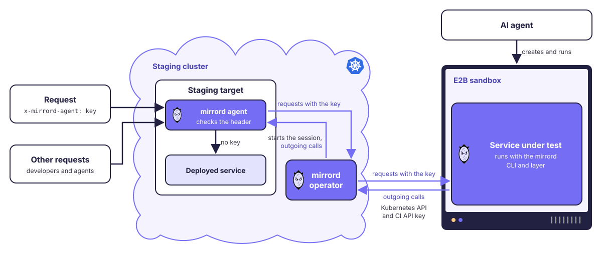

# Test E2B Sandbox Code Against Staging

Many AI agents run their code in an E2B sandbox. The sandbox isolates the code from your machines and your cluster. It does not give the code the services, queues, and databases of your real environment. The agent then can only check that the code compiles and that the unit tests pass.

mirrord adds that connection. The E2B sandbox runs the code, and mirrord in the sandbox connects the code to a target in your staging cluster. The agent can then test a change against the real APIs, queues, and databases. The process steals only the requests that carry its own header, so other developers and agents continue to use staging.

This page shows a Python script that creates an E2B sandbox, starts a service under mirrord, sends one request through staging, checks the answer, and stops mirrord.

## How it works

The script creates an E2B sandbox from a template that contains mirrord, and gives the sandbox a kubeconfig and a CI API key. mirrord starts the service in the sandbox and connects to the mirrord Operator through the Kubernetes API. The staging target continues to serve all requests, except the requests whose header carries the session key of the agent. mirrord sends those requests to the service in the sandbox. For the full flow, see [How it works](./sandboxes.md#how-it-works).



## What you need

- The setup in [Run AI Sandbox Code Against Staging](./sandboxes.md): the mirrord Operator on the Enterprise plan, a CI API key, an agent identity with its RBAC, a kubeconfig without an auth plugin, a Kubernetes API server and a staging endpoint that the sandbox can reach, and the files `mirrord.json` and `check.sh`. Sessions with a CI API key are machine sessions and do not take up seats.
- An E2B account and an API key.
- The E2B Python SDK on the machine that runs the script.

## E2B behavior and limits

E2B runs each sandbox in a Firecracker microVM with its own kernel ([E2B infrastructure](https://github.com/e2b-dev/infra)). The mirrord layer works there as on other Linux VMs. The default E2B base image is Debian, so it has glibc ([Base image](https://docs.e2b.dev/template/base-image)).

- **Network:** Sandboxes have outbound internet access by default. If you limit egress with `network`, allow the IP address of the Kubernetes API server and of `STAGING_URL` ([Internet access](https://docs.e2b.dev/sandbox/internet-access)).
- **Egress addresses:** E2B does not publish fixed egress addresses ([E2B egress IP ranges](https://docs.e2b.dev/faq/egress-ip-ranges)).
- **Secrets:** Give the kubeconfig and the CI API key with `envs` ([Environment variables](https://docs.e2b.dev/sandbox/environment-variables)). These values are visible to all processes in the sandbox. Do not use E2B secrets for them. The environment variable of an E2B secret holds a placeholder, such as `${e2b.secrets.<name>}`, and mirrord needs the real value.

For the limits on all platforms, see [Behavior and limits](./sandboxes.md#behavior-and-limits).

## Run the check in an E2B sandbox

The script reads `SANDBOX_KUBECONFIG`, `MIRRORD_CI_API_KEY`, and `STAGING_URL` from your environment. Change its constants to match your service. See [The values for the Python scripts](./sandboxes.md#the-values-for-the-python-scripts).

1. Install the SDK with `pip install e2b`, and set `E2B_API_KEY`.
2. Save this script as `run_e2b.py` next to `mirrord.json` and `check.sh`.
3. Run `python3 run_e2b.py`.

```python
import base64
import os
import uuid

from e2b import Sandbox, Template, default_build_logger

MIRRORD_VERSION = "3.288.0"
APP_REPO = "https://github.com/your-org/orders-api.git"
APP_CMD = "python3 app.py"
APP_PORT = "8080"
EXPECTED = '"version": "sandbox"'
KEY = f"agent-{uuid.uuid4().hex}"

INSTALL = (
    "curl -fsSL https://raw.githubusercontent.com/metalbear-co/mirrord/main/scripts/install.sh"
    f" | MIRRORD_INSTALL_DIR=/usr/local/bin bash -s -- {MIRRORD_VERSION}"
)

# The Debian base image has glibc, curl, git, and Python.
template = Template().from_base_image().run_cmd(INSTALL, user="root")
Template.build(template, "mirrord-sandbox", cpu_count=2, memory_mb=2048,
               on_build_logs=default_build_logger())

with open(os.environ["SANDBOX_KUBECONFIG"], "rb") as f:
    kubeconfig_b64 = base64.b64encode(f.read()).decode()

sandbox = Sandbox.create(
    template="mirrord-sandbox",
    timeout=900,
    envs={
        "KUBECONFIG_B64": kubeconfig_b64,
        "MIRRORD_CI_API_KEY": os.environ["MIRRORD_CI_API_KEY"],
        "AGENT_KEY": KEY,
        "APP_PORT": APP_PORT,
        "STAGING_URL": os.environ["STAGING_URL"],
        "EXPECTED": EXPECTED,
    },
)
try:
    for name in ("mirrord.json", "check.sh"):
        with open(name) as f:
            sandbox.files.write(f"/tmp/{name}", f.read())
    sandbox.commands.run(f"git clone --depth 1 {APP_REPO} /tmp/app", timeout=120)
    # commands.run raises an exception when check.sh exits with an error.
    result = sandbox.commands.run(
        f"cd /tmp/app && bash /tmp/check.sh {APP_CMD}", timeout=600
    )
    print(result.stdout)
finally:
    sandbox.kill()
```

## Troubleshooting

| Problem | Cause and fix |
|---|---|
| `` `MIRRORD_CI_API_KEY` is required `` or the key does not decode. | The variable holds the placeholder of an E2B secret. Give the real key with `envs`. |
| A timeout when mirrord connects to the Kubernetes API. | The `network` setting of the sandbox blocks the API server, or the cluster blocks the sandbox. Allow the IP address of the API server in `network`, and allow the sandbox in the authorized networks of the cluster. |

For the problems on all platforms, see [Troubleshooting](./sandboxes.md#troubleshooting).

## FAQ

### Can I use mirrord in an E2B sandbox?

Yes. Install mirrord in the sandbox template, and give the sandbox a kubeconfig and a CI API key. The sandbox must reach the Kubernetes API server of your cluster.

### Does mirrord work in a Firecracker sandbox?

Yes. A Firecracker microVM has its own Linux kernel, so mirrord works there as on other Linux VMs.

For more questions, see [FAQ](./sandboxes.md#faq).

## See also

- [Run AI Sandbox Code Against Staging](./sandboxes.md)
- [Test Modal Sandbox Code Against Staging](./modal.md)
- [Using mirrord with Cloud Agents](./cloud-agents.md)
- [CI/CD Integration](../use-cases/mirrord-for-ci.md)
