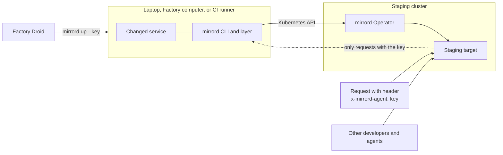

# Test Factory Droid Changes Against Staging

[Factory](https://factory.ai) Droids write code changes on a developer laptop, in Factory cloud computers, and in CI with `droid exec`. To check a change to a microservice, a Droid needs the services, queues, and databases that the service talks to. Without them, the Droid can only check that the code compiles and that the unit tests pass.

mirrord gives the Droid that connection. The Droid runs the changed service on its own machine, and mirrord connects the process to a target in your staging cluster. The Droid then sends real requests, reads the real results, and fixes what breaks. Nothing is deployed. Each Droid session steals only the requests that carry its own session key in a header, so other developers and agents continue to use staging.

## How it works

The Droid reads the instructions in `AGENTS.md`, picks a session key, and starts the service with `mirrord up`. mirrord connects to the mirrord Operator through the Kubernetes API, and the Operator starts a session on the staging target. The target continues to serve all requests, except the requests whose `x-mirrord-agent` header holds the key of the Droid session. mirrord sends those requests to the service that the Droid runs.



This page uses `mirrord up`, because one `mirrord-up.yaml` file holds the target, the filter, and the command, and `--key` sets the session key.

## Prerequisites

- The mirrord Operator in the staging cluster. Many Droid sessions on one target need the Operator.
- A staging service with an HTTP endpoint that the Droid can reach, for example through an ingress. The ingress must forward the `x-mirrord-agent` header to the service. If the requests come through other services, those services must [propagate the header](../sharing-the-cluster/header-propagation.md).
- The source code of the service in the repository that the Droid works on.
- A Linux or macOS machine with glibc for the Droid. The mirrord Linux binary does not work on Alpine or other musl images.

For Factory cloud computers and CI, you also need the Enterprise plan, a CI API key, and a Kubernetes identity for agents. See [Using mirrord with Cloud Agents](./cloud-agents.md). Bind the identity to the `mirrord-operator-ci` ClusterRole, and give it `get` on the target deployment and `list` on pods in the target namespace.

## Add the mirrord files to the repository

Save this file as `mirrord-up.yaml` at the root of the repository. Change the context, the target, and the command to match your service.

```yaml
common:
  operator: true
  context: staging
services:
  orders-api:
    target:
      path: deployment/orders-api
      namespace: staging
    http_filter:
      header_filter: "^x-mirrord-agent: {{ key }}$"
    run:
      command: ["python3", "app.py"]
```

- `context` is the name of the staging context in the kubeconfig. It keeps the session on staging after a context switch.
- `{{ key }}` gets the value of `--key`. Without `--key`, `mirrord up` uses the OS username, so all Droids on the same machine image get the same key.
- The header filter is a regular expression. The `^` and `$` anchors stop the filter for `droid-1` from also matching `droid-10`.

Then add this section to `AGENTS.md` at the root of the repository. Droids read `AGENTS.md` from the current directory up to the git root, and also accept `CLAUDE.md` ([AGENTS.md](https://docs.factory.com/docs/harness/agents-md)).


If the tests write to or delete data in a database that other people use, do not run them against the shared database. Use [DB branching](../sharing-the-cluster/db-branching.md) to give each session its own copy.


```markdown
## Test changes against staging with mirrord

ALWAYS test a change to orders-api against staging with mirrord before you report it as done.

1. If `KUBECONFIG_B64` is set and `~/.kube/config` does not exist, decode it:
   `mkdir -p ~/.kube && echo "$KUBECONFIG_B64" | base64 -d > ~/.kube/config && chmod 600 ~/.kube/config`
2. Use `$MIRRORD_KEY` as the session key. If it is not set, make a key with `echo droid-$(openssl rand -hex 4)`,
   and start each later command with `export MIRRORD_KEY=<that key>;`. Each command runs in a new shell.
   Use only letters, numbers, and dashes in the key. Never use the key of another session.
3. Start the service in the background, and save its process ID:
   `MIRRORD_PROGRESS_MODE=simple mirrord up --key "$MIRRORD_KEY" > /tmp/mirrord-up.log 2>&1 & echo $! > /tmp/mirrord-up.pid`
4. Wait until the service listens on port 8080. Read /tmp/mirrord-up.log if it does not start.
5. Test the change with requests to https://orders.staging.example.com that carry the header `x-mirrord-agent: $MIRRORD_KEY`.
   Read the answers and the service logs, and fix the code until the result is correct.
6. Stop the session: `kill "$(cat /tmp/mirrord-up.pid)"`. Do not leave it running.

- NEVER target a production cluster.
- NEVER use `--mode replace`. It sends the traffic of all users to your process.
- After two failures to start mirrord, stop and report the error. Do not retry in a loop.
```

The Droid runs each command in a new shell. A background process stays alive across commands, but shell variables and job numbers such as `%1` do not.

## Run a Droid on a developer laptop

A Droid on a laptop uses the kubeconfig and the mirrord license of the developer.

1. Install the mirrord CLI. See [Install mirrord](../getting-started/install-mirrord.md).
2. Install the Droid CLI with `curl -fsSL https://app.factory.ai/cli | sh`. The binary goes to `~/.local/bin`.
3. Register the [mirrord MCP server](./mcp-server.md) with `droid mcp add mirrord "mirrord mcp"`.
4. Start `droid` in the repository and give it a task.

The MCP server gives the Droid the mirrord skills for your installed mirrord version, and it validates the configs that the Droid writes. To install the skills as files, see [Agent Skills for mirrord](./ai-skills-plugin.md). Droid loads skills from `.factory/skills/` and `.agents/skills/` in the repository, and from `~/.factory/skills/` ([Skills](https://docs.factory.com/docs/harness/skills)). To make the `AGENTS.md` section for many services at once, use the [meta-prompt](./the-meta-prompt.md).

A prompt to start with: "Add a `currency` field to the `/orders` response, and test it against staging with mirrord as AGENTS.md says."

## Run Droids in Factory Environments and Droid Computers

A Factory [Environment](https://docs.factory.com/docs/environments/create) is a build of your repositories and setup scripts. Each session from an Environment starts a fresh instance from the last Ready build ([Run Droids](https://docs.factory.com/docs/environments/run-droids)). A [Droid Computer](https://docs.factory.com/docs/droid-computers/overview) is a persistent cloud computer that keeps its files and tools between sessions.


Secrets are not available during the Environment build. Do not put the kubeconfig or the CI API key in a setup script.


1. In **Settings → Environments**, add this line to the global setup script. It installs mirrord to `~/.local/bin`.

   ```bash
   curl -fsSL https://raw.githubusercontent.com/metalbear-co/mirrord/main/scripts/install.sh | MIRRORD_INSTALL_DIR="$HOME/.local/bin" bash -s -- 3.288.0
   ```

2. On your workstation, encode the kubeconfig of the agent identity as one base64 line:

   ```bash
   base64 < agent-kubeconfig.yaml | tr -d '\n'
   ```

3. In **Settings → Account → Secrets**, add `KUBECONFIG_B64` with that line. Choose **Organization** to share it with all members.
4. Add `MIRRORD_CI_API_KEY` with the key from `mirrord ci api-key`.
5. Start a session on the Environment. Step 1 of the `AGENTS.md` section writes the kubeconfig at session runtime.

Factory gives secrets to sessions as environment variables. A secret value must be one line of at most 10,000 characters, so the kubeconfig can be at most about 7,500 bytes before encoding ([Secrets](https://docs.factory.com/docs/environments/prerequisites)). Use a kubeconfig with a service account token and no auth plugin, such as `gke-gcloud-auth-plugin`. Each Droid session picks its own key, so many sessions can test the same service at the same time.

On a Droid Computer, run the same install command once in a session. The `factory-user` account has passwordless sudo, so you can also install mirrord to `/usr/local/bin`.

On a Factory machine, the secrets are in the environment of login shells. If a command does not see a secret, run it with `bash -lc`.

## Run headless Droids in CI with `droid exec`

`droid exec "<prompt>"` runs a Droid without a terminal and exits non-zero when the run stops early ([Droid Exec](https://docs.factory.com/docs/droid-exec/overview)). By default it is read-only. `--auto low`, `--auto medium`, and `--auto high` allow more actions.

### Prerequisites

- A paid Factory plan. `droid exec` in CI needs a Factory API key, and API keys need a paid plan.
- A Factory API key from [app.factory.ai/settings/api-keys](https://app.factory.ai/settings/api-keys).
- The Enterprise plan for mirrord, and a CI API key from `mirrord ci api-key`.
- A Kubernetes API server that the CI runners can reach.

### GitHub Actions example

Add three repository secrets: `FACTORY_API_KEY`, `STAGING_KUBECONFIG_B64` (the base64 line from the previous section), and `MIRRORD_CI_API_KEY`. This workflow lets a Droid test each pull request against staging and write a report.

```yaml
name: droid-staging-check
on:
  pull_request:

jobs:
  staging-check:
    # Secrets are not given to pull requests from forks.
    if: github.event.pull_request.head.repo.full_name == github.repository
    runs-on: ubuntu-latest
    permissions:
      contents: read
    env:
      FACTORY_API_KEY: ${{ secrets.FACTORY_API_KEY }}
      KUBECONFIG_B64: ${{ secrets.STAGING_KUBECONFIG_B64 }}
      MIRRORD_CI_API_KEY: ${{ secrets.MIRRORD_CI_API_KEY }}
      MIRRORD_KEY: droid-${{ github.run_id }}-${{ github.run_attempt }}
      MIRRORD_PROGRESS_MODE: simple
    steps:
      - uses: actions/checkout@v4
      - name: Install mirrord and droid
        run: |
          curl -fsSL https://raw.githubusercontent.com/metalbear-co/mirrord/main/scripts/install.sh \
            | MIRRORD_INSTALL_DIR="$HOME/.local/bin" bash -s -- 3.288.0
          curl -fsSL https://app.factory.ai/cli | sh
          echo "$HOME/.local/bin" >> "$GITHUB_PATH"
      - name: Test the change against staging
        run: |
          droid exec --auto medium --cwd "$GITHUB_WORKSPACE" \
            "Test the change in this pull request against staging with mirrord, as AGENTS.md says. \
            Do not edit files. Write the result to droid-report.md, and make its first line PASS or FAIL."
      - name: Check the result
        run: head -n 1 droid-report.md | grep -qx PASS
      - uses: actions/upload-artifact@v4
        if: always()
        with:
          name: droid-report
          path: droid-report.md
```

To pin the Droid CLI version, install it with `npm install -g droid@<version>`. The job runs for every pull request from a branch of the repository, with no manual approval. The `if` line keeps the secrets away from pull requests from forks. `droid exec` exits with 0 also when the Droid reports a failed test, so the `Check the result` step reads the first line of the report.

## Behavior and limits

- **Each Droid session needs its own key.** Sessions with different keys can target the same service at the same time. Sessions with the same key get each other's requests.
- **The session ends with mirrord.** The session ends when the Droid stops `mirrord up`, or when the instance or the CI job stops.
- **Nothing is deployed.** The staging target continues to serve all requests without the header.
- **Queues and databases need their own setup.** `mirrord up` splits queues with the session key when the Operator has queue splitting for the target. For databases, use DB branching. See [Using mirrord with Cloud Agents](./cloud-agents.md#4-keep-agent-sessions-apart).
- **Laptop sessions use the seat of the developer.** When `MIRRORD_CI_API_KEY` is set, `mirrord up` starts machine sessions, which do not take up seats.

## Troubleshooting

| Problem | Cause and fix |
|---|---|
| mirrord prints nothing, and the command does not end. | The Droid shell has no terminal. Set `MIRRORD_PROGRESS_MODE=simple`. |
| `mirrord: command not found` in a cloud session. | The install directory is not on `PATH`. Add `~/.local/bin` to `PATH`, or install to `/usr/local/bin`. |
| `` `MIRRORD_CI_API_KEY` is required `` | The secret is not set for the session. Add it in **Settings → Account → Secrets**, and start a new session. |
| `~/.kube/config` is empty, or `base64: invalid input`. | The secret holds line breaks, or it is cut. Encode the file again with `tr -d '\n'`. |
| `Secret name is reserved by the managed computer runtime.` | Factory reserves this name. Use another name, for example `MY_` plus the name. |
| `... is forbidden: User "system:serviceaccount:..." cannot ...` | The agent identity does not have the permission. Bind it to `mirrord-operator-ci`, and give it `get` on the target deployment and `list` on pods. |
| `executable "gke-gcloud-auth-plugin" not found` or a similar error. | The kubeconfig uses an auth plugin that is not installed. Use a kubeconfig with a service account token. |
| The staging service, not the Droid, answers the request. | The service does not run yet, or the header does not match. Wait until the service listens on port 8080, and check the key and the header name. Also check that the ingress forwards the header. |
| `droid exec` passes, but the report says that the test failed. | `droid exec` exits with 0 when the Droid finishes. Check the first line of `droid-report.md` in a later step. |
| `droid exec` stops with a permission error. | The autonomy level is too low for mirrord. Use `--auto medium`. |

For mirrord logs, see [Collecting logs](../troubleshooting/collecting-logs.md).

## FAQ

### Can a Factory Droid test its changes against my staging cluster?

Yes. Install mirrord where the Droid runs, give it a kubeconfig, and add the `AGENTS.md` section. The Droid then starts the changed service with `mirrord up` and sends requests through staging.

### Does each Droid session take a mirrord seat?

A Droid on a laptop uses the seat of the developer. Sessions in Factory cloud computers and CI use a CI API key. These are machine sessions, and they count towards the concurrent machine sessions of your [plan](https://metalbear.com/mirrord/pricing/).

### Can many Droids use the same staging service at the same time?

Yes. Give each Droid session a different key. Each session then steals only the requests with its own header, and the staging service serves all other requests.

### Why can the setup script not write the kubeconfig?

Factory does not give secrets to the Environment build. The Droid writes the kubeconfig from `KUBECONFIG_B64` when the session starts.

### Do I need to expose the cluster to the internet?

The Droid machine needs to reach the Kubernetes API server and the staging endpoint that it tests. You do not need to expose the mirrord Operator.

## See also

- [Using mirrord with Cloud Agents](./cloud-agents.md)
- [Test Claude Code Changes Against Staging](./claude-code.md)
- [Configure AI Agents to Use mirrord](./the-meta-prompt.md)
- [Multiple Concurrent Sessions (`mirrord up`)](../using-mirrord/multiple-concurrent-sessions.md)
- [CI/CD Integration](../use-cases/mirrord-for-ci.md)
- [Filtering Incoming Traffic](../using-mirrord/incoming-traffic/filter-incoming-traffic.md)
