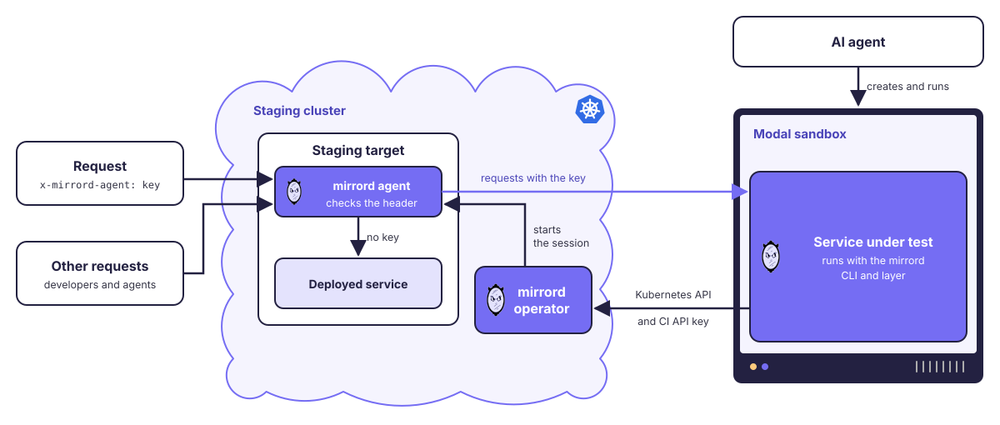

# Test Modal Sandbox Code Against Staging

Many AI agents run their code in a Modal sandbox. The sandbox isolates the code from your machines and your cluster. It does not give the code the services, queues, and databases of your real environment. The agent then can only check that the code compiles and that the unit tests pass.

mirrord adds that connection. The Modal sandbox runs the code, and mirrord in the sandbox connects the code to a target in your staging cluster. The agent can then test a change against the real APIs, queues, and databases. The process steals only the requests that carry its own header, so other developers and agents continue to use staging.

This page shows a Python script that creates a Modal sandbox, starts a service under mirrord, sends one request through staging, checks the answer, and stops mirrord.

## How it works

The script creates a Modal sandbox from an image that contains mirrord, and gives the sandbox a kubeconfig and a CI API key. mirrord starts the service in the sandbox and connects to the mirrord Operator through the Kubernetes API. The staging target continues to serve all requests, except the requests whose header carries the session key of the agent. mirrord sends those requests to the service in the sandbox. For the full flow, see [How it works](./sandboxes.md#how-it-works).



## What you need

- The setup in [Run AI Sandbox Code Against Staging](./sandboxes.md): the mirrord Operator on the Enterprise plan, a CI API key, an agent identity with its RBAC, a kubeconfig without an auth plugin, a Kubernetes API server and a staging endpoint that the sandbox can reach, and the files `mirrord.json` and `check.sh`. Sessions with a CI API key are machine sessions and do not take up seats.
- A Modal account.
- The Modal Python SDK on the machine that runs the script.

## Modal behavior and limits

Create the sandbox with `runtime="vm"`. With `runtime="vm"`, `Sandbox.create` runs the sandbox in a VM with its own Linux kernel, and the mirrord layer works as on other Linux VMs. `Image.debian_slim` is a Debian image, so it has glibc ([Images](https://modal.com/docs/guide/images)).

- **Network:** `Sandbox.create` does not block the network by default (`block_network=False`). If you set `outbound_cidr_allowlist`, include the CIDR of the Kubernetes API server and of `STAGING_URL` ([modal.Sandbox](https://modal.com/docs/reference/modal.Sandbox)).
- **Egress addresses:** Modal gives fixed egress addresses with a Proxy on the Team and Enterprise plans ([Proxy IPs](https://modal.com/docs/guide/proxy-ips)).
- **Secrets:** Modal gives the keys of a secret to the sandbox as environment variables ([Secrets](https://modal.com/docs/guide/secrets)).


Modal runs containers in an isolated sandbox with "primitives like gVisor or microVMs" ([Security](https://modal.com/docs/guide/security)), and Modal uses gVisor as its container runtime ([Modal and gVisor](https://modal.com/blog/modal-gvisor-maintainer)). gVisor implements the Linux system calls in user space, and some calls have only partial support ([gVisor compatibility](https://gvisor.dev/docs/user_guide/compatibility/linux/amd64/)). Under the gVisor runtime (`runtime="gvisor"`), the mirrord layer has these limits:

- A Python service stops with a segmentation fault (`SIGSEGV`) when it imports the `socket` module, also with all mirrord features off.
- The sandbox has no IPv6 loopback address. The service must listen on an IPv4 address, such as `0.0.0.0`, not on `::`.
- With the default `fs` mode, `busybox httpd` stops with `memory allocation of ... bytes failed` when it answers a request. Set `feature.fs` to `local` if your service stops with this error.

A service that is not written in Python, such as `busybox httpd`, listens on `0.0.0.0`, and runs with `feature.fs` set to `local`, gets the stolen requests.


For the limits on all platforms, see [Behavior and limits](./sandboxes.md#behavior-and-limits).

## Run the check in a Modal sandbox

The script reads `SANDBOX_KUBECONFIG`, `MIRRORD_CI_API_KEY`, and `STAGING_URL` from your environment. Change its constants to match your service. See [The values for the Python scripts](./sandboxes.md#the-values-for-the-python-scripts).

1. Install the SDK with `pip install modal`, and run `modal setup`.
2. Save this script as `run_modal.py` next to `mirrord.json` and `check.sh`.
3. Run `python3 run_modal.py`.

```python
import base64
import os
import uuid

import modal

MIRRORD_VERSION = "3.288.0"
APP_REPO = "https://github.com/your-org/orders-api.git"
APP_CMD = "python3 app.py"
APP_PORT = "8080"
EXPECTED = '"version": "sandbox"'
KEY = f"agent-{uuid.uuid4().hex}"

image = (
    modal.Image.debian_slim()
    .apt_install("curl", "ca-certificates", "git")
    .run_commands(
        "curl -fsSL https://raw.githubusercontent.com/metalbear-co/mirrord/main/scripts/install.sh"
        f" | MIRRORD_INSTALL_DIR=/usr/local/bin bash -s -- {MIRRORD_VERSION}"
    )
)

with open(os.environ["SANDBOX_KUBECONFIG"], "rb") as f:
    kubeconfig_b64 = base64.b64encode(f.read()).decode()

# For a long-lived setup, create a named secret and use modal.Secret.from_name.
secret = modal.Secret.from_dict({
    "KUBECONFIG_B64": kubeconfig_b64,
    "MIRRORD_CI_API_KEY": os.environ["MIRRORD_CI_API_KEY"],
})

app = modal.App.lookup("mirrord-sandbox", create_if_missing=True)
sandbox = modal.Sandbox.create(
    app=app,
    image=image,
    secrets=[secret],
    env={
        "AGENT_KEY": KEY,
        "APP_PORT": APP_PORT,
        "STAGING_URL": os.environ["STAGING_URL"],
        "EXPECTED": EXPECTED,
    },
    timeout=900,
    # Under the gVisor runtime, a Python service stops with a segmentation fault.
    runtime="vm",
)
try:
    for name in ("mirrord.json", "check.sh"):
        with open(name) as f:
            sandbox.filesystem.write_text(f.read(), f"/tmp/{name}")
    process = sandbox.exec(
        "bash", "-c",
        f"git clone --depth 1 {APP_REPO} /tmp/app"
        f" && cd /tmp/app && bash /tmp/check.sh {APP_CMD}",
        timeout=600,
    )
    print(process.stdout.read())
    print(process.stderr.read())
    process.wait()
    if process.returncode != 0:
        raise SystemExit(f"check.sh failed with exit code {process.returncode}")
finally:
    sandbox.terminate()
```

## Troubleshooting

| Problem | Cause and fix |
|---|---|
| The service stops with a segmentation fault. | The sandbox uses the gVisor runtime, and the service is written in Python. Create the sandbox with `runtime="vm"`. |
| `Cannot assign requested address (os error 99)` in the answer. | The sandbox uses the gVisor runtime, which has no IPv6 loopback address, and the service listens on `::`. Create the sandbox with `runtime="vm"`, or make the service listen on `0.0.0.0`. |

For the problems on all platforms, see [Troubleshooting](./sandboxes.md#troubleshooting).

## FAQ

### Can I use mirrord in a Modal sandbox?

Yes. Install mirrord in the sandbox image, and give the sandbox a kubeconfig and a CI API key. The sandbox must reach the Kubernetes API server of your cluster. Create the sandbox with `runtime="vm"`.

### Does mirrord work in a gVisor sandbox?

gVisor implements the Linux system calls in user space. Under gVisor, a Python service stops with a segmentation fault, and the service must listen on IPv4. On Modal, use `runtime="vm"`.

For more questions, see [FAQ](./sandboxes.md#faq).

## See also

- [Run AI Sandbox Code Against Staging](./sandboxes.md)
- [Test E2B Sandbox Code Against Staging](./e2b.md)
- [Using mirrord with Cloud Agents](./cloud-agents.md)
- [CI/CD Integration](../use-cases/mirrord-for-ci.md)
