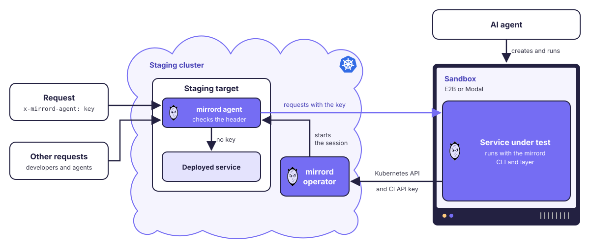

# Run AI Sandbox Code Against Staging

Many AI agents run their code in a remote sandbox, such as an E2B, Daytona, or Modal sandbox. The sandbox isolates the code from your machines and your cluster. It does not give the code the services, queues, and databases of your real environment. The agent then can only check that the code compiles and that the unit tests pass.

mirrord adds that connection. The sandbox runs the code, and mirrord in the sandbox connects the code to a target in your staging cluster. The agent can then test a change against the real APIs, queues, and databases. The process steals only the requests that carry its own header, so other developers and agents continue to use staging.

This page shows one setup for each of the three sandbox platforms. Each setup uses a Python script that creates a sandbox, starts a service under mirrord, sends one request through staging, checks the answer, and stops mirrord.

## How it works

The agent, or a script that the agent calls, creates a sandbox from an image that contains mirrord. The sandbox gets a kubeconfig and a CI API key as secrets. mirrord starts the service in the sandbox and connects to the mirrord Operator through the Kubernetes API. The Operator starts a session on the staging target. The target continues to serve all requests, except the requests whose header carries the session key of the agent. mirrord sends those requests to the service in the sandbox.



The scripts on this page use `mirrord ci start`, not `mirrord up`. `mirrord ci start` starts the service in the background and returns, so one shell script can start the service, send the request, and stop the session with `mirrord ci stop`.

## What you need

- The mirrord Operator in the cluster, on the Enterprise plan.
- A CI API key and a Kubernetes identity for your agents. See [Using mirrord with Cloud Agents](./cloud-agents.md) for how to create them. Sessions with a CI API key are machine sessions and do not take up seats.
- A Kubernetes API server that the sandbox can reach from the internet. The sandbox platform must also let the sandbox open outbound connections to it.
- A kubeconfig for the agent identity that does not need an auth plugin, for example a kubeconfig with a service account token. A sandbox image usually does not contain plugins such as `gke-gcloud-auth-plugin` or `aws`.
- A staging service with an HTTP endpoint that the sandbox can reach, for example through an ingress. The ingress must forward the `x-mirrord-agent` header to the service.
- An account and an API key for E2B, Daytona, or Modal, and the Python SDK of that platform on the machine that runs the script.

Bind the agent identity to the `mirrord-operator-ci` ClusterRole. Also give it `get` on the target deployment and `list` on pods in the target namespace. See [Security](../managing-mirrord/security.md) for the built-in roles. For example, this Role and RoleBinding give these permissions to the service account `mirrord-agent`:

```yaml
apiVersion: rbac.authorization.k8s.io/v1
kind: Role
metadata:
  name: mirrord-sandbox-target
  namespace: staging
rules:
  - apiGroups: ["apps"]
    resources: ["deployments"]
    resourceNames: ["orders-api"]
    verbs: ["get"]
  - apiGroups: [""]
    resources: ["pods"]
    verbs: ["list"]
---
apiVersion: rbac.authorization.k8s.io/v1
kind: RoleBinding
metadata:
  name: mirrord-sandbox-target
  namespace: staging
roleRef:
  apiGroup: rbac.authorization.k8s.io
  kind: Role
  name: mirrord-sandbox-target
subjects:
  - kind: ServiceAccount
    name: mirrord-agent
    namespace: staging
```

## Prepare the files for the sandbox

All three setups put the same two files in the sandbox: a mirrord configuration and a shell script that runs the check.

### The mirrord configuration

Save this file as `mirrord.json` next to the Python script. Change the target to your staging service.

```json
{
  "target": {
    "path": "deployment/orders-api",
    "namespace": "staging"
  },
  "operator": true,
  "feature": {
    "network": {
      "incoming": {
        "mode": "steal",
        "http_filter": {
          "header_filter": "^x-mirrord-agent: {{ key }}$"
        }
      }
    }
  },
  "ci": {
    "output_dir": "/tmp/mirrord-ci"
  }
}
```

The `{{ key }}` template gets the session key that the script gives with `--key`. The header filter is a regular expression, and the `^` and `$` anchors stop one key from matching a longer key. For example, without the anchors the filter for `agent-1` also matches `agent-10`. Use keys that contain only letters, numbers, and dashes. `ci.output_dir` is the directory where mirrord writes the output of the service.

### The check script

Save this file as `check.sh` next to the Python script. It runs in the sandbox, and it takes the command that starts the service as its arguments. The check passes when a request with the header gets the answer of the service in the sandbox, and a request without the header gets the answer of staging.


`mirrord ci start` returns some seconds before the steal is active. The script sends requests with the header until the service in the sandbox answers. Do not remove that loop.


```bash
#!/bin/bash
# Runs in the sandbox: bash /tmp/check.sh <command that starts the service>
# Needs KUBECONFIG_B64, MIRRORD_CI_API_KEY, AGENT_KEY, APP_PORT, STAGING_URL, and EXPECTED.
set -euo pipefail

# Without a terminal, the default progress mode prints nothing.
export MIRRORD_PROGRESS_MODE=simple

mkdir -p "$HOME/.kube"
echo "$KUBECONFIG_B64" | base64 -d > "$HOME/.kube/config"
chmod 600 "$HOME/.kube/config"

trap 'mirrord ci stop || true' EXIT
mirrord ci start -f /tmp/mirrord.json --key "$AGENT_KEY" -- "$@"

# Wait until the service listens on its port.
for i in $(seq 1 60); do
  if (exec 3<>"/dev/tcp/127.0.0.1/$APP_PORT") 2>/dev/null; then break; fi
  if [ "$i" -eq 60 ]; then echo "The service did not start." >&2; exit 1; fi
  sleep 2
done

# The steal starts some seconds after mirrord ci start returns.
for i in $(seq 1 30); do
  answer=$(curl -s --connect-timeout 5 --max-time 10 \
    -H "x-mirrord-agent: $AGENT_KEY" "$STAGING_URL" || true)
  if [[ "$answer" == *"$EXPECTED"* ]]; then break; fi
  if [ "$i" -eq 30 ]; then
    echo "The answer with the header is not from the sandbox: $answer" >&2; exit 1
  fi
  sleep 2
done
echo "With the header: $answer"

# A request without the header must get a successful answer of staging.
if ! answer=$(curl -sf --connect-timeout 5 --max-time 10 "$STAGING_URL"); then
  echo "Staging did not send a successful answer to the request without the header." >&2; exit 1
fi
echo "Without the header: $answer"
if [[ "$answer" == *"$EXPECTED"* ]]; then
  echo "A request without the header got the answer of the sandbox." >&2; exit 1
fi
echo "The sandbox got the request with the header, and staging got the request without it."
```

### The values for the Python scripts

Each Python script reads these environment variables on your machine:

- `SANDBOX_KUBECONFIG`: the path of the kubeconfig for the agent identity.
- `MIRRORD_CI_API_KEY`: the CI API key from `mirrord ci api-key`.
- `STAGING_URL`: the staging URL to send the request to, for example `https://orders.staging.example.com/health`.

Each script also has these constants. Change them to match your service:

- `MIRRORD_VERSION`: the mirrord release to install in the image. Use the same version for all sandboxes.
- `APP_REPO`: the repository of the service. In an agent sandbox, the code is usually there already. Then remove the `git clone` step.
- `APP_CMD`: the command that starts the service, for example `python3 app.py`.
- `APP_PORT`: the port that the service listens on. It must be the port of the target container.
- `EXPECTED`: a text that only the answer of the changed code contains, for example `"version": "sandbox"`. The answer of staging must not contain it.

## E2B

E2B runs each sandbox in a Firecracker microVM with its own kernel ([E2B infrastructure](https://github.com/e2b-dev/infra)). Sandboxes have outbound internet access by default. If you limit egress with `network`, allow the IP address of the Kubernetes API server and of `STAGING_URL` ([Internet access](https://docs.e2b.dev/sandbox/internet-access)). The default E2B base image is Debian, so it has glibc ([Base image](https://docs.e2b.dev/template/base-image)).

Give the kubeconfig and the CI API key with `envs` ([Environment variables](https://docs.e2b.dev/sandbox/environment-variables)). These values are visible to all processes in the sandbox. Do not use E2B secrets for them. The environment variable of an E2B secret holds a placeholder, such as `${e2b.secrets.<name>}`, and mirrord needs the real value.

1. Install the SDK with `pip install e2b`, and set `E2B_API_KEY`.
2. Save this script as `run_e2b.py` next to `mirrord.json` and `check.sh`.
3. Run `python3 run_e2b.py`.

```python
import base64
import os
import uuid

from e2b import Sandbox, Template, default_build_logger

MIRRORD_VERSION = "3.288.0"
APP_REPO = "https://github.com/your-org/orders-api.git"
APP_CMD = "python3 app.py"
APP_PORT = "8080"
EXPECTED = '"version": "sandbox"'
KEY = f"agent-{uuid.uuid4().hex}"

INSTALL = (
    "curl -fsSL https://raw.githubusercontent.com/metalbear-co/mirrord/main/scripts/install.sh"
    f" | MIRRORD_INSTALL_DIR=/usr/local/bin bash -s -- {MIRRORD_VERSION}"
)

# The Debian base image has glibc, curl, git, and Python.
template = Template().from_base_image().run_cmd(INSTALL, user="root")
Template.build(template, "mirrord-sandbox", cpu_count=2, memory_mb=2048,
               on_build_logs=default_build_logger())

with open(os.environ["SANDBOX_KUBECONFIG"], "rb") as f:
    kubeconfig_b64 = base64.b64encode(f.read()).decode()

sandbox = Sandbox.create(
    template="mirrord-sandbox",
    timeout=900,
    envs={
        "KUBECONFIG_B64": kubeconfig_b64,
        "MIRRORD_CI_API_KEY": os.environ["MIRRORD_CI_API_KEY"],
        "AGENT_KEY": KEY,
        "APP_PORT": APP_PORT,
        "STAGING_URL": os.environ["STAGING_URL"],
        "EXPECTED": EXPECTED,
    },
)
try:
    for name in ("mirrord.json", "check.sh"):
        with open(name) as f:
            sandbox.files.write(f"/tmp/{name}", f.read())
    sandbox.commands.run(f"git clone --depth 1 {APP_REPO} /tmp/app", timeout=120)
    # commands.run raises an exception when check.sh exits with an error.
    result = sandbox.commands.run(
        f"cd /tmp/app && bash /tmp/check.sh {APP_CMD}", timeout=600
    )
    print(result.stdout)
finally:
    sandbox.kill()
```

## Daytona

Daytona runs sandboxes as Linux containers by default, and it can also run Linux VMs ([Sandboxes](https://www.daytona.io/docs/en/sandboxes)). A container sandbox runs on a Linux kernel, and the mirrord layer loads in it. It builds images from code only for container sandboxes ([Declarative builder](https://www.daytona.io/docs/en/declarative-builder)). `Image.debian_slim` is a Debian image, so it has glibc.

The network access of a Daytona sandbox depends on the tier of your organization ([Network limits](https://www.daytona.io/docs/en/network-limits)):

- On Tier 1 and Tier 2, the organization limits outbound access, and sandbox settings, also `network_allow_list`, cannot change that limit. The sandbox cannot reach a Kubernetes API server that is not on the allow list of Daytona, and mirrord fails with `client error (Connect)`.
- On Tier 3 and Tier 4, the sandbox has full internet access by default.
- To limit egress, use `network_allow_list` with the CIDR of the Kubernetes API server and of `STAGING_URL`. Do not use `domain_allow_list`. With a domain allow list, Daytona intercepts HTTPS with its own CA, and the CA in the kubeconfig does not trust it.

Give the kubeconfig and the CI API key with `env_vars` ([Python SDK](https://www.daytona.io/docs/en/python-sdk/sync/daytona)). Do not use Daytona `secrets` for them. The environment variable of a Daytona secret holds a placeholder, and Daytona puts the real value only in outbound requests to allowed hosts. mirrord decodes the CI API key in the sandbox, so it needs the real value.

1. Install the SDK with `pip install "daytona[v0-sdk]"`, and set `DAYTONA_API_KEY`. The script uses the `v0` API of the SDK, which needs the `v0-sdk` extra from version 2 of the SDK.
2. Save this script as `run_daytona.py` next to `mirrord.json` and `check.sh`.
3. Run `python3 run_daytona.py`.

```python
import base64
import os
import shlex
import uuid

from daytona import Daytona
from daytona.v0 import CreateSandboxFromImageParams, Image

MIRRORD_VERSION = "3.288.0"
APP_REPO = "https://github.com/your-org/orders-api.git"
APP_CMD = "python3 app.py"
APP_PORT = "8080"
EXPECTED = '"version": "sandbox"'
KEY = f"agent-{uuid.uuid4().hex}"

image = Image.debian_slim("3.12").run_commands(
    "apt-get update && apt-get install -y --no-install-recommends curl ca-certificates git"
    " && rm -rf /var/lib/apt/lists/*",
    "curl -fsSL https://raw.githubusercontent.com/metalbear-co/mirrord/main/scripts/install.sh"
    f" | MIRRORD_INSTALL_DIR=/usr/local/bin bash -s -- {MIRRORD_VERSION}",
)

with open(os.environ["SANDBOX_KUBECONFIG"], "rb") as f:
    kubeconfig_b64 = base64.b64encode(f.read()).decode()

daytona = Daytona()
sandbox = daytona.v0.create(
    CreateSandboxFromImageParams(
        image=image,
        env_vars={
            "KUBECONFIG_B64": kubeconfig_b64,
            "MIRRORD_CI_API_KEY": os.environ["MIRRORD_CI_API_KEY"],
            "AGENT_KEY": KEY,
            "APP_PORT": APP_PORT,
            "STAGING_URL": os.environ["STAGING_URL"],
            "EXPECTED": EXPECTED,
        },
    ),
    timeout=0,
    on_snapshot_create_logs=print,
)
try:
    for name in ("mirrord.json", "check.sh"):
        with open(name, "rb") as f:
            sandbox.fs.upload_file(f.read(), f"/tmp/{name}")
    # process.exec runs the command in the shell of the sandbox user, which is not always bash.
    steps = (
        f"git clone --depth 1 {APP_REPO} /tmp/app"
        f" && cd /tmp/app && bash /tmp/check.sh {APP_CMD}"
    )
    result = sandbox.process.exec(f"bash -c {shlex.quote(steps)}", timeout=600)
    print(result.result)
    if result.exit_code != 0:
        raise SystemExit(f"check.sh failed with exit code {result.exit_code}")
finally:
    daytona.v0.delete(sandbox)
```

## Modal

Modal runs containers in an isolated sandbox with "primitives like gVisor or microVMs" ([Security](https://modal.com/docs/guide/security)), and Modal uses gVisor as its container runtime ([Modal and gVisor](https://modal.com/blog/modal-gvisor-maintainer)). gVisor implements the Linux system calls in user space, and some calls have only partial support ([gVisor compatibility](https://gvisor.dev/docs/user_guide/compatibility/linux/amd64/)). With `runtime="vm"`, `Sandbox.create` runs the sandbox in a VM with its own Linux kernel, and the mirrord layer works as on other Linux VMs.

`Sandbox.create` does not block the network by default (`block_network=False`). If you set `outbound_cidr_allowlist`, include the CIDR of the Kubernetes API server and of `STAGING_URL` ([modal.Sandbox](https://modal.com/docs/reference/modal.Sandbox)). `Image.debian_slim` is a Debian image, so it has glibc ([Images](https://modal.com/docs/guide/images)). Modal gives the keys of a secret to the sandbox as environment variables ([Secrets](https://modal.com/docs/guide/secrets)).


The script creates the sandbox with `runtime="vm"`. Under the gVisor runtime (`runtime="gvisor"`), the mirrord layer has these limits:

- A Python service stops with a segmentation fault (`SIGSEGV`) when it imports the `socket` module, also with all mirrord features off.
- The sandbox has no IPv6 loopback address. The service must listen on an IPv4 address, such as `0.0.0.0`, not on `::`.
- With the default `fs` mode, `busybox httpd` stops with `memory allocation of ... bytes failed` when it answers a request. Set `feature.fs` to `local` if your service stops with this error.

A service that is not written in Python, such as `busybox httpd`, listens on `0.0.0.0`, and runs with `feature.fs` set to `local`, gets the stolen requests.


1. Install the SDK with `pip install modal`, and run `modal setup`.
2. Save this script as `run_modal.py` next to `mirrord.json` and `check.sh`.
3. Run `python3 run_modal.py`.

```python
import base64
import os
import uuid

import modal

MIRRORD_VERSION = "3.288.0"
APP_REPO = "https://github.com/your-org/orders-api.git"
APP_CMD = "python3 app.py"
APP_PORT = "8080"
EXPECTED = '"version": "sandbox"'
KEY = f"agent-{uuid.uuid4().hex}"

image = (
    modal.Image.debian_slim()
    .apt_install("curl", "ca-certificates", "git")
    .run_commands(
        "curl -fsSL https://raw.githubusercontent.com/metalbear-co/mirrord/main/scripts/install.sh"
        f" | MIRRORD_INSTALL_DIR=/usr/local/bin bash -s -- {MIRRORD_VERSION}"
    )
)

with open(os.environ["SANDBOX_KUBECONFIG"], "rb") as f:
    kubeconfig_b64 = base64.b64encode(f.read()).decode()

# For a long-lived setup, create a named secret and use modal.Secret.from_name.
secret = modal.Secret.from_dict({
    "KUBECONFIG_B64": kubeconfig_b64,
    "MIRRORD_CI_API_KEY": os.environ["MIRRORD_CI_API_KEY"],
})

app = modal.App.lookup("mirrord-sandbox", create_if_missing=True)
sandbox = modal.Sandbox.create(
    app=app,
    image=image,
    secrets=[secret],
    env={
        "AGENT_KEY": KEY,
        "APP_PORT": APP_PORT,
        "STAGING_URL": os.environ["STAGING_URL"],
        "EXPECTED": EXPECTED,
    },
    timeout=900,
    # Under the gVisor runtime, a Python service stops with a segmentation fault.
    runtime="vm",
)
try:
    for name in ("mirrord.json", "check.sh"):
        with open(name) as f:
            sandbox.filesystem.write_text(f.read(), f"/tmp/{name}")
    process = sandbox.exec(
        "bash", "-c",
        f"git clone --depth 1 {APP_REPO} /tmp/app"
        f" && cd /tmp/app && bash /tmp/check.sh {APP_CMD}",
        timeout=600,
    )
    print(process.stdout.read())
    print(process.stderr.read())
    process.wait()
    if process.returncode != 0:
        raise SystemExit(f"check.sh failed with exit code {process.returncode}")
finally:
    sandbox.terminate()
```

## Behavior and limits

- **The platform must allow the layer.** mirrord loads its layer into the service with `LD_PRELOAD`. A sandbox with its own Linux kernel, such as an E2B sandbox or a Modal sandbox with `runtime="vm"`, and a container, such as a Daytona sandbox, behave like a Linux VM. A gVisor sandbox, such as a Modal sandbox with the gVisor runtime, implements the Linux system calls itself, and a Python service does not work there. See [Modal](#modal).
- **The image needs glibc.** The mirrord Linux binary needs glibc. Images based on Alpine or another musl distribution do not work, also with `gcompat`. Use a Debian or Ubuntu image.
- **mirrord runs on Linux x86_64 and aarch64 only.** The install script stops on other architectures.
- **The sandbox must reach the Kubernetes API server.** mirrord connects to the Operator through the Kubernetes API, so the sandbox needs no other path into the cluster. If your API server accepts only some source addresses, add the egress addresses of the sandbox platform. E2B and Daytona do not publish fixed egress addresses ([E2B egress IP ranges](https://docs.e2b.dev/faq/egress-ip-ranges)). Modal gives fixed egress addresses with a Proxy on the Team and Enterprise plans ([Proxy IPs](https://modal.com/docs/guide/proxy-ips)).
- **Each sandbox needs its own session key.** Sandboxes with different keys can target the same service at the same time. Sandboxes with the same key get each other's requests.
- **The session ends with mirrord.** The session ends when `mirrord ci stop` runs or when the platform stops the sandbox. Set the sandbox timeout longer than the tests.
- **Nothing from the sandbox is deployed.** The staging target continues to serve all requests without the header.
- **Queues and databases need their own filters.** For queues and databases, use queue splitting and DB branching with the session key. See [Using mirrord with Cloud Agents](./cloud-agents.md#4-keep-agent-sessions-apart).


## Troubleshooting

| Problem | Cause and fix |
|---|---|
| mirrord prints nothing, and the command does not end. | The sandbox command has no terminal. Set `MIRRORD_PROGRESS_MODE=simple`. |
| `mirrord: not found`, or the binary does not start, on an Alpine image. | The image uses musl. Use an image with glibc, such as Debian. |
| `` `MIRRORD_CI_API_KEY` is required `` or the key does not decode. | The variable is not set, or it holds a placeholder, such as the value of a Daytona secret. Give the real key as an environment variable. |
| `... is forbidden: User "system:serviceaccount:..." cannot ...` | The agent identity does not have the permission. Bind it to `mirrord-operator-ci`, and give it `get` on the target deployment and `list` on pods. |
| A timeout when mirrord connects to the Kubernetes API. | The platform or the cluster blocks the connection. Allow the API server in the egress settings of the sandbox, and allow the platform in the authorized networks of the cluster. |
| `finding operator failed with ServiceError: client error (Connect)` on Daytona. | The organization is on Tier 1 or Tier 2, which limits outbound access. Move the organization to Tier 3 or higher. |
| The service stops with a segmentation fault on Modal. | The sandbox uses the gVisor runtime, and the service is written in Python. Create the sandbox with `runtime="vm"`. |
| `Cannot assign requested address (os error 99)` in the answer on Modal. | The sandbox uses the gVisor runtime, which has no IPv6 loopback address, and the service listens on `::`. Create the sandbox with `runtime="vm"`, or make the service listen on `0.0.0.0`. |
| `executable "gke-gcloud-auth-plugin" not found` or a similar error. | The kubeconfig uses an auth plugin that is not in the image. Use a kubeconfig with a service account token. |
| `x509: certificate signed by unknown authority` on Daytona. | A domain allow list intercepts HTTPS. Use `network_allow_list` with a CIDR. |
| The staging service, not the sandbox, answers the request. | The steal is not active yet, or the header does not match. Send requests again for some seconds, and check the key and the header name. Also check that the ingress forwards the header. |

For logs, see [Collecting logs](../troubleshooting/collecting-logs.md). `mirrord ci start` writes the output of the service to `ci.output_dir`.

## FAQ

### Can I use mirrord in an E2B, Daytona, or Modal sandbox?

Yes. Install mirrord in the sandbox image, and give the sandbox a kubeconfig and a CI API key. The sandbox must reach the Kubernetes API server of your cluster. On Modal, create the sandbox with `runtime="vm"`. See [Modal](#modal).

### Does each sandbox take a mirrord seat?

No. Sessions that use a CI API key are machine sessions. They count towards the concurrent machine sessions of your [plan](https://metalbear.com/mirrord/pricing/).

### Can many agents use the same staging service at the same time?

Yes. Give each sandbox a different session key. Each session then steals only the requests with its own header, and the staging service serves all other requests.

### Does mirrord work in a gVisor or Firecracker sandbox?

A Firecracker microVM has its own Linux kernel, so mirrord works there as on other Linux VMs. gVisor implements the Linux system calls in user space. Under gVisor, a Python service stops with a segmentation fault, and the service must listen on IPv4. On Modal, use `runtime="vm"`. See [Modal](#modal).

### Why use `mirrord ci start` and not `mirrord exec` in a sandbox?

`mirrord ci start` runs the service in the background and returns. The same script can then send requests and run tests, and `mirrord ci stop` ends the session.

### Do I need to expose the cluster to the internet?

The sandbox needs to reach the Kubernetes API server. The check script on this page also sends requests from the sandbox to `STAGING_URL`. The sandbox needs a route to that endpoint, for example through an ingress. You do not need to expose the other staging services or the mirrord Operator. Limit access to the API server to the egress addresses of the sandbox platform where the platform publishes them.

## See also

- [Using mirrord with Cloud Agents](./cloud-agents.md)
- [CI/CD Integration](../use-cases/mirrord-for-ci.md)
- [Filtering Incoming Traffic](../using-mirrord/incoming-traffic/filter-incoming-traffic.md)
- [Queue Splitting](../sharing-the-cluster/queue-splitting.md)
- [DB Branching](../sharing-the-cluster/db-branching.md)
- [Security](../managing-mirrord/security.md)
